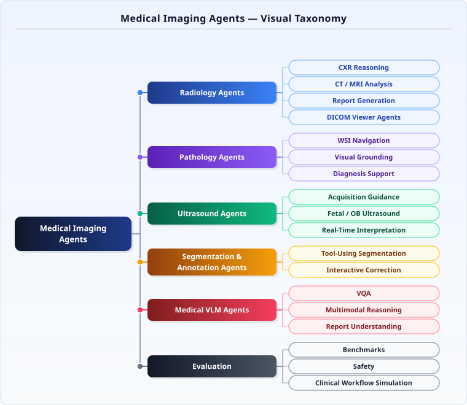

# Awesome Medical Imaging Agents 

> Agentic AI systems for medical image analysis, including radiology agents, pathology agents, ultrasound agents, surgical imaging agents, segmentation agents, and medical vision-language model agents.

This repository curates research papers, agent benchmarks, and open-source systems for medical imaging agents. It focuses on tool use, retrieval-augmented generation, multi-agent collaboration, planning, segmentation, report generation, clinical reasoning, safety, and evaluation across CT, MRI, chest X-ray, ultrasound, pathology, endoscopy, ophthalmology, PET, and other imaging modalities.

## Contents

- [Taxonomy](#taxonomy)
- [Start Here](#start-here)
- [Scope](#scope)
- [Radiology Agents (57)](#radiology-agents-57)
- [Pathology Agents (Whole-Slide Imaging · Digital Pathology) (40)](#pathology-agents-whole-slide-imaging--digital-pathology-40)
- [Ultrasound Agents (Echocardiography · Robotic Ultrasound) (28)](#ultrasound-agents-echocardiography--robotic-ultrasound-28)
- [Endoscopy and Surgical Imaging Agents (28)](#endoscopy-and-surgical-imaging-agents-28)
- [Ophthalmology Agents (15)](#ophthalmology-agents-15)
- [3D CT / MRI / Volumetric Imaging Agents (39)](#3d-ct--mri--volumetric-imaging-agents-39)
- [Segmentation and Annotation Agents (23)](#segmentation-and-annotation-agents-23)
- [Report Generation Agents (23)](#report-generation-agents-23)
- [Medical Vision-Language Model (VLM) Agents (41)](#medical-vision-language-model-vlm-agents-41)
- [Tool-Using and Multi-Agent Frameworks](#tool-using-and-multi-agent-frameworks)
  - [Clinical Reasoning Agents (78)](#clinical-reasoning-agents-78)
  - [Workflow and Simulation Agents (60)](#workflow-and-simulation-agents-60)
  - [Agent Skills and Tool Learning (11)](#agent-skills-and-tool-learning-11)
- [Benchmarks and Evaluation](#benchmarks-and-evaluation)
  - [Benchmark Overview](#benchmark-overview)
  - [Benchmark Papers (55)](#benchmark-papers-55)
  - [Safety, Robustness, and Fairness (39)](#safety-robustness-and-fairness-39)
- [Toolboxes](#toolboxes)
- [Surveys and Position Papers (26)](#surveys-and-position-papers-26)
- [Related Awesome Lists](#related-awesome-lists)

## Taxonomy

## Start Here

Selected systems, surveys, and benchmarks across imaging domains.

- [MedImageOSWorld](https://github.com/Nanboy-Ronan/awesome-medical-imaging-agents#start-medimageosworld) - Benchmark for GUI agents operating CT, MRI, and ultrasound consoles and planning acquisitions (2026).
- [MedRAX: Medical Reasoning Agent for Chest X-ray](https://github.com/Nanboy-Ronan/awesome-medical-imaging-agents#start-medrax) - Director-worker architecture where composable tool-using agents outperform single-model baselines on chest X-ray reasoning (Radiology, 2025; [Code](https://github.com/bowang-lab/MedRAX)).
- [RadAgent: A Tool-Using AI Agent for Stepwise Interpretation of Chest CT](https://github.com/Nanboy-Ronan/awesome-medical-imaging-agents#start-radagent) - Generates chest CT reports through an explicit tool-calling workflow with inspectable intermediate reasoning traces (Radiology, 2026).
- [Agentic Systems in Radiology: Design, Applications, Evaluation, and Challenges](https://github.com/Nanboy-Ronan/awesome-medical-imaging-agents#start-agentic-systems-in-radiology) - Best entry-point survey mapping agent design patterns, evaluation protocols, and open challenges across the full radiology pipeline (Survey · Radiology, 2025).
- [CPathAgent: An Agent-based Foundation Model for Interpretable High-Resolution Pathology Image Analysis](https://github.com/Nanboy-Ronan/awesome-medical-imaging-agents#start-cpathagent) - Agentic pathology foundation model mimics pathologist diagnostic logic to deliver interpretable analysis of whole-slide images (Pathology, 2025).
- [Echo-alpha: Large Agentic Multimodal Reasoning Model for Ultrasound Interpretation](https://github.com/Nanboy-Ronan/awesome-medical-imaging-agents#start-echo-alpha) - Demonstrates that large agentic reasoning models can jointly localize lesions and perform grounded multimodal clinical interpretation of ultrasound studies (Ultrasound, 2026).
- [EndoAgent: A Memory-Guided Reflective Agent for Intelligent Endoscopic Vision-to-Decision Reasoning](https://github.com/Nanboy-Ronan/awesome-medical-imaging-agents#start-endoagent) - Memory-guided reflective agent for endoscopic vision-to-decision reasoning; representative model for specialty-specific imaging agent design (Endoscopy, 2025; [Code](https://github.com/Tyyds-ai/EndoAgent)).
- [VoxelPrompt: A Vision Agent for End-to-End Medical Image Analysis](https://github.com/Nanboy-Ronan/awesome-medical-imaging-agents#start-voxelprompt) - Multi-stage vision agent for end-to-end volumetric medical image analysis covering segmentation, detection, and QA across CT, MRI, and PET (3D Imaging, 2024).
- [MedSAM-Agent: Empowering Interactive Medical Image Segmentation with Multi-turn Agentic Reinforcement Learning](https://github.com/Nanboy-Ronan/awesome-medical-imaging-agents#start-medsam-agent) - Introduces multi-turn RL to train an interactive segmentation agent that decides which prompts to issue to SAM — the first RL-trained imaging segmentation agent (Segmentation, 2026; [Code](https://github.com/CUHK-AIM-Group/MedSAM-Agent)).
- [MMedAgent: Learning to Use Medical Tools with Multi-modal Agent](https://github.com/Nanboy-Ronan/awesome-medical-imaging-agents#start-mmedagent) - First paper to train a medical agent that selects and calls specialist tools (segmentation, retrieval, calculators) on demand across seven imaging modalities (Multimodal, 2024; [Code](https://github.com/Wangyixinxin/MMedAgent)).
- [MedAgent-Pro: Towards Evidence-based Multi-modal Medical Diagnosis via Reasoning Agentic Workflow](https://github.com/Nanboy-Ronan/awesome-medical-imaging-agents#start-medagent-pro) - Integrates imaging, labs, and clinical guidelines via explicit tool calling; demonstrates evidence-based multimodal clinical reasoning (Medical VLM, 2026; [Code](https://github.com/jinlab-imvr/MedAgent-Pro)).
- [AgentClinic: A Multimodal Benchmark for Tool-Using Clinical AI Agents](https://github.com/Nanboy-Ronan/awesome-medical-imaging-agents#start-agentclinic) - The canonical multimodal benchmark for tool-using clinical AI agents with an open simulator across imaging, EHR, and lab modalities (Benchmark, 2026; [Code](https://github.com/SamuelSchmidgall/AgentClinic)).
- [ABRA: Agent Benchmark for Radiology Applications](https://github.com/Nanboy-Ronan/awesome-medical-imaging-agents#start-abra) - First benchmark where agents operate a real DICOM viewer (OHIF + Orthanc) via tool calls, testing end-to-end radiology agent workflows on live imaging software (Benchmark · Radiology, 2026).

## Scope

- Medical imaging agents for radiology, pathology, ultrasound, CT, MRI, chest X-ray, dermatology, endoscopy, PET, ophthalmology, and cardiac imaging.
- Agent workflows for tool use, retrieval-augmented generation, multi-agent collaboration, self-reflection, planning, report generation, quality control, and human-in-the-loop review.
- Research resources including peer-reviewed papers, arXiv preprints, agent benchmarks, reproducible code, and related open-source systems.
- Safety and evaluation work on hallucination detection, fairness, robustness, uncertainty, abstention, privacy, and clinically grounded evaluation.

## Radiology Agents (57)

Agents for chest X-ray, CT, MRI, DICOM workflows, radiotherapy planning, and radiology decision support.

- [CAG-WM: A Synthetic-Data-Driven Coronary World Model for Autonomous Guidewire Navigation](https://papers.miccai.org/miccai-2026/0138-Paper4072.html) - A world model trained on 100 synthetic angiography–3D coronary cases in a SOFA simulator learns vessel–guidewire dynamics and plans through internal multi-step rollouts for autonomous percutaneous coronary guidewire navigation; it exceeds 80% success on 20 multi-center clinical cases with the shortest total navigation time (about 2 minutes) (MICCAI 2026, 2026; [Code](https://github.com/CaoYue2004/CAG-WM)).
- [SeedPro: Place Brachytherapy Seeds Like Expert Clinicians via Hierarchical Reinforcement Agents](https://papers.miccai.org/miccai-2026/0930-Paper3635.html) - Hierarchical reinforcement-learning agents generate fine-grained preoperative brachytherapy seed-placement plans that favor fewer needle punctures; on internal and external datasets they reduce organ-at-risk exposure by 12–20% and puncture count by 25% relative to prior planners (MICCAI 2026, 2026; [Code](https://github.com/Haitao-Lee/SeedPro)).
- [MeVisQA: Medical Visual Question Answering via Visual Programming](https://papers.miccai.org/miccai-2026-sat/SAFER_007.html) - Applies visual programming to medical VQA, with generated code invoking vision modules so reasoning and execution stay separate and auditable for measurement, counting, multi-step, and multi-image questions; introduces the radiologist-workflow-inspired SliceVQA benchmark, where it nearly doubles the accuracy of recent medical LVLMs (MICCAI 2026 SAFER workshop, 2026; [Dataset](https://github.com/NdkArthur/SliceVQA)).
- [X-Ragent: Tool-Augmented Reinforcement Learning for Evidence-Grounded Chest X-Ray Reasoning](https://arxiv.org/abs/2610.16811) - Trains a Qwen3-VL-8B chest X-ray agent with agentic SFT and GRPO on Rad-CoT, a 7.7K-trajectory tool-augmented corpus, separating learned evidence seeking from validity-gated measurement so invalid quantitative tool outputs never enter the reasoning; reports the best results on three CXR benchmarks, including +8.6 points on held-out ChestAgentBench (arXiv, 2026).
- [MammoClaw: Towards Skill-Evolving Agent Harness for Breast Cancer Mammography Analysis](https://papers.miccai.org/miccai-2026-sat/Deep_Brea3th_010.html) - Training-free harness lets frozen MLLMs gather mammography evidence with ROI, paired-view, and contralateral-breast tools, and turns failed trajectories into reusable skills; on BI-RADS assessment and breast density estimation, tools alone did not reliably help while evolved skills improved tool use in some settings (MICCAI 2026 Deep-Brea3th workshop, 2026; [Project](https://krishnakanthnakka.github.io/mammoclaw)).
- [OA-MAP: Evidence-Grounded Multi-Agent Multimodal Framework for Interpretable Knee Osteoarthritis Progression](https://arxiv.org/abs/2610.12134) - A coordinator recruits MRI, X-ray, and clinical agents that select prediction tools and retrieve literature evidence, with uncertainty-informed clinician review that triggers recomputation of affected findings; fusion models reach AUROCs of 0.80 for structural and 0.68 for pain progression on 100 held-out FNIH participants (arXiv, 2026).
- [RadOnc-Agent: An LLM-Orchestrated Framework for AI Workflows Across the Radiotherapy Care Pathway](https://arxiv.org/abs/2610.06923) - An LLM controller coordinates 26 functions across four radiotherapy phases through schema-constrained tool calls and persistent patient context; evaluation measures workflow execution rather than clinical correctness or prospective benefit (arXiv, 2026).
- [Multi-Agent AI for Chest Radiography: A Sequential Segmentation and LLM-Driven Consultative Tool for Medical Training](https://www.medrxiv.org/content/10.64898/2026.05.29.26354432v1) - Vision agents localize anatomy and segment pathology, then ground a locally hosted LLaVA 7B tutor with prompt guardrails that block unanchored queries; the preprint reports no quantitative performance metrics (medRxiv, 2026).
- [When to Request and Whether to Trust: A Two-Decision Imaging Agent for Pleural Effusion Assessment](https://papers.miccai.org/miccai-2026-sat/MedAgent_033.html) - A learned policy requests lateral chest radiographs selectively, then checks image-pair compatibility before re-reading; counterfactual controls find no measurable mean benefit from matched lateral views over duplicated frontal images, and verification rejects some valid returns (MICCAI 2026 MedAgent workshop, 2026).
- [LongCXR-Agent: Query-Driven Tool Selection for Longitudinal Chest X-ray Reasoning](https://papers.miccai.org/miccai-2026-sat/MedAgent_024.html) - A query-driven agent preserves prior-current chest X-ray order, routes questions among four comparison types, and selectively invokes five specialized tools for disease transitions, severity, spatial evidence, and structural comparison; evaluated on 666 longitudinal QA episodes (MICCAI 2026 MedAgent workshop, 2026).
- [AutoProtocol: Agent-Driven Automation of CT and MRI Protocoling in Radiology](https://openreview.net/forum?id=UXJ4X0HCHi) - Retrieves similar cases from 4.4 million prior examinations so an LLM agent can recommend patient-specific CT and MRI protocols without task-specific fine-tuning (MIDL 2026 Short Paper, 2026).
- [FRAC-MAS: A Safe and Explainable Multi-Agent System for Fracture Diagnosis](https://arxiv.org/abs/2608.28662) - Stacks four vision models with conformal prediction to produce statistically grounded differential fracture diagnoses, then hands off to a multi-agent workflow that independently verifies results, retrieves clinical guidelines, and drafts patient-accessible reports; the verification agent flags 86.6% of cases as high-confidence needing no escalation, and user studies rate its reports as significantly more comprehensible than reports from Llama, MedGemma, and Gemini (arXiv, 2026).
- [A Modular Agent for Reliable and Auditable Spatial Relation Verification in CT Scans](https://arxiv.org/abs/2608.21140) - Decomposes binary spatial-relation verification in axial CT slices into language parsing, YOLO-based anatomical localization, and deterministic geometric verification instead of end-to-end VLM prediction, reaching 94.1% accuracy on the MIRP spatial QA benchmark and beating direct Qwen2-VL prompting by 42.5 points while keeping every intermediate step auditable (arXiv, 2026).
- [DentAgent: Evidence-Centric Multi-Agent Coordination for Multimodal Dental Reasoning](https://arxiv.org/abs/2608.18878) - An Orchestrator agent coordinates five modality-specialist agents over radiographs, intraoral photographs, and 3D dental data, tracking each agent's findings as structured evidence on a shared blackboard before generating traceable diagnoses, surpassing senior specialists by 17.3 points on multi-label diagnosis across four benchmarks (arXiv, 2026).
- [CT-PrepAgent: Bounded Policy and Controlled Execution for Adaptive CT Data Preparation](https://arxiv.org/abs/2608.01233) - Policy-driven CT data-preparation agent that profiles heterogeneous DICOM series and executes adaptive preprocessing through guarded, verified, and recoverable steps, lifting verified output yield from 61.7% to 70.0% on private data and improving downstream segmentation Dice across three public CT tasks (arXiv, 2026).
- [One-for-All Adaptive Radiotherapy Planning Agent: A Foundation Framework for Daily CBCT-guided Radiotherapy](https://arxiv.org/abs/2607.14870) - Foundation-model agent that autonomously performs complete online adaptive radiotherapy planning directly from daily cone-beam CT in under two minutes, chaining synthetic CT generation, multimodal alignment, and tumor/organ segmentation into a human-in-the-loop workflow across head-and-neck, lung, abdominal, and prostate cancers (arXiv, 2026).
- [Policy-Driven CT-Agent: Modeling Phase-Aware Diagnostic Control for Clinically Consistent CT Reasoning](https://arxiv.org/abs/2607.10748) - Policy-driven agent harmonizes heterogeneous CT phases into a unified evidence representation and iteratively requests additional contrast phases when diagnostic sufficiency is unmet, letting it flexibly follow different institutional, regional, or guideline-specific phase-selection protocols (arXiv, 2026).
- [A Vision-Language Framework for Comparative Reasoning in Radiology](https://arxiv.org/abs/2606.06407) - Entity-aware cross-image reasoning framework for reference-case retrieval and longitudinal comparison in radiology; introduces MedReCo-DB with 690K images from 160K patients across eight institutions and seven modalities (arXiv, 2026).
- [A Machine-to-Machine Knowledge-Guided LLM Agent for Generalizable Radiotherapy Treatment Planning](https://arxiv.org/abs/2606.00922) - Transfers DRL-derived treatment planning parameter knowledge to an LLM agent via in-context learning for autonomous, iterative radiotherapy planning without human intervention across prostate, liver, and complex anatomy cases (arXiv, 2026).
- [MedExpMem: Adapting Experience Memory for Differential Diagnosis](https://arxiv.org/abs/2605.22872) - Experience-memory framework that lets VLM-based diagnostic agents accumulate differential diagnosis expertise from prior failures and retrieve it for radiology cases across 11 subspecialties (MICCAI 2026, 2026).
- [A Discordance-Aware Multimodal Framework with Multi-Agent Clinical Reasoning](https://arxiv.org/abs/2604.16333) - Multimodal ensemble fuses ResNet18-derived knee MRI and X-ray embeddings with demographics and biomarkers, then a multi-agent clinical-reasoning layer interprets discordance between imaging-observed structural damage and patient-reported symptoms to assign osteoarthritis phenotypes and tailored management recommendations (arXiv, 2026).
- [Evo-MedAgent: Beyond One-Shot Diagnosis with Agents That Remember, Reflect, and Improve](https://arxiv.org/abs/2604.14475) - Self-evolving memory module that equips a chest X-ray agent with episodic, procedural, and tool-reliability memory stores for inter-case learning without retraining, lifting ChestAgentBench accuracy by up to 14 points (arXiv, 2026).
- [Agentic Automation of BT-RADS Scoring: End-to-End Multi-Agent System for Standardized Brain Tumor Follow-up Assessment](https://arxiv.org/abs/2603.21494) - Multi-agent system combining an extractor agent (clinical notes) and a scorer agent (BT-RADS decision logic + volumetric CNN segmentation) for standardized post-treatment glioma MRI response assessment (arXiv, 2026).
- [Agentic LLM Workflow for MR Spectroscopy Volume-of-Interest Placements in Brain Tumors](https://arxiv.org/abs/2603.13371) - LLM agent decomposes spectroscopy VOI placement into candidate generation and optimal selection via tool calls, enabling user-instruction-driven MRS acquisition planning for brain tumors (arXiv, 2026).
- [An Explainable Agentic AI Framework for Uncertainty-Aware and Abstention-Enabled Acute Ischemic Stroke Imaging Decisions](https://arxiv.org/abs/2601.01008) - Imaging agent that explains decisions and abstains under uncertainty for acute stroke workflows (arXiv, 2026).
- [CXReasonAgent: Evidence-Grounded Diagnostic Reasoning Agent for Chest X-rays](https://arxiv.org/abs/2602.23276) - Evidence-grounded chest X-ray agent that structures diagnostic reasoning around retrieved findings (arXiv, 2026).
- [DUCX: Decomposing Unfairness in Tool-Using Chest X-ray Agents](https://arxiv.org/abs/2603.00777) - Audits how unfairness arises across tool-selection and reasoning stages in CXR agents (arXiv, 2026).
- [Evidential Reasoning Advances Interpretable Real-World Disease Screening](https://arxiv.org/abs/2605.15171) - EviScreen retrieves region-level historical case evidence from dual knowledge banks to make medical image screening more interpretable (arXiv, 2026).
- [Experience-Guided Self-Adaptive Cascaded Agents for Breast Cancer Screening and Diagnosis with Reduced Biopsy Referrals](https://arxiv.org/abs/2602.23899) - Cascaded imaging agents adapt from prior cases to improve screening decisions while reducing unnecessary biopsies (arXiv, 2026).
- [GAZE: Grounded Agentic Zero-shot Evaluation on Rare Brain MRI](https://arxiv.org/abs/2605.00876) - Lets VLMs call DICOM viewer tools and PubMed-backed retrieval before generating reports for rare brain MRI cases (arXiv, 2026).
- [MARCH: Multi-Agent Radiology Clinical Hierarchy for CT Report Generation](https://arxiv.org/abs/2604.16175) - Hierarchical radiology agents emulate clinical oversight to reduce hallucinations in 3D CT report generation (arXiv, 2026).
- [OPGAgent: An Agent for Auditable Dental Panoramic X-ray Interpretation](https://arxiv.org/abs/2603.00462) - Dental X-ray agent with auditable reasoning traces for clinical review (arXiv, 2026).
- [RadAgent: A Tool-Using AI Agent for Stepwise Interpretation of Chest CT](https://arxiv.org/abs/2604.15231) - Generates chest CT reports through an explicit tool-calling workflow with inspectable intermediate reasoning traces (arXiv, 2026). 
- [Which Tool Response Should I Trust? Tool-Expertise-Aware Chest X-ray Agent with Multimodal Agentic Learning](https://arxiv.org/abs/2602.21517) - Learns when to trust different tool outputs in chest X-ray workflows using expertise-aware agent collaboration (arXiv, 2026).
- [XrayClaw: Cooperative-Competitive Multi-Agent Alignment for Trustworthy Chest X-ray Diagnosis](https://arxiv.org/abs/2604.02695) - Uses cooperative and adversarial agent interactions to improve trustworthiness in chest X-ray diagnosis (arXiv, 2026).
- [An Evidence-Driven Multi-Agent Compound AI System for Head and Neck Proton Radiotherapy Planning](https://arxiv.org/abs/2610.29010) - Combines PPO-generated proton therapy plans with planning, conversational, and evaluation agents that use prior-plan evidence to refine physician-requested trade-offs; the Qwen3-14B planner is post-trained with SFT and GRPO, with eight held-out refinement examples from a 21-patient cohort (arXiv, 2026).
- [ClinLoop: Human-AI Collaborative Agents for Multimodal Breast Cancer Diagnosis Under Incomplete Clinical Data](https://papers.miccai.org/miccai-2026/0173-Paper2960.html) - Pairs a diagnosis agent that fuses whichever of CT, MRI, or mammography is available with a quality-assurance agent that uses ensemble uncertainty to defer low-confidence or discordant cases to clinicians, whose confirmed labels update the model; evaluated with five-fold cross-validation on a private 3,108-patient breast cancer cohort (MICCAI 2026, 2026).
- [A Multi-Agent System for Complex Reasoning in Radiology Visual Question Answering](https://arxiv.org/abs/2508.02841) - Coordinates specialized agents for question decomposition, visual evidence retrieval, and answer synthesis (arXiv, 2025).
- [Agent-Based Output Drift Detection for Breast Cancer Response Prediction in a Multisite Clinical Decision Support System](https://arxiv.org/abs/2512.18450) - Uses agents to detect performance drift across sites in clinical imaging decision support (arXiv, 2025).
- [Agentic large language models improve retrieval-based radiology question answering](https://arxiv.org/abs/2508.00743) - Multi-step retrieval-and-reasoning agent (RaR) for radiology QA (arXiv, 2025).
- [AT-CXR: Uncertainty-Aware Agentic Triage for Chest X-rays](https://arxiv.org/abs/2508.19322) - Triage agent that defers or escalates based on calibrated uncertainty (arXiv, 2025).
- [Automated stereotactic radiosurgery planning using a human-in-the-loop reasoning large language model agent](http://arxiv.org/abs/2512.20586v1) - Planning agent drafts SRS shot plans with clinician review loops for quality and safety (arXiv, 2025).
- [Bridging Clinical Narratives and ACR Appropriateness Guidelines: A Multi-Agent RAG System for Medical Imaging Decisions](https://arxiv.org/abs/2510.04969) - Maps free-text clinical context to imaging guideline recommendations with multi-agent retrieval and reasoning (arXiv, 2025).
- [CT-Agent: A Multimodal-LLM Agent for 3D CT Radiology Question Answering](https://arxiv.org/abs/2505.16229) - Slice-aware CT agent answers volumetric radiology questions with targeted tool calls over 3D imaging data (arXiv, 2025).
- [CXRAgent: Director-Orchestrated Multi-Stage Reasoning for Chest X-Ray Interpretation](https://arxiv.org/abs/2510.21324) - Director agent routes tasks among radiology specialists (arXiv, 2025).
- [IMACT-CXR: An Interactive Multi-Agent Conversational Tutoring System for Chest X-Ray Interpretation](https://arxiv.org/abs/2511.15825) - Multi-agent tutor combines gaze analysis, annotation, and retrieval for CXR education (arXiv, 2025).
- [LungNoduleAgent: A Collaborative Multi-Agent System for Precision Diagnosis of Lung Nodules](https://arxiv.org/abs/2511.21042) - Collaborative agents analyze CT nodules and reason about malignancy (arXiv, 2025).
- [MAARTA: Multi-Agentic Adaptive Radiology Teaching Assistant](https://arxiv.org/abs/2506.17320) - Tutoring agents guide trainees with attention feedback and targeted remediation (arXiv, 2025).
- [MedRAX: Medical Reasoning Agent for Chest X-ray](https://arxiv.org/pdf/2502.02673v1) - Director-worker architecture where composable tool-using agents outperform single-model baselines on chest X-ray reasoning (ICML 2025, 2025). 
- [PASS: Probabilistic Agentic Supernet Sampling for Interpretable and Adaptive Chest X-Ray Reasoning](https://arxiv.org/abs/2508.10501) - Builds interpretable reasoning paths with probabilistic agent selection (arXiv, 2025).
- [RadAgents: Multimodal Agentic Reasoning for Chest X-ray Interpretation with Radiologist-like Workflows](https://arxiv.org/abs/2509.20490) - Emulates radiology conferences with discussion-style agents (arXiv, 2025).
- [RadFabric: Agentic AI System with Reasoning Capability for Radiology](https://arxiv.org/abs/2506.14142) - Radiology agent blends visual grounding and text-based reasoning for CXR interpretation (arXiv, 2025).
- [Radiologist Copilot: An Agentic Assistant with Orchestrated Tools for Radiology Reporting with Quality Control](https://arxiv.org/abs/2512.02814) - Tool-orchestrated agent drafts volumetric reports with explicit quality-control passes (arXiv, 2025).
- [Scan-do Attitude: Towards Autonomous CT Protocol Management using a Large Language Model Agent](https://arxiv.org/abs/2509.20270) - LLM agent configures acquisition and reconstruction protocols for CT workflows (arXiv, 2025).
- [Trustworthy Multimodal AI Agents for Early Breast Cancer Detection and Clinical Decision Support](https://doi.org/10.3390/engproc2025112052) - Published in Eng.
- [Zero-Shot Large Language Model Agents for Fully Automated Radiotherapy Treatment Planning](https://arxiv.org/abs/2510.11754) - Planning agent automates radiotherapy workflows with iterative plan refinement via zero-shot LLM reasoning (arXiv, 2025).
- [RadioRAG: Online Retrieval-Augmented Generation for Radiology Question Answering](https://arxiv.org/abs/2407.15621) - Streaming RAG agent that continuously pulls prior studies and reports while answering radiology questions (arXiv, 2024).

## Pathology Agents (Whole-Slide Imaging · Digital Pathology) (40)

Agents for whole-slide image analysis, digital pathology, pathology reports, and slide navigation.

- [PlanPath: Exploration-Guided Orchestration for Patient-Level Pathology Reasoning](https://arxiv.org/abs/2610.18664) - Turns a clinical question into an exploration plan, routes to the relevant slides among roughly 15 WSIs per patient, and moves from tissue- to cell-level analysis; on new renal and gastric cancer patient-level VQA datasets it beats the strongest baseline by 9.4% and 12.1% overall accuracy (arXiv, 2026; [Code](https://github.com/JSGe-AI/PlanPath_1)).
- [PathPilot: An Adaptive Question-Conditioned Multi-Magnification Navigation Agent for Whole-Slide Image Analysis](https://arxiv.org/abs/2610.16734) - Navigates across magnifications like a pathologist: CrossMagLoc learns per-magnification localization from pathologist viewing behavior to pick a starting region, then EviRegionSearch explores outward according to which question-relevant evidence is still missing; evaluated on question answering across five internal and external cohorts (arXiv, 2026).
- [MechAgent: Active Mechanism Falsification for Agentic Cross-Species Medical Reasoning](https://papers.miccai.org/miccai-2026-sat/MedAgent_042.html) - A committee of pathology, toxicology, translational, evidence-auditor, and adversarial agents deliberates over a typed hypothesis graph, selecting evidence information-theoretically and running latent interventions on a multimodal foundation model to test whether proposed biological mechanisms causally drive preclinical-to-clinical predictions (MICCAI 2026 MedAgent workshop, 2026).
- [An agentic framework for autonomous scientific discovery in cancer pathology](https://www.nature.com/articles/s41591-026-04357-y) - SPARK generates biological hypotheses, converts them into executable tissue-analysis tools, and verifies candidate biomarkers across histopathology and spatial biology cohorts; clinical utility still requires prospective validation (Nature Medicine, 2026; [Code](https://github.com/cpath-ukk/SPARK)).
- [TissueCodePilot: A Code-Action Agent for AI-Assisted Spatial Tissue Analysis](https://papers.miccai.org/miccai-2026/1062-Paper1741.html) - A coding agent plans and executes spatial tissue analyses from minimal natural-language prompts, evaluated on 1,500 image-question pairs across three tissue types; the project repository notes that code and data are not yet fully released (MICCAI 2026, 2026; [Project](https://github.com/hula-ai/TissueCodePilot)).
- [MorphoOrgaAgent: A Foundation-Model-Based Multi-Agent System for Autonomous Organoid Analysis](https://papers.miccai.org/miccai-2026-sat/MedAgent_039.html) - Agents interpret natural-language organoid analysis requests, combine Cellpose geometric prompts with SAM3 text prompts for instance segmentation, and generate measurements and reports; introduces the MorphoOrgaVQA evaluation benchmark (MICCAI 2026 MedAgent workshop, 2026).
- [Hepato-LLaVA: An Expert MLLM with Sparse Topo-Pack Attention for Hepatocellular Pathology Analysis on Whole Slide Images](https://arxiv.org/abs/2602.19424) - Introduces a sparse topo-pack attention mechanism and a 33K-pair expert-validated QA dataset to enable an expert multimodal LLM to interpret gigapixel hepatocellular carcinoma whole-slide pathology images (arXiv, 2026; [Code](https://github.com/PRIS-CV/Hepto-LLaVA)).
- [SlideBank: A Persistent Hierarchical Evidence Bank for Consistent Whole-Slide Reasoning](https://arxiv.org/abs/2609.00342) - Training-free framework builds a persistent, concept-indexed evidence bank per whole-slide image by hierarchically exploring informative regions and multi-scale views into explicit, patch-and-coordinate-grounded morphological observations, then answers queries by matching relevant evidence and fusing it via confidence-based cross-level consensus; reaches 52.77% on WSI-VQA with Patho-R1 and 50.92% on SlideBench-BCNB with Quilt-LLaVA, with over 99% answer consistency when the same bank is reused across rephrased queries (arXiv, 2026).
- [LUCAID: Agentic Multimodal AI for Lung Cancer Precision Pathology](https://arxiv.org/abs/2608.23803) - Integrative agent couples diagnostic reasoning with nine clinically validated modules spanning quality control, tumor detection and subtyping, microenvironment profiling, and PD-L1/MET/TROP-2 biomarker scoring through to structured report generation, reaching 93.0% concordance with an expert-panel reference versus 68.3-81.1% for five thoracic pathologists in prospective clinical validation (arXiv, 2026).
- [Interactive Whole Slide Images for RL-based Tumour Segmentation](https://arxiv.org/abs/2608.16607) - Formulates the whole-slide image itself as a hierarchical multi-resolution environment in which a PPO-trained actor-critic agent navigates via movement, zooming, and tumour-selection actions, performing end-to-end sequential tumour segmentation directly on full pulmonary adenocarcinoma slides in seconds rather than exhaustive patch-based inference (arXiv, 2026).
- [Agentic Visual Reasoning in Whole-Slide Pathology Images via Active Perception](https://arxiv.org/abs/2608.08648) - AdaptivePath treats whole-slide image analysis as sequential decision-making: a PPO-trained Navigator chooses observation locations and magnification, a Morphology Interpreter extracts question-specific evidence, and a Deliberator-Arbiter pair refines and synthesizes answers across scales, reaching 80.14% accuracy on six-cohort TCGA cancer subtyping and 82.9% pathologist accuracy in a blinded diagnostic-utility study using its selected observation sequences (arXiv, 2026; [Code](https://github.com/G14nTDo4/AdaptivePath)).
- [Beyond Relevance: Bayesian Evidence Acquisition for Agentic Whole-Slide Image Reasoning](https://arxiv.org/abs/2608.05757) - BEACON reformulates whole-slide image reasoning as Bayesian evidence acquisition, maintaining a probabilistic belief over competing diagnoses and sequentially acquiring patches that maximize expected information gain rather than semantic relevance, achieving the strongest zero-shot results among training-free agentic frameworks across five WSI-VQA benchmarks (arXiv, 2026; [Code](https://github.com/bryanwong17/BEACON)).
- [Trust but Verify: Evidence-Linked Multi-Agent Clinical Information Extraction in Pathology](https://arxiv.org/abs/2607.06435) - Multi-agent workflow (nMAS) extracts structured clinical features from pathology reports via configurable field specifications, complexity-based routing, and report-level aggregation, linking every decision to verbatim source text; on 54 gastric biopsy reports covering 216 feature-case decisions it reaches 98.6% accuracy with all correct calls traceable to source evidence (arXiv, 2026).
- [A Multi-modal Agentic Co-pilot for Evidence Grounded Computational Pathology](https://arxiv.org/abs/2606.08093) - PathPocket grounds pathology interpretation in a 110,472-document evidence corpus and a 4.55-million-entity multimodal hypergraph, coordinating input-understanding, evidence-retrieval, filtering, and diagnosis-generation agents to resolve tasks from text-only queries to gigapixel whole-slide diagnostics, improving pathologist diagnostic accuracy and confidence in user studies over 200,000 real-world cases (arXiv, 2026).
- [Democratizing and accelerating AI-driven pathology research through agentic intelligence](https://arxiv.org/abs/2606.20677) - PathLab translates natural-language research objectives into executable, validated computational pathology workflows by composing reusable methodological modules for preprocessing, model development, evaluation, and interpretation, matching expert implementations across 12 public datasets spanning ROI classification, WSI classification, segmentation, and survival prediction while letting non-programmers design and run studies (arXiv, 2026).
- [Act Like a Pathologist: Tissue-Aware Whole Slide Image Reasoning](https://arxiv.org/abs/2603.00667) - HistoSelect mimics pathologist visual search with a question-guided, tissue-aware, coarse-to-fine retrieval framework that narrows from broad tissue regions to diagnostic patches, cutting visual token usage 70% on gigapixel WSI question answering (CVPR 2026, 2026; [Code](https://github.com/winston52/HistoSelect)).
- [SAGE: Agentic Framework for Interpretable and Clinically Translatable Computational Pathology Biomarker Discovery](https://arxiv.org/abs/2602.00953) - Multi-agent system that automates pathology biomarker discovery by grounding hypothesis generation in biological knowledge graphs, applying debate-based novelty assessment, and running automated validation pipelines on multimodal pathology datasets (arXiv, 2026).
- [An Interactive Trustworthy AI Pathology Copilot to Improve Biomarker-Driven Prognostic Stratification and Therapeutic Response Prediction](https://www.medrxiv.org/content/10.64898/2026.05.17.26352870v1) - Published in MedRxiv (2026).
- [CellDX AI Autopilot: Agent-Guided Training and Deployment of Pathology Classifiers](https://arxiv.org/abs/2605.10362) - Agent-guided platform that helps pathologists train, evaluate, and deploy whole-slide pathology classifiers with minimal ML engineering (arXiv, 2026).
- [Exploring General-Purpose Autonomous Multimodal Agents for Pathology Report Generation](https://arxiv.org/abs/2601.11540) - Published in BVM 2026 (2026).
- [MMNavAgent: Multi-Magnification WSI Navigation Agent for Clinically Consistent Whole-Slide Analysis](https://arxiv.org/abs/2603.02079) - Multi-magnification navigation agent that improves clinically consistent exploration of pathology slides (arXiv, 2026).
- [PathNavigate: A Training-Free Pathology Agent with Surprise-Guided Scan and Shared Slide Memory for Whole-Slide Image VQA](https://arxiv.org/abs/2605.23559) - Training-free WSI agent performs surprise-guided low-magnification scanning and shared-memory filtering to identify question-relevant regions before high-resolution evidence extraction for VQA (arXiv, 2026).
- [PathoSage: Towards Multi-Source Evidence Adjudication in Pathology via Experience-Aware Agentic Workflow](https://arxiv.org/abs/2606.07549) - Experience-aware pathology agent that separately gathers, deliberates over, and adjudicates evidence from multiple tools — tracking tool reliability with a Beta-Bernoulli experience system — to reduce hallucinations in patch-level whole-slide VQA (arXiv, 2026).
- [LAMMI-Pathology: A Tool-Centric Bottom-Up LVLM-Agent Framework for Molecularly Informed Medical Intelligence in Pathology](https://arxiv.org/abs/2602.18773) - Tool-centric bottom-up agent framework that organizes domain-specific pathology tools into Atomic Execution Nodes, enabling LVLMs to construct multi-step diagnostic reasoning trajectories for molecularly informed pathology analysis (arXiv, 2026).
- [QCAgent: An Agentic Framework for Quality-Controllable Pathology Report Generation from Whole Slide Image](https://arxiv.org/abs/2603.01647) - Pathology reporting agent framework with explicit quality-control loops over whole-slide analysis (arXiv, 2026).
- [TIAgent: From Natural Language to Grounded Agentic Workflows for Computational Pathology](https://arxiv.org/abs/2610.32993) - Turns natural-language computational pathology requests into inspectable, executable computational graphs built from existing tissue-analysis operations, and benchmarks 14 backbone LLMs on 90 unit tasks spanning 18 operation types, where the best model reaches 0.967 unit workflow success (arXiv, 2026).
- [Agent-Based Large Language Model System for Extracting Structured Data from Breast Cancer Synoptic Reports: A Dual-Validation Study](https://www.medrxiv.org/content/10.1101/2025.11.25.25340989v1) - Published in MedRxiv (2025).
- [CPathAgent: An Agent-based Foundation Model for Interpretable High-Resolution Pathology Image Analysis](https://arxiv.org/abs/2505.20510) - Agentic pathology foundation model mimics pathologist diagnostic logic to deliver interpretable analysis of whole-slide images (arXiv, 2025). 
- [Evidence-based diagnostic reasoning with multi-agent copilot for human pathology](https://arxiv.org/abs/2506.20964) - Multi-agent copilot integrates pathology slides with evidence-based reasoning (arXiv, 2025).
- [GMAT: Grounded Multi-Agent Clinical Description Generation for Text Encoder in Vision-Language MIL for Whole Slide Image Classification](https://arxiv.org/abs/2508.01293) - Multi-agent generation of clinical descriptions to steer WSI classification (arXiv, 2025).
- [Navigating Gigapixel Pathology Images with Large Multimodal Models](https://arxiv.org/abs/2511.19652) - GIANT enables large multimodal models to iteratively navigate whole-slide images at multiple scales, paired with MultiPathQA, a benchmark of 934 clinical pathology questions including 128 authored by professional pathologists (arXiv, 2025).
- [NOVA: An Agentic Framework for Automated Histopathology Analysis and Discovery](https://arxiv.org/abs/2511.11324) - Agentic framework converts pathology research queries into executable Python analysis pipelines using 49 domain-specific tools, introducing SlideQuest, a 90-question pathologist-verified benchmark for multi-step coding-agent reasoning over whole-slide images (arXiv, 2025).
- [PathAgent: Toward Interpretable Analysis of Whole-slide Pathology Images via Large Language Model-based Agentic Reasoning](https://arxiv.org/pdf/2511.17052v1) - Combines slide parsers with language agents to narrate lesion findings (arXiv, 2025).
- [PathFinder: A Multi-Modal Multi-Agent System for Medical Diagnostic Decision-Making Applied to Histopathology](https://arxiv.org/pdf/2502.08916) - Uses planner, analyzer, and verifier agents for histopathology question answering and diagnostic decision-making (arXiv, 2025).
- [PathFound: An Agentic Multimodal Model Activating Evidence-seeking Pathological Diagnosis](https://arxiv.org/abs/2512.23545) - Evidence-seeking pathology agent iterates between regions and findings (arXiv, 2025).
- [Patho-AgenticRAG: Towards Multimodal Agentic Retrieval-Augmented Generation for Pathology VLMs via Reinforcement Learning](https://arxiv.org/abs/2508.02258) - RL-trained agentic RAG reduces pathology VLM hallucinations (arXiv, 2025).
- [Pathology-CoT: Learning Visual Chain-of-Thought Agent from Expert Whole Slide Image Diagnosis Behavior](https://arxiv.org/abs/2510.04587) - Learns sequential field-of-view decisions for WSI diagnosis (arXiv, 2025).
- [PathReasoning: A Multimodal Reasoning Agent for Query-Based ROI Navigation on Whole-Slide Images](https://arxiv.org/abs/2511.21902) - Multimodal agent that navigates gigapixel whole-slide images through iterative reasoning cycles — sampling regions, reflecting on selections, and building reasoning chains — for cancer subtyping and survival prediction (arXiv, 2025).
- [SurvAgent: Hierarchical CoT-Enhanced Case Banking and Dichotomy-Based Multi-Agent System for Multimodal Survival Prediction](https://arxiv.org/pdf/2511.16635v1) - Multimodal agents pool pathology, imaging, and clinical signals for survival analysis (arXiv, 2025).
- [WSI-Agents: A Collaborative Multi-Agent System for Multi-Modal Whole Slide Image Analysis](https://arxiv.org/pdf/2507.14680) - Delegates slide parsing, reporting, and triaging across specialized collaborative agents for whole-slide image analysis (MICCAI 2025, 2025).

## Ultrasound Agents (Echocardiography · Robotic Ultrasound) (28)

Agents for echocardiography interpretation, fetal ultrasound, robotic scanning, and ultrasound-guided workflows.

- [Pressure-Tuned Auditor for Sycophancy-Resistant Breast Ultrasound VLM Diagnosis](https://papers.miccai.org/miccai-2026/0807-Paper4746.html) - Two-agent audit pipeline in which a pressure-tuned, visually grounded second agent independently checks and corrects a first VLM's breast ultrasound diagnosis when clinicians supply misleading prompts; on a new 16-template sycophancy benchmark it cuts sycophancy from 20.8% to 0.9% while keeping 98.5% cancer detection accuracy and raising lesion IoU from 0.12 to 0.59 (MICCAI 2026, 2026).
- [Ultrasound Operator Guidance Using World Modeling and Retrieval Based Action Planning](https://arxiv.org/abs/2610.06008) - Plans probe motions by receding-horizon search in a V-JEPA 2.1 latent world model whose transitions are retrieved from a database of physically executed probe moves, guiding operators from the live image alone; it reaches the target carotid view in 86% of retrospective closed-loop episodes versus 52% and 43% for baselines, and 83% in a prospective volunteer study on CPU (arXiv, 2026).
- [Toward Agentic Echocardiography: Reinforcement Learning with Foundation-Model Similarity Rewards in a CT-Derived Simulation](https://papers.miccai.org/miccai-2026-sat/HAIC26_018.html) - Frames transthoracic view acquisition as reinforcement learning in a patient-specific ultrasound simulator built from public chest CT, rewarding a soft actor-critic probe policy with frozen DINOv2 similarity to the target view; it acquires the PLAX view on five unseen patients with 12.4 mm mean position error and 81.2% clinical-tolerance success (MICCAI 2026 HAIC workshop, 2026).
- [Active guidance in ultrasound bladder scanning using reinforcement learning](https://www.nature.com/articles/s41598-026-35285-z) - Uses a Deep Q-Network variant with ultrasound-specific rewards to guide probe positioning toward optimal bladder views, demonstrating navigation feasibility in a simulated scanning environment (Scientific Reports, 2026).
- [Disentangling Perception and Reasoning in Zero-Shot Multimodal LLMs for Ultrasound Diagnosis](https://papers.miccai.org/miccai-2026-sat/MedAgent_016.html) - Compares zero-shot prompting with a multi-reader agent workflow for breast ultrasound and qualitatively examines echocardiography, finding that the multi-agent pipeline does not outperform single-request prompting and that lesion-feature perception is a major bottleneck (MICCAI 2026 MedAgent workshop, 2026).
- [A multitask framework for automated multi-frame right upper quadrant ultrasound interpretation and clinical decision support](https://doi.org/10.1038/s41467-026-77498-w) - Vision-language agent analyzes multi-frame ultrasound studies to classify 16 clinical findings, draft reports, and support cholecystectomy decisions, with evaluation across three institutions (Nature Communications, 2026).
- [RACA: Rule-Aligned Collaborative Agents for Evidence-Grounded Breast Ultrasound Classification](https://github.com/Swecamellia/RACA/blob/main/Paper-2740.pdf) - Perception, risk-modeling, and critic agents combine breast-ultrasound lesion evidence with diagnostic rules and similar prior cases for traceable classification across three benchmarks (MICCAI 2026 (accepted); [Project](https://github.com/Swecamellia/RACA)).
- [Auditable agentic AI for evidence-grounded thyroid ultrasound diagnosis and reporting](https://arxiv.org/abs/2608.12590) - ThyroidXAgent coordinates nodule-segmentation, risk-stratification, and reporting tools into an auditable, clinician-correctable case-level evidence record for thyroid ultrasound, evaluated on 28,458 test cases across 35 centres and raising report diagnostic consistency from 70.3% to 86.2% (arXiv, 2026).
- [UltraSAM3: A Concept-Driven Foundation Model for Universal Ultrasound Image Segmentation](https://arxiv.org/abs/2607.29200) - Adapts SAM3 to ultrasound image-mask-concept triplets across 37 datasets and 13 anatomical categories, pairing the segmentation model with an instruction-guided agent that parses complex natural-language queries into concise ultrasound concept prompts (arXiv, 2026).
- [FetalAgents: A Multi-Agent System for Fetal Ultrasound Image and Video Analysis](https://arxiv.org/abs/2603.09733) - Multi-agent system that coordinates specialized vision experts to analyze fetal ultrasound images and videos across diagnosis, measurement, and segmentation tasks, generating structured clinical reports from keyframe identification and anatomical plane analysis (arXiv, 2026).
- [Unified Ultrasound Intelligence Toward an End-to-End Agentic System](https://arxiv.org/abs/2604.16914) - Three-stage ultrasound intelligence system (USTri) that trains a universal model, adapts dataset-specific specialists, and orchestrates them via an agent to produce clinically structured reports across multiple organ types (arXiv, 2026).
- [UltrasoundAgents: Hierarchical Multi-Agent Evidence-Chain Reasoning for Breast Ultrasound Diagnosis](https://arxiv.org/abs/2603.10852) - Hierarchical multi-agent framework that mirrors clinical diagnostic workflows by localizing breast lesions, analyzing fine-grained attributes such as echogenicity and calcification, and integrating traceable evidence chains for BI-RADS classification (arXiv, 2026).
- [Echo-alpha: Large Agentic Multimodal Reasoning Model for Ultrasound Interpretation](https://arxiv.org/abs/2604.28011) - Demonstrates that large agentic reasoning models can jointly localize lesions and perform grounded multimodal clinical interpretation of ultrasound studies (arXiv, 2026). 
- [EchoAgent: Towards Reliable Echocardiography Interpretation with Eyes, Hands and Minds](https://arxiv.org/abs/2604.05541) - Decomposes echocardiography interpretation into visual observation, measurement, and expert reasoning for more reliable cardiac assessment (arXiv, 2026).
- [Evidence-Based Actor-Verifier Reasoning for Echocardiographic Agents](https://arxiv.org/abs/2604.06347) - Adds an actor-verifier loop to echocardiography agents so image understanding is cross-checked against clinical evidence before conclusions (arXiv, 2026).
- [From Scanning Guidelines to Action: A Robotic Ultrasound Agent with LLM-Based Reasoning](https://arxiv.org/abs/2603.14393) - Turns ultrasound scanning guidelines into a reasoning-driven robotic agent for autonomous acquisition (arXiv, 2026).
- [MARCUS: An Agentic, Multimodal Vision-Language Model for Cardiac Diagnosis and Management](https://arxiv.org/abs/2603.22179) - Hierarchical agentic architecture with modality-specific expert models interprets ECGs, echocardiograms, and cardiac MRI, achieving nearly triple the multimodal accuracy of frontier models on cardiac cases (arXiv, 2026).
- [RAG-RUSS: A Retrieval-Augmented Robotic Ultrasound for Autonomous Carotid Examination](https://arxiv.org/abs/2603.01153) - Interpretable retrieval-augmented robotic ultrasound that autonomously plans probe motions and explains each scanning stage to complete a full carotid examination across transverse and longitudinal planes (arXiv, 2026).
- [Towards Reliable Fetal Ultrasound Interpretation with Multi-Agent Collaboration](https://arxiv.org/abs/2605.25357) - FetUSAgents coordinates specialized visual tools and LLM agents with Dual-Path Evidence Arbitration for fetal ultrasound interpretation; introduces FetUS-VQA benchmark with 1,892 images and 10 clinical tasks (arXiv, 2026).
- [Anatomical Prior-Driven Framework for Autonomous Robotic Cardiac Ultrasound Standard View Acquisition](https://arxiv.org/abs/2603.21134) - RL-trained probe-adjustment agent uses a YOLO-based spatial-relation graph to embed cardiac anatomical priors into state representation, autonomously acquiring standard echocardiography views with a 92.5% success rate in simulation and 86.7% in phantom experiments (arXiv, 2026).
- [Optimizing Point-of-Care Ultrasound Video Acquisition for Probabilistic Multi-Task Heart Failure Detection](https://arxiv.org/abs/2602.13658) - IJCARS / IPCAI 2026 special issue (accepted) (2026).
- [Echo-CoPilot: A Multi-View, Multi-Task Agent for Echocardiography Interpretation and Reporting](http://arxiv.org/abs/2512.09944v2) - Multi-stage agent handles view selection, measurements, and report drafting for echo studies (arXiv, 2025).
- [EchoAgent: Guideline-Centric Reasoning Agent for Echocardiography Measurement and Interpretation](https://arxiv.org/abs/2511.13948) - Orchestrates specialized echocardiography vision tools under LLM control for guideline-centric temporal localization, spatial measurement, and clinical interpretation of cardiac studies (arXiv, 2025).
- [FUAS-Agents: Autonomous Multi-Modal LLM Agents for Treatment Planning in Focused Ultrasound Ablation Surgery](https://arxiv.org/abs/2505.21418) - Multi-modal LLM agent integrates MRI data and patient profiles to orchestrate specialized tools including segmentation for autonomous treatment plan generation in focused ultrasound ablation surgery across 3,000+ multicenter cases (arXiv, 2025).
- [USPilot: An Embodied Robotic Assistant Ultrasound System with Large Language Model Enhanced Graph Planner](https://arxiv.org/abs/2502.12498) - Embodied robotic assistant where an LLM-enhanced graph neural network planner selects and sequences ultrasound APIs to enable autonomous acquisition and patient query handling, tackling the global shortage of sonographers (IEEE RA-L, 2025).
- [Image-Guided Navigation of a Robotic Ultrasound Probe for Autonomous Spinal Sonography Using a Shadow-aware Dual-Agent Framework](http://arxiv.org/abs/2111.02167) - Cooperative perception-control agents for ultrasound-guided robotics (arXiv, 2021).
- [Agent with Tangent-based Formulation and Anatomical Perception for Standard Plane Localization in 3D Ultrasound](https://arxiv.org/abs/2207.00475) - Reinforcement-learning agent searches for standard planes using a tangent-point action representation, auxiliary anatomical perception, and spatial-anatomical rewards, evaluated on fetal brain and uterus ultrasound volumes (MICCAI 2022, 2022).
- [Agent with Warm Start and Adaptive Dynamic Termination for Plane Localization in 3D Ultrasound](https://arxiv.org/abs/2103.14502) - Adds adaptive early stopping to a reinforcement-learning plane-search agent with anatomical alignment, evaluating localization of seven standard planes across fetal brain, fetal abdomen, and uterus volumes (IEEE Transactions on Medical Imaging, 2021; [Code](https://github.com/wulalago/AgentSPL)).

## Endoscopy and Surgical Imaging Agents (28)

Agents for gastrointestinal endoscopy, surgical scene understanding, and autonomous endoscopic navigation.

- [SurgiCLAW: An Interpretable Atomic-Skill Agent for Precision Robotic Micromanipulation](https://arxiv.org/abs/2610.15766) - Confines a multimodal LLM to intraoperative visual understanding, explanation, and atomic-skill selection while verifiable deterministic programs execute the motions, trained with SFT and then RL rewards for action correctness, prerequisites, and format; for brain–machine-interface implantation it reaches 94.6% skill-selection accuracy and 88% success over 50 closed-loop real-robot trials (arXiv, 2026).
- [SurgVLA-Struct: Structured Surgical Reward Modeling for Across-Task Vision-Language Robotic Manipulation](https://papers.miccai.org/miccai-2026-sat/COLAS_002.html) - GRPO-refined vision-language-action policy for surgical robots in SurRoL predicts chunked 7-DoF actions in a shared action space, with task-invariant simulator-verifiable rewards for precision, efficiency, trajectory stability, and contact safety; on a 10-task benchmark with seven new language-conditioned variants it outperforms classical RL and prior VLA models (MICCAI 2026 COLAS workshop, 2026).
- [ARISE: Adaptive Agentic Reasoning with Image-grounded Self-Evaluation for Interpretable IBD Assessment](https://arxiv.org/abs/2610.04777) - A VLM agent runs hypothesis generation, image-grounded evidence summary, evidence-based refinement, symbolic verification, and final diagnosis for few-shot inflammatory bowel disease assessment from capsule endoscopy (Crohn's disease) and bowel ultrasound (ulcerative colitis), improving over baseline VLMs on two patient cohorts (arXiv, 2026).
- [Structured Reasoning Agentic Framework for Interpretable Critical View of Safety Assessment](https://arxiv.org/abs/2609.31524) - ReasonCVS decomposes laparoscopic cholecystectomy Critical View of Safety criteria into anatomical checks over a scene graph, with a rationale-distilled LLM decision agent querying a VLM verifier per sub-criterion and aggregating a traceable verdict; it reaches 68.1% mAP on Endoscapes-CVS201 (arXiv, 2026).
- [SpineSAC: Hierarchical Multi-Agent Soft Actor-Critic for Patient-Agnostic 2D–3D Spine Registration in Image-Guided Spine Surgery](https://papers.miccai.org/miccai-2026-sat/COLAS_020.html) - Hierarchical multi-agent soft actor-critic agents estimate six-degree-of-freedom vertebral pose to register preoperative CT to intraoperative C-arm X-ray, using a PCA-based canonical coordinate system and a rotational feature encoder over DRR and X-ray views; reports 1.45 mm TRE on phantoms, 2.31 mm on cadavers, and 9x faster inference (MICCAI 2026 COLAS workshop, 2026).
- [BiliVLA: Scene-Aware Vision-Language-Action Model with Reinforcement Learning for Autonomous Biliary Endoscopic Navigation](https://arxiv.org/abs/2606.23531) - Combines scene-aware semantic grounding with reinforcement learning to autonomously navigate biliary endoscopic (ERCP) procedures, achieving 91.96% action precision and an 84.85% success rate in phantom experiments (arXiv, 2026).
- [EndoNav: Semantic-to-Geometric Grounding for Language-Guided Robotic Endoscopic Examination](https://arxiv.org/abs/2608.22093) - Endoscopic viewpoint agent conditioned on a patient-specific anatomical scene representation converts spoken surgeon instructions into visualization targets, then executes them as inspection paths via geometry-constrained motion planning; across a three-pass sinus examination on CT-derived anatomy and a cadaveric specimen it reaches 87.04% and 84.37% visualization IoU, approaching the 87.44% inter-surgeon benchmark (arXiv, 2026).
- [MedClaw: Heuristic Agent Harness for Long-Horizon Surgical Video Reasoning](https://arxiv.org/abs/2608.14015) - A text-only orchestrator plans which visual evidence to gather and issues an auditable sequence of tool calls to frozen vision-language sub-agents that view, crop, and inspect frames of tens-of-minutes surgical recordings, improving via a gradient-free skill-distillation loop instead of weight updates (arXiv, 2026; [Demo](https://fyycs.github.io/medclaw/)).
- [Agentic AI-Powered Flexible Fiber-Bundle Endoscopy for High-Resolution NIR-II Fluorescence Imaging In Vivo](https://arxiv.org/abs/2608.08402) - Agent-Guided Mixture-of-Experts (GAME) pipeline uses a vision-language model to dynamically route each fiber-bundle NIR-II fluorescence endoscopy frame to the most suitable restoration expert, removing fiber-pattern artifacts for high-resolution in-vivo endoscopic imaging (arXiv, 2026).
- [ARTEMIS: Agent-guided Reliability-aware Temporal Mask Evolution for Imperfectly Supervised Video Polyp Segmentation](https://arxiv.org/abs/2606.20161) - A debate-and-judge vision-language agent selects reliable temporal anchor frames under weak or sparse supervision, then propagates masks bidirectionally with SAM2 and trains the segmenter with reliability-weighted robust learning, reaching state-of-the-art imperfectly supervised video polyp segmentation on SUN-SEG and CVC-ClinicDB-612 (arXiv, 2026).
- [EndoWAM: A Grounded World-Action Model for Generalizable Endoscopic Navigation](https://arxiv.org/abs/2608.01221) - Couples a diffusion-transformer world model that predicts future target regions with an action-generation head sharing the same predictive representation, enabling autonomous endoscopic navigation across ureteroscopy, esophagoscopy, and ERCP with strong zero-shot generalization to unseen viewpoints and targets (arXiv, 2026).
- [A 4D Representation for Training-Free Agentic Reasoning from Monocular Laparoscopic Video](https://arxiv.org/abs/2604.00867) - Fuses 2D vision-language understanding with 3D computer vision into an explicit 4D (space + time) scene representation, letting a multimodal LLM act training-free as an agent over trajectory-derived tools to answer clinically relevant spatiotemporal questions about laparoscopic surgery (arXiv, 2026).
- [Long-Short Term Agents for Pure-Vision Bronchoscopy Robotic Autonomy](https://arxiv.org/abs/2603.07909) - Hierarchical dual-agent framework for autonomous vision-only bronchoscopic navigation, combining a short-term reactive agent for continuous motion control with a long-term strategic agent for navigational decisions at ambiguous anatomical junctions, validated on phantoms, ex vivo tissue, and live animal models (arXiv, 2026).
- [Anatomical Landmark-Guided Deep Reinforcement Learning for Autonomous Gastric Navigation](https://arxiv.org/abs/2605.08269) - RL-trained agent uses anatomical landmarks to autonomously navigate the stomach during wireless capsule endoscopy, achieving >97% gastric coverage and decoupling diagnostic quality from specialist availability (arXiv, 2026).
- [Reinforcement Learning for Follow-the-Leader Robotic Endoscopic Navigation via Synthetic Data](https://arxiv.org/abs/2601.02798) - RL-trained agent drives a flexible continuum endoscope by combining monocular depth estimation with policy learning in a synthetic intestinal simulation, improving depth accuracy 39% over baselines (arXiv, 2026).
- [EndoRSI: Physical-Evidence-Driven Recursive Improvement of Endoscopic Robot Policies](https://arxiv.org/abs/2610.13376) - The EndoForge coding agent revises endoscopic robot policies from failed physical rollouts under human-authorized execution; insertion success increases from 2/21 to 17/21 across four policy generations, with final-policy evaluation on six independent ex-vivo porcine specimens (arXiv, 2026).
- [AGRO-SUVIDE: Agentic Robotics for Surgical Viscoelastic Debridement](https://arxiv.org/abs/2609.34823) - A coding agent extracts recurring skills from a single expert demonstration using visual and kinematic signals, builds each as a model-based or learned policy skill, and composes them into a monitored loop that checks pre- and post-conditions for surgical debridement on the da Vinci Research Kit, reaching 85% single-fragment success over 340 physical trials (arXiv, 2026; [Project](https://surgical-robotics.github.io/AGRO-SUVIDE/)).
- [Complexity-Aware Surgical Video Reasoning Segmentation with Digital Twin and Context Memory](https://arxiv.org/abs/2610.28776) - SurgReasonSeg answers implicit surgical-video segmentation queries with RL-trained LLM adapters over digital-twin representations, using an RL-trained router to pick between complexity-specific adapters and a context memory that retrieves similar historical cases; introduces the EndoVis-ReasonSeg benchmark and runs at 18.8 FPS (arXiv, 2026).
- [Operating Room Workflow Analysis via Reasoning Segmentation over Digital Twins](https://arxiv.org/abs/2503.21054) - ORDiRS-Agent decomposes operating-room efficiency questions into reasoning-segmentation subqueries over digital twins encoding semantic and spatial relations, then combines temporal analysis with textual explanations and supporting visual evidence (MICCAI 2025, 2025).
- [EndoAgent: A Memory-Guided Reflective Agent for Intelligent Endoscopic Vision-to-Decision Reasoning](https://arxiv.org/abs/2508.07292) - Memory-guided reflective agent for endoscopic vision-to-decision reasoning; representative model for specialty-specific imaging agent design (arXiv, 2025). 
- [EndoVLA: Dual-Phase Vision-Language-Action Model for Autonomous Tracking in Endoscopy](https://arxiv.org/abs/2505.15206) - Published in CoRL 2025 (2025).
- [Multi-Agent Intelligence for Multidisciplinary Decision-Making in Gastrointestinal Oncology](https://arxiv.org/abs/2512.08674) - Hierarchical multi-agent framework with a Visual-Language Endoscopy Agent plus domain-specialist agents for radiology, lab, and text analysis, emulating multidisciplinary team decision-making for GI oncology (arXiv, 2025).
- [SCOPE: Speech-guided COllaborative PErception Framework for Surgical Scene Segmentation](https://arxiv.org/abs/2509.10748) - Collaborative perception agent combines LLM reasoning with vision foundation models for real-time, hands-free speech-guided segmentation of surgical instruments and anatomy during operations (arXiv, 2025).
- [AgentPolyp: Accurate Polyp Segmentation via Image Enhancement Agent](https://arxiv.org/abs/2504.10978) - Reinforcement-learning agent combines CLIP-based semantic degradation analysis with a quality-assessment feedback loop to dynamically select multi-modal image-enhancement operations before polyp segmentation on degraded endoscopic frames (arXiv, 2025).
- [Surgical Agent Orchestration Platform for Voice-directed Patient Data Interaction](https://arxiv.org/pdf/2511.07392v2) - Voice-first assistant that routes surgical team requests across documentation and data tools (arXiv, 2025).
- [SurgicalVLM-Agent: Towards an Interactive AI Co-Pilot for Pituitary Surgery](https://arxiv.org/abs/2503.09474) - AI co-pilot for image-guided pituitary surgery that plans and executes MRI tumor segmentation, endoscope anatomy analysis, intraoperative overlay, and surgical VQA through a planner–worker agent pair (arXiv, 2025).
- [SurgVisAgent: Multimodal Agentic Model for Versatile Surgical Visual Enhancement](https://arxiv.org/abs/2507.02252) - Identifies distortion categories and severity in endoscopic images via in-context few-shot reasoning and chain-of-thought to apply targeted enhancements such as low-light correction, smoke removal, and motion deblurring (arXiv, 2025).
- [SurgRAW: Multi-Agent Workflow with Chain of Thought Reasoning for Robotic Surgical Video Analysis](https://arxiv.org/abs/2503.10265) - Hierarchical orchestrator directs specialized agents through parallel chain-of-thought reasoning streams with a panel-discussion mechanism and RAG-grounded surgical knowledge, introducing the SurgCoTBench reasoning benchmark (arXiv, 2025; [Code](https://github.com/jinlab-imvr/SurgRAW)).

## Ophthalmology Agents (15)

Agents for fundus, OCT, glaucoma, diabetic retinopathy, myopia, and neuro-ophthalmic decision support.

- [OphthaAgent: Learning Cognitive Prudence for Reliable Fundus Diagnosis via Tool-Augmented Reinforcement Learning](https://papers.miccai.org/miccai-2026-sat/OMIA_007.html) - Trains a tool-augmented fundus MLLM in an online multi-turn environment to decide when to call specialist tools and when to trigger reflective verification, countering blind trust in brittle tools; reports state-of-the-art in- and out-of-distribution results on two fundus benchmarks and emergent self-correction (MICCAI 2026 OMIA workshop, 2026; [Code](https://github.com/rikey123/OphthaAgent)).
- [Retrieval-Augmented Longitudinal Reasoning for OCT Change Detection and Forecasting: A Trajectory-Aware Multimodal RAG Framework with Calibrated Vision-Language Models](https://papers.miccai.org/miccai-2026-sat/MedAgent_010.html) - TrajRAG retrieves precedent visit-pair trajectories from a patient-disjoint memory to condition medical VLMs on OCT change detection and next-visit forecasting; controls on MARIO and OLIVES show that retrieved-label copying, rather than longitudinal reasoning, accounts for most of the reported gains (MICCAI 2026 MedAgent workshop, 2026).
- [Guideline-as-Oracle: Zero-Annotation Training of an Ophthalmic Telephone Triage Agent](https://arxiv.org/abs/2608.04772) - Converts American Academy of Ophthalmology guidance into a 70-row operational rule table used to supervise 3,000 synthetic training dialogues across eight rule-to-dialogue conversion strategies, then fine-tunes a 9B GAO-Triage model with no expert-annotated data; agreement with reference triage decisions rises from 61.7% to 74.1% and emergent-case recall jumps from 9.5% to 69.0%, matching seven general-purpose systems without a frontier model at inference (arXiv, 2026).
- [An Agentic AI Framework Overcomes Fundamental Limitations of Large Language Models for Glaucoma Detection from Fundus Photography](https://arxiv.org/abs/2608.07651) - Agentic workflow combining LLM assessment, function-calling image-quality and segmentation tools, and LLM reflection corrects monolithic-LLM failure modes in glaucoma detection from fundus photographs, improving classification accuracy by 16 to 47 percentage points across two public datasets (arXiv, 2026).
- [An Autonomous Multimodal AI Agent for Evidence-Grounded Ophthalmic Diagnosis](https://doi.org/10.1016/j.xcrm.2026.102969) - Cell Reports Medicine (2026) ([Code](https://github.com/OpenMedAILab/AgentEYE)).
- [OphAgent: A Generalisable Ophthalmic Agentic System for Global Eye Care](https://doi.org/10.21203/rs.3.rs-9189179/v1) - Research Square preprint (2026).
- [Deliberative multi-agent large language models improve clinical reasoning in ophthalmology](https://arxiv.org/abs/2603.21447) - Multi-agent council where LLMs independently answer ophthalmic clinical questions, peer-review each other's responses, and synthesize conclusions via a designated chair, consistently outperforming individual models in diagnostic accuracy while reducing harmful errors (arXiv, 2026).
- [MAGIS: Evidence-Based Multi-Agent Reasoning for Interpretable Strabismus Clinical Decision-Making](https://arxiv.org/abs/2606.09249) - Multi-agent framework that analyses nine-cardinal-gaze photographs with hypothesis-generation, dual-evidence-constrained, and verification agents to deliver interpretable, evidence-grounded strabismus diagnoses (arXiv, 2026).
- [Evo-RAD: Navigating Rare Retinal Disease Diagnosis via Self-Evolving Agentic Retrieval](https://arxiv.org/abs/2606.22955) - Self-evolving agentic retrieval framework that reformulates evidence acquisition for rare retinal disease diagnosis as an MDP, dynamically inserting, deleting, and terminating reference-case retrieval to overcome the hubness problem of static retrieval (MICCAI 2026, 2026; [Code](https://github.com/SDH-Lab/Evo-RAD)).
- [ChatMyopia: An AI Agent for Pre-consultation Education in Primary Eye Care Settings](https://arxiv.org/abs/2507.19498) - Pre-consultation education agent that integrates image tools and RAG for myopia counseling in primary eye care (arXiv, 2025).
- [Detection and Diagnosis of Diabetic Retinopathy in Retinal Fundus Images Using Agentic AI Approaches](https://www.nature.com/articles/s41598-025-34016-0) - AADR-AI uses JADE/Mesa autonomous agents that specialize in preprocessing, feature extraction, fusion, classification, and clinical explanation for diabetic retinopathy detection from retinal fundus images (Scientific Reports, 2025).
- [EyeAgent: An Agentic AI System for Multimodal Clinical Decision Support in Ophthalmology](https://arxiv.org/abs/2511.09394) - Tool-using agentic AI that orchestrates 53 validated ophthalmic tools across 23 imaging modalities with RAG-grounded reasoning from authoritative textbooks, matching or exceeding senior ophthalmologist performance (arXiv, 2025).
- [LLM-based multi-agent system for neuro-ophthalmic diagnosis and personalized treatment planning](https://doi.org/10.3389/fnins.2025.1688509) - Multi-agent framework with an Information Collection Agent and Diagnosis Agent synthesizes ophthalmic imaging and clinical records to produce uncertainty-aware, ensemble-ranked neuro-ophthalmic diagnoses (Frontiers in Neuroscience, 2025).
- [MedChat: A Multi-Agent Framework for Multimodal Diagnosis with Large Language Models](https://arxiv.org/abs/2506.07400) - Director agent coordinates role-specific LLM agents (ophthalmologist, glaucoma specialist, optometrist, pharmacist) each receiving deep-learning classifier outputs for fundus-based glaucoma diagnosis (IEEE MIPR 2025, 2025).
- [Multimodal reasoning agent for enhanced ophthalmic decision-making: a preliminary real-world clinical validation](https://doi.org/10.3389/fcell.2025.1642539) - Three-module agentic pipeline integrating GPT-4o visual understanding, RAG from ophthalmic guideline knowledge bases, and DeepSeek-R1 diagnostic reasoning; validated on 30 real-world ophthalmic cases matching ophthalmology resident accuracy (Frontiers in Cell and Developmental Biology, 2025).

## 3D CT / MRI / Volumetric Imaging Agents (39)

Agents for volumetric CT, MRI, PET, dosimetry, neuroimaging, and multi-organ image analysis.

- [VoxelSage: Tool-Augmented 3D CT Analysis and Simulator-Shielded Sequential Resection Planning for Liver Tumors](https://arxiv.org/abs/2609.37648) - Dual-port liver-tumor system separates LLM request interpretation and skill selection from eight image-computation skills (measurement, 3D reconstruction, mask refinement, resection planning) so numbers are never computed by the language model; a behavior-cloned ranker with a simulator safety shield orders resections, cutting simulated blood loss 38.9% across 256 unseen scenes (arXiv, 2026; [Code](https://github.com/ZJUMAI/VoxelSage)).
- [MedRAG-SCA: A Retrieval-Augmented Self-correcting Agent for Clinically Compliant Cross-Modality MRI Synthesis](https://papers.miccai.org/miccai-2026/0641-Paper3774.html) - Retrieve–Verify–Refine agent for cross-modality brain MRI synthesis: a protocol-aware RAG consultant turns ACR guidelines into pixel-space checks, an anatomist–radiologist–diagnostician critic committee localizes violations for targeted inpainting, and a geometric fail-safe preserves lesions; blinded neuroradiologists rate 92% of BraTS 2024 outputs clinically acceptable, 11 points above the best diffusion baseline (MICCAI 2026, 2026; [Code](https://github.com/exsinger-hub/MedRAG-SCA)).
- [CORTEX: Deep Reinforcement Learning with Pulse-Sequence Computation for Resource-Efficient MRI Protocol Adaptation](https://papers.miccai.org/miccai-2026-sat/MIRASOL_020.html) - An actor–critic agent adapts brain 2D fast-spin-echo protocol parameters to each patient's coverage while calling a vendor pulse-sequence API at every transition to enforce patient and hardware limits; it converges on 97.0% of protocols with 100% limit-compliant parameters and an SNR-ratio MAE of 0.079 (MICCAI 2026 MIRASOL workshop, 2026).
- [Inter-Slice Acquisition Budget Allocation for Pathology Aware Accelerated MRI](https://papers.miccai.org/miccai-2026-sat/MLMI_061.html) - Volume-level RL agent observes per-slice lesion confidence and sampling fractions and decides which slice of an accelerated 3D knee MRI receives more k-space lines next; on fastMRI it gives the best lesion-region SSIM at 2–4× acceleration, +0.041 to +0.078 over uniform random sampling, without lesion annotations at test time (MICCAI 2026 MLMI workshop, 2026).
- [M3D-QAdapter: 3D Medical VQA with Lesion-Level Finding-Segmentation Alignment and Query-Driven Adaptive Token Reduction](https://papers.miccai.org/miccai-2026/0604-Paper1643.html) - Uses query-conditioned anatomical region selection followed by segmentation and geometry-semantics token sampling for volumetric CT question answering, with lesion-level alignment and safe negative mining; its bounded tool sequence is evaluated on 3D-RAD (MICCAI 2026, 2026; [Code](https://github.com/ccarliu/M3D-QAdapter)).
- [From Given to Gathered Evidence: Agentic Learning for Longitudinal Medical Reasoning](https://arxiv.org/abs/2609.39566) - CASE trains role-specific clinical agents with SFT and agentic RL to choose which visits, organs, sequences, slices, and tools to inspect in UK Biobank baseline and follow-up MRI, with a 50,401-question ICD-10-grounded benchmark over 4,739 participants; a Qwen3-VL-8B agent reports over 16% relative accuracy gain over GPT-5.4 (arXiv, 2026; [Code](https://github.com/VinyehShaw/CASE)).
- [ReVision3D: Attribution-Guided Recursive Self-Improvement for 3D Medical Perception](https://arxiv.org/abs/2609.32984) - A frozen LLM designer proposes revisions to acquisition, perception, training, or inference stages while a grounded verifier keeps a change only if it beats measured seed-to-seed noise; attribution flagged perception as the bottleneck, yielding 79% liver and 83% kidney lesion recall at under 0.4 false positives per patient on abdominal CT (arXiv, 2026; [Project](https://leeh43.github.io/ReVision3D/)).
- [CineMR: Tool-Integrated Vision-Language Reasoning for Quantitative Cardiac MRI Assessment](https://arxiv.org/abs/2610.01166) - A VLM trained with SFT on tool-interaction traces and then GRPO with conditional tool-use rewards calls segmentation, phase-selection, volumetry, morphometry, and wall-motion tools during interleaved reasoning, reaching 35.9% pass@1 on a multi-cohort cine CMR benchmark versus 1.5% for its Qwen3-VL-8B backbone (arXiv, 2026).
- [FaceLandmarkAgent: A Training-Free Planner-Critic Agent for 3D Facial Landmarking via Spatial-Semantic Reasoning](https://papers.miccai.org/miccai-2026-sat/MedAgent_047.html) - A planning agent rotates and renders 3D facial meshes through typed geometric tools and lifts VLM landmark proposals onto the surface via ray-mesh intersection, while a belief-state critic requests extra views; reaches 3.92 mm mean radial error on a BU-3DFE holdout, behind a 2.42 mm supervised baseline (MICCAI 2026 MedAgent workshop, 2026).
- [Towards Automated Cardiac MRI Assessment: A MultiAgent CAD Framework for Functional Analysis and Tissue Characterization](https://papers.miccai.org/miccai-2026-sat/MedAgent_017.html) - MRI-CARDAIX uses a supervisor to coordinate cine MRI, late-gadolinium-enhancement MRI, and evidence-retrieval agents for cardiac function, fibrosis quantification, and reporting, with routing and clinical report-reliability evaluation (MICCAI 2026 MedAgent workshop, 2026).
- [Task-Based CT Protocol Optimization Using Reinforcement Learning and Virtual Imaging Trials](https://arxiv.org/abs/2609.13309) - Proximal Policy Optimization agent trained on patient-specific vision-transformer embeddings selects CT scan protocols across 63 virtual computational patients with liver lesions and 468 parameter combinations, evaluating only about 2% of exhaustive protocols per patient while recovering 98.2% of the exhaustive-search oracle objective for balancing lesion-detection image quality against radiation dose (arXiv, 2026).
- [MedVA: An End-to-End Neuro-Symbolic Agentic System for Medical Volume Visualization](https://arxiv.org/abs/2609.14874) - Three cooperating agents replace end-to-end MLLM inference for medical volume rendering: a neuro-symbolic intent-formulation agent grounds natural-language visualization requests in clinical knowledge, a multi-model ROI-identification agent locates semantically specified regions using pretrained medical segmentation models, and an objective-driven optimization agent tunes ROI visibility and occlusion via a volume-based visibility objective; a formative user study found the system usable across expertise levels while producing more clinically complete ROI specifications than MLLM-only reasoning (arXiv, 2026).
- [An Integrated Diffusion-Weighted Imaging Processing and Interpretation Platform for MR-Guided Radiotherapy](https://arxiv.org/abs/2608.20519) - Web-based platform pairs a deep-learning MR-Linac DWI pipeline (distortion correction, denoising, IVIM/ADC fitting, longitudinal ROI analysis) with a retrieval-augmented interpretation agent that delegates arithmetic to deterministic tools and traces every statement to a source document, section, and line; across 54 expert ratings the pooled mean was 4.65/5 with 93% rated 4 or higher (arXiv, 2026).
- [VLM- and LLM-Driven Multi-Agent System for PET Image Denoising](https://arxiv.org/abs/2608.13791) - Multi-agent framework where vision-language and language models assess PET image quality and lesion status, autonomously select denoising models and parameters, and support closed-loop rollback, outperforming UNet, GAN, and DDPM baselines at two low-dose settings (arXiv, 2026).
- [NeuroPilot: An Agent-Driven Smart Pipeline for Processing, Quality Control, and Managing Neuroimages](https://arxiv.org/abs/2608.07541) - LLM-driven multi-agent pipeline digitalizes neuroimage-processing expertise into standardization, preprocessing, and quality-control skills, deployed across 17 cohorts of more than 123,000 subjects and compressing a typical two- to three-month manual processing timeline into one week (arXiv, 2026).
- [NeuroClaw Technical Report](https://arxiv.org/abs/2604.24696) - A three-tier skill/agent hierarchy grounds decisions directly in raw neuroimaging data and BIDS metadata across sMRI, fMRI, dMRI, EEG, PET, ASL, and MEG, combining checkpointing, post-execution verification, and environment management to make multi-stage neuroimaging pipelines reproducible and auditable, evaluated with the accompanying NeuroBench system-level benchmark (arXiv, 2026; [Demo](https://cuhk-aim-group.github.io/NeuroClaw/index.html)).
- [CyberNeuro: A Privacy-Preserving Agentic Workbench for Cohort-Scale Neuroimage and Clinical Data Analysis](https://arxiv.org/abs/2607.28841) - Four-agent workbench (Planner, Validator, Dispatcher, Reporter) coordinated over a secure MCP bridge automates metadata curation, pipeline execution, and quality control for cohort-scale neuroimaging and clinical data while preserving clinical-grade data privacy (arXiv, 2026).
- [UniField++: A Unified Agentic Framework with Loop Reasoning for MRI Field-Strength Enhancement](https://arxiv.org/abs/2610.22982) - A VLM planner trained on radiologist annotations predicts hallucination-prone brain regions and correction plans, guiding a flow-matching enhancer that loops over high-risk regions across 64mT-to-3T and 3T-to-7T field-strength transitions and improves PSNR by 2.74 dB on average over comparison methods (arXiv, 2026; [Code](https://github.com/CUHK-AIM-Group/UniField_plusplus)).
- [Multi-agent Test-Time Adaptation for Robust Medical Image-to-Image Translation](https://papers.miccai.org/miccai-2026/0680-Paper2376.html) - Splits test-time adaptation into task-execution, distribution-shift monitoring, adaptation-selection, and model-update agents so each sample receives only the adaptation it needs, evaluated on T1-to-T2 MRI translation and low-dose CT denoising across four public datasets (MICCAI 2026, 2026; [Code](https://github.com/arco-group/Multi-Agent-TTA)).
- [Reinforcing intra-operative tumour localisation with weak supervision from pre-operative appearances](https://arxiv.org/abs/2610.31253) - A classifier trained on pre-operative MRI supplies weak tumour-presence signals that guide a reinforcement-learning agent to localise hepatocellular carcinoma on intra-operative CT without paired MR-CT data; translating CT into synthetic MR before localisation performs best on an external cohort (arXiv, 2026).
- [CPAgents: Agentic Composite Phenotype Generation for Cardiac Disease Association](https://arxiv.org/abs/2606.28179) - Agentic framework that automatically constructs and validates interpretable composite phenotypes from cardiac imaging features to surface disease associations beyond single-variable phenome-wide studies (MICCAI 2026).
- [3DMedAgent: Unified Perception-to-Understanding for 3D Medical Analysis](https://arxiv.org/abs/2602.18064) - Enables 2D MLLMs to perform general 3D CT analysis by coordinating visual and textual tools with a structured long-term memory for multi-step perception-to-understanding reasoning across 40+ tasks (arXiv, 2026).
- [A multi-agent system for spine MRI report generation from multi-sequence imaging](https://arxiv.org/abs/2606.08897) - Coordinates 37 specialised agents for classification, localisation, segmentation, and image-report retrieval across multi-sequence (T1/T2) spine MRI, integrating their outputs into a report agent for radiologist-level clinical report generation (arXiv, 2026).
- [Agentic Large Language Models for Training-Free Neuro-Radiological Image Analysis](https://arxiv.org/abs/2604.16729) - Tool-orchestrating LLM framework performs neuro-radiological analysis without retraining native 3D vision models (arXiv, 2026).
- [BAAI Cardiac Agent: An intelligent multimodal agent for automated reasoning and diagnosis of cardiovascular diseases from cardiac magnetic resonance imaging](https://arxiv.org/abs/2604.04078) - Multimodal cardiac MRI agent for automated cardiovascular diagnosis with integrated reasoning over image findings and clinical context (arXiv, 2026).
- [BCER Agent: Reliable Long-Horizon MRI Workflow Execution via Compilation, Artifact Binding, and Bounded Local Recovery](https://arxiv.org/abs/2605.29163) - Controller architecture that decouples planning from execution for long-horizon MRI analysis pipelines, with bounded local recovery to prevent cascading failures across multi-organ brain, prostate, and cardiac tasks (arXiv, 2026).
- [CT-Flow: Orchestrating CT Interpretation Workflow with Model Context Protocol Servers](https://arxiv.org/abs/2603.00123) - MCP-based agentic CT interpreter that orchestrates radiomics, segmentation, and measurement tool calls over volumetric DICOM data; introduces CT-FlowBench, a 3D CT multi-step tool-use benchmark, surpassing static VLMs by 41% in diagnostic accuracy (ACL 2026, 2026).
- [DosimeTron: Automating Personalized Monte Carlo Radiation Dosimetry in PET/CT with Agentic AI](https://arxiv.org/abs/2604.06280) - Agentic PET/CT dosimetry system automates patient-specific internal radiation dose estimation with clinician-facing workflow support (arXiv, 2026).
- [End-to-End PET/CT Interpretation and Quantification with an LLM-Orchestrated AI Agent: A Real-World Pilot Study](https://jnm.snmjournals.org/content/early/2026/06/18/jnumed.126.272362) - A three-layer LLM-orchestrated agent (a reasoning LLM as workflow orchestrator, a tool-abstraction layer, and Python execution modules running AutoPET nnU-Net segmentation, TotalSegmentator, and SUV/DICOM processing) autonomously interprets and quantifies FDG PET/CT for lung cancer staging end to end, completing 169 of 170 real-world baseline exams with 100% sensitivity for primary tumor detection but far lower sensitivity for adrenal (18.2%) and brain (0%) metastases (Journal of Nuclear Medicine, 2026).
- [NeuroAgent: LLM Agents for Multimodal Neuroimaging Analysis and Research](https://arxiv.org/abs/2605.06584) - Hierarchical multi-agent system that automates preprocessing, validation, and analysis of heterogeneous neuroimaging data (sMRI, fMRI, dMRI, PET) through a Generate-Execute-Validate engine with feedback-driven error recovery (arXiv, 2026).
- [TheraAgent: Multi-Agent Framework with Self-Evolving Memory and Evidence-Calibrated Reasoning for PET Theranostics](https://arxiv.org/abs/2603.13676) - Multi-agent PET theranostics framework with case memory and trial-grounded reasoning (arXiv, 2026).
- [Towards a Virtual Neuroscientist: Autonomous Neuroimaging Analysis via Multi-Agent Collaboration](https://arxiv.org/abs/2605.09366) - Multi-agent neuroimaging analyst that plans preprocessing, feature extraction, interpretation, and iterative workflow refinement (arXiv, 2026).
- [AURA: A Multi-Modal Medical Agent for Understanding, Reasoning & Annotation](https://arxiv.org/abs/2507.16940) - Unified multimodal agent that annotates and reasons over MRI, CT, and EHR text (arXiv, 2025).
- [INFORM-CT: INtegrating LLMs and VLMs FOR Incidental Findings Management in Abdominal CT](https://arxiv.org/abs/2512.14732) - Plan-and-execute agentic framework where an LLM planner generates Python scripts and a VLM executor detects, classifies, and reports incidental findings in abdominal CT scans, outperforming pure VLM baselines (arXiv, 2025).
- [VoxelPrompt: A Vision Agent for End-to-End Medical Image Analysis](http://arxiv.org/abs/2410.08397) - Multi-stage vision agent for end-to-end volumetric medical image analysis covering segmentation, detection, and QA across CT, MRI, and PET (arXiv, 2024). 
- [Multi-Target Landmark Detection with Incomplete Images via Reinforcement Learning and Shape Prior](https://arxiv.org/abs/2301.05392) - Multi-agent reinforcement learning incorporates a statistical shape model to localize multiple anatomical landmarks despite incomplete fields of view, evaluated on whole-body DXA, cardiac MRI, and head CT, including prediction of landmarks outside the observed image (arXiv, 2023).
- [Communicative Reinforcement Learning Agents for Landmark Detection in Brain Images](https://arxiv.org/abs/2008.08055) - C-MARL learns explicit communication channels between landmark-search agents alongside shared convolutional weights, improving anatomical landmark localization over independent agents on adult brain MRI and fetal ultrasound (MICCAI 2020 MLCN workshop, 2020; [Code](https://github.com/gml16/rl-medical)).
- [Multitask radiological modality invariant landmark localization using deep reinforcement learning](https://proceedings.mlr.press/v121/parekh20a.html) - MIDRL trains a 2D agent to localize six anatomical structures across multiparametric MRI sequences and a 3D multi-agent model for four whole-body landmarks, demonstrating shared localization policies across organs and acquisition contrasts (MIDL 2020, 2020).
- [Multiple Landmark Detection using Multi-Agent Reinforcement Learning](https://arxiv.org/abs/1907.00318) - Collab-DQN shares convolutional representations and experience among agents searching for different anatomical landmarks, exploiting spatial interdependence in brain MRI, cardiac MRI, and fetal brain ultrasound while reducing training cost relative to separate agents (MICCAI 2019, 2019; [Code](https://github.com/thanosvlo/MARL-for-Anatomical-Landmark-Detection)).

## Segmentation and Annotation Agents (23)

Agents that plan, prompt, refine, or evaluate segmentation and annotation workflows.

- [nnInteractive Agent: General-Purpose AI Agents as 3D Image Annotators](https://arxiv.org/abs/2610.31080) - Exposes the nnInteractive 3D segmenter as Model Context Protocol tools plus a prompting skill so general-purpose coding agents locate targets, place prompts, inspect and correct volumetric masks, and write their own analysis code; on 51 targets across CT, MRI, PET, and micro-CT, Claude Code and Codex reach mean Dice 0.81 and 0.84 from plain-language requests alone (arXiv, 2026; [Code](https://github.com/MIC-DKFZ/nninteractive-agent)).
- [SegBanana: Steering Unified Multimodal Models into Medical Segmenters](https://arxiv.org/abs/2609.34235) - Training-free agentic segmentation in which a state-aware controller iteratively orchestrates anatomy-aware exemplar retrieval, comparative quality critique, and targeted mask editing around a frozen unified multimodal generator; averages 77.45% mDice over eight datasets, at least 14.93 points above SAM3, SegGPT, BiomedParse, and MedSAM3 (arXiv, 2026).
- [IBISAgent: Reinforcing Pixel-Level Visual Reasoning in MLLMs for Universal Biomedical Object Referring and Segmentation](https://arxiv.org/abs/2601.03054) - An MLLM interleaves reasoning with text-based click actions and segmentation-tool calls, trained with supervised cold start and agentic reinforcement learning with fine-grained rewards (arXiv, 2026).
- [Learning to Reason Over Physician Corrections: An Interactive Agentic Framework for 3D Tumor Segmentation](https://papers.miccai.org/miccai-2026-sat/CLiMeM_013.html) - LORE trains an agent on a frozen 3D SAM backbone to reason over correction histories and anticipate subsequent physician edits using a spatial grounding reward, evaluated on six CT and FDG-PET tumor benchmarks (MICCAI 2026 CLiMeM workshop, 2026).
- [A Label-Efficient On-Device QC Agent for MRI Segmentation under Domain Shift](https://papers.miccai.org/miccai-2026-sat/MedAgent_023.html) - An on-device agent routes risky brain-tumor MRI slices for review and recalibrates from streamed feedback while keeping the segmenter frozen; feedback is simulated from ground-truth Dice, and improved discrimination yields only small gains at a fixed review budget (MICCAI 2026 MedAgent workshop, 2026).
- [A Guideline-Aware AI Agent for Zero-Shot Target Volume Auto-Delineation](https://papers.miccai.org/miccai-2026/0009-Paper5049.html) - OncoAgent converts textual radiotherapy guidelines into 3D target contours without target-volume annotations and adapts to alternative esophageal guidelines without retraining (MICCAI 2026, 2026; [Code](https://github.com/Oncosoft-Research/OncoAgent)).
- [Source-Free Domain Adaptation for Medical Image Segmentation via LLM-Agent Collaboration](https://papers.miccai.org/miccai-2026/0975-Paper4948.html) - RaMA uses a multimodal LLM to check semantic errors and guide a committee of SAM models toward consensus pseudo-labels for source-free cardiac MRI segmentation adaptation (MICCAI 2026, 2026; [Code](https://github.com/TianyuZhang-hdu/RaMA)).
- [TSegAgent: Zero-Shot Tooth Segmentation via Geometry-Aware Vision-Language Agents](https://papers.miccai.org/miccai-2026/1094-Paper0737.html) - A vision-language agent uses multi-view observations and dental-arch geometry to guide zero-shot tooth instance segmentation and identification in 3D intraoral scans (MICCAI 2026, 2026; [Code](https://github.com/znshje/TSegAgent)).
- [Human and AI collaboration for pulmonary nodule segmentation](https://arxiv.org/abs/2606.22486) - Hi-Seg lets medical and non-medical annotators iteratively refine SAM prompts through trial-and-error and semantic reasoning for pulmonary nodule segmentation, reaching a mean Dice near 85% across 1,179 patients at 12 centers — 10-22% above five deep-learning baselines — while reducing annotation time for medical annotators (arXiv, 2026).
- [Active few-shot segmentation by reinforcing data selection](https://arxiv.org/abs/2607.22371) - EMA4MICCAI 2026 (2026).
- [Understanding From Human Perspective: A Multi-agent System for Interactive Egocentric Medical Image Segmentation](https://arxiv.org/abs/2607.17341) - EgoMed-Agent confirms the clinician-intended target through a reliability-scored grounding workflow and keeps interactive segmentation locked onto that target across egocentric smart-glasses video via localization-guided mask propagation, reaching 71.34% average Dice versus 11.70% for the best text-prompted baseline (arXiv, 2026; [Code](https://github.com/wdyyyyyy/EgoMed-Agent)).
- [MedVeriSeg: Teaching LISA-Like Medical Segmentation Models to Verify Query Validity Without Extra Training](https://arxiv.org/abs/2604.10242) - Training-free verification agent adds a similarity-based response quality score and a routed multi-agent module so LISA-like medical segmentation models can reject invalid or hallucinated queries without retraining (arXiv, 2026).
- [TopoAgent: An Agentic Framework for Automated Topology Learning in Medical Imaging](https://arxiv.org/abs/2606.29763) - LLM-driven agent that automatically selects and applies topological descriptors (persistent homology) for a given medical imaging dataset without task-specific training (arXiv, 2026).
- [MARL-MambaContour: Unleashing Multi-Agent Deep Reinforcement Learning for Active Contour Optimization in Medical Image Segmentation](https://arxiv.org/abs/2506.18679) - Multi-agent RL framework where each contour point is an autonomous agent that iteratively refines its position using a Mamba-based SAC policy with entropy regularization for topologically consistent medical image segmentation across five datasets (arXiv, 2026).
- [Camyla: Scaling Autonomous Research in Medical Image Segmentation](https://arxiv.org/abs/2604.10696) - Autonomous research pipeline that transforms raw segmentation datasets into literature-grounded proposals, executable experiments, and complete manuscripts without human intervention, demonstrated across 31 benchmark datasets (arXiv, 2026).
- [MedSAM-Agent: Empowering Interactive Medical Image Segmentation with Multi-turn Agentic Reinforcement Learning](https://arxiv.org/abs/2602.03320) - Introduces multi-turn RL to train an interactive segmentation agent that decides which prompts to issue to SAM — the first RL-trained imaging segmentation agent (arXiv, 2026). 
- [Shifting Adaptation from Weight Space to Memory Space: A Memory-Augmented Agent for Medical Image Segmentation](https://arxiv.org/abs/2603.05873) - Memory-augmented segmentation agent with an agentic controller that dynamically composes static, few-shot, and test-time working memories to generalize a fixed backbone across institutions without retraining (arXiv, 2026).
- [Beyond Manual Annotation: A Human-AI Collaborative Framework for Medical Image Segmentation Using Only "Better or Worse" Expert Feedback](https://arxiv.org/abs/2507.05815) - Clicking agent that learns from minimal expert 'better or worse' preference signals to decide where and how to annotate, eliminating pixel-level manual labeling while training a strong segmentation model (arXiv, 2025).
- [Incentivizing Tool-augmented Thinking with Images for Medical Image Analysis](http://arxiv.org/abs/2512.14157v1) - Adds vision-tool reward shaping so agents decide when to call segmentation, detection, or retrieval modules (arXiv, 2025).
- [Policy to Assist Iteratively Local Segmentation: Optimising Modality and Location Selection for Prostate Cancer Localisation](https://arxiv.org/abs/2508.03953) - Policy network agent iteratively recommends optimal imaging modalities and anatomical regions of interest to progressively localize prostate cancer in multiparametric MRI (arXiv, 2025).
- [Towards User-Centered Interactive Medical Image Segmentation in VR with an Assistive AI Agent](https://arxiv.org/abs/2505.07214) - SAMIRA is a conversational VR agent that assists radiologists with localizing, segmenting, and visualizing 3D medical image structures through speech and multimodal interaction (arXiv, 2025).
- [Optimizing Efficiency and Effectiveness in Sequential Prompt Strategy for SAM using Reinforcement Learning](https://papers.miccai.org/miccai-2024/579-Paper1442.html) - AIES trains a deep Q-network to recommend point or box interactions and decide when to stop prompting SAM, balancing segmentation accuracy against interaction costs on three medical datasets while clinicians still supply prompt locations (MICCAI 2024, 2024).
- [Iteratively-Refined Interactive 3D Medical Image Segmentation with Multi-Agent Reinforcement Learning](https://arxiv.org/abs/1911.10334) - Foundational paper modelling iterative 3D medical image segmentation as an MDP; each voxel acts as an independent agent sharing a behaviour policy, converging to accurate segmentations with fewer user interactions than prior methods (CVPR, 2020).

## Report Generation Agents (23)

Agents focused on automated imaging report drafting, refinement, evaluation, and quality control.

- [MedPAO-VL: Interpretable and Protocol-Compliant Agent for Structured Radiology Report Generation](https://arxiv.org/abs/2610.21794) - A plan-act-observe agent first surfaces diagnostic uncertainty with a vision module, then drafts and iteratively revises a protocol-compliant structured chest X-ray report by checking text against visual findings; expert raters scored accuracy 3.5/5 and structure 4.3/5 (ECCV 2026 BISCUIT workshop, 2026).
- [templar: agentic induction and evolution of standardized radiology reporting templates from large-scale clinical corpora](https://arxiv.org/abs/2610.05247) - Induction, Evolution, and Clinical Agents build and revise radiology reporting templates using anatomical and diagnostic knowledge graphs, external evidence, and downstream feedback, with evaluation across four report datasets (arXiv, 2026).
- [MedPAO-Assist: Edge-Deployable, Modality-Aware Agentic AI for Radiology Report Structuring](https://papers.miccai.org/miccai-2026-sat/MedAgent_025.html) - An offline multi-agent pipeline converts radiologist dictation into structured reports through concept extraction, SNOMED-CT grounding, and generation, with speech-driven clinician correction; evaluated through stage-level metrics and CPU-only hardware profiling (MICCAI 2026 MedAgent workshop, 2026).
- [A Multi-Agent Framework for Automated MRI Reporting in Glioma: A Real-World Clinical Validation](https://papers.miccai.org/miccai-2026-sat/MedAgent_007.html) - Specialist agents align multi-sequence MRI, segment abnormalities, grade glioma, and draft and review reports under human oversight; evaluated retrospectively on 63 adult cases (MICCAI 2026 MedAgent workshop, 2026).
- [MAC-RRG: Iterative Multi-Agent Collaboration for X-ray Radiology Report Generation](https://arxiv.org/abs/2609.26124) - Structured knowledge-graph and medical-reference agents supply complementary evidence to iteratively refine chest X-ray reports on IU X-ray, MIMIC-CXR, and CheXpert Plus (arXiv, 2026; [Code](https://github.com/Event-AHU/Medical_Image_Analysis/tree/main/MAC_RRG)).
- [STRIVE: Multi-Agent Structured Temporal Reasoning with Integrated Verification for Longitudinal Radiology Report Generation](https://arxiv.org/abs/2608.24237) - Diagnosis, Attribute, and Temporal Change Agents produce explicit intermediate evidence for longitudinal chest X-ray reports, with the Temporal Change Agent trained via Progression-Aware GRPO and a Consistency Gate plus Validation Agent verifying outputs, more than doubling Longitudinal Change Concordance on Longitudinal-MIMIC (arXiv, 2026).
- [Multi-Agent AI System for Radiology Report Structuring and Quality Assurance with Independent Radiologist Evaluation](https://arxiv.org/abs/2608.18072) - Locally deployed multi-agent pipeline restructures 22,270 CT report sentences into standardized anatomical sections while flagging findings-impression mismatches, gender-anatomy conflicts, and undocumented critical-finding communication, rated "excellent" or "good" by independent radiologists in 84% of evaluated reports (arXiv, 2026).
- [MonteRET: AI Agent Enhancing Multimodal LLMs with Multi-granularity Knowledge Retrieval for Chest CT Report Generation](https://arxiv.org/abs/2607.14264) - Region-aware retrieval-enhanced framework that integrates global and region-level chest CT representations, retrieves clinically relevant knowledge, and refines findings sections through a knowledge-guided report-rewriting agent, improving recall and radiologist-rated quality over prior methods (arXiv, 2026).
- [CogRad: A Cognitively-Inspired Multi-Agent Framework for Radiology Report Generation](https://arxiv.org/abs/2607.03853) - Coordinates Scout, Investigator, Writer, and Verifier agents that locate suspicious regions, focus analysis, draft findings, and validate each claim against the chest X-ray before finalizing the report (arXiv, 2026).
- [AtomiMed: Hierarchical Atomic Fact-Checking for Universal Clinical-Aware Medical Report Evaluation](https://arxiv.org/abs/2606.31292) - Decomposes medical reports into a hierarchy of Atomic Clinical Facts and runs an agentic cross-verification loop that simulates multi-radiologist peer review to score diagnostic and descriptive accuracy, released with the OmniMRG-Bench benchmark spanning X-ray, CT, MRI, and ultrasound (arXiv, 2026; [Code](https://github.com/Venn2336/MRGEvalkit)).
- [XMedFusion: A Knowledge-Guided Multimodal Perception and Reasoning Framework for Autonomous Medical Systems](https://arxiv.org/abs/2606.14766) - Decomposes chest X-ray report generation into coordinated visual-perception, knowledge-graph-construction, and synthesis agents for image-grounded radiology reporting (arXiv, 2026).
- [AgentsEval: Clinically Faithful Evaluation of Medical Imaging Reports via Multi-Agent Reasoning](https://arxiv.org/abs/2601.16685) - Multi-agent evaluation framework with a perturbation-based benchmark for report faithfulness (arXiv, 2026).
- [EviAgent: Evidence-Driven Agent for Radiology Report Generation](https://arxiv.org/abs/2603.13956) - Evidence-grounded radiology reporting agent that emphasizes interpretable report generation (arXiv, 2026).
- [Grounded Multimodal Retrieval-Augmented Drafting of Radiology Impressions Using Case-Based Similarity Search](https://arxiv.org/abs/2603.17765) - Retrieval-augmented pipeline combines contrastive image-text embeddings, case-based similarity search, and citation-constrained generation to draft grounded chest radiograph impressions, with confidence-based refusal when evidence is insufficient (arXiv, 2026).
- [MARL-Rad: Multi-Modal Multi-Agent Reinforcement Learning for Radiology Report Generation](https://arxiv.org/abs/2603.16876) - Jointly trains region-specific observation agents and a global integrating agent via clinically verifiable rewards, achieving state-of-the-art RadGraph and CheXbert scores on MIMIC-CXR (arXiv, 2026).
- [MedScribe: Clinically Grounded CT Reporting through Agentic Workflows](https://arxiv.org/abs/2605.01779) - Hypothesis-driven CT reporting agent iteratively acquires visual evidence to reduce hallucination and improve anatomical grounding (arXiv, 2026).
- [An Agentic AI Workflow for Liver Lesion Segmentation and Structured Radiology Reporting](https://arxiv.org/abs/2610.34599) - Chains TotalSegmentator-based nnU-Net liver, Couinaud-segment, and lesion segmentation with deterministic measurement tools and an LLM that fills a predefined reporting schema under numerical consistency checks against the source measurements; reports 0.947 liver Dice and 75.6% lesion sensitivity on 51 LiTS cases (arXiv, 2026).
- [MRGAgents: A Multi-Agent Framework for Improved Medical Report Generation with Med-LVLMs](https://arxiv.org/abs/2505.18530) - Splits chest X-ray reports into disease-specific sentences to fine-tune specialist vision-language agents, then combines their outputs into reports that better cover normal and abnormal findings on IU X-ray and MIMIC-CXR (arXiv, 2025).
- [A Multimodal Multi-Agent Framework for Radiology Report Generation](https://arxiv.org/abs/2505.09787) - Multi-agent pipeline for chest imaging report drafting and refinement (arXiv, 2025).
- [CBM-RAG: Demonstrating Enhanced Interpretability in Radiology Report Generation with Multi-Agent RAG and Concept Bottleneck Models](https://arxiv.org/abs/2504.20898) - Improves report transparency via agentic RAG plus bottleneck concepts (arXiv, 2025).
- [Clinically Grounded Agent-based Report Evaluation: An Interpretable Metric for Radiology Report Generation](https://arxiv.org/abs/2508.02808) - Agent-based metric for clinically grounded evaluation of radiology report quality (arXiv, 2025).
- [Medical AI Consensus: A Multi-Agent Framework for Radiology Report Generation and Evaluation](http://arxiv.org/abs/2509.17353) - Ensembles expert agents to reach consensus on imaging impressions (arXiv, 2025).
- [Hybrid Retrieval-Generation Reinforced Agent for Medical Image Report Generation](http://arxiv.org/abs/1805.08298) - Early agent that jointly retrieves priors and drafts radiology reports (arXiv, 2018).

## Medical Vision-Language Model (VLM) Agents (41)

Vision-language agents that combine imaging encoders, language models, tools, and clinical reasoning. Includes broad multimodal agents that reason jointly over multiple imaging modalities and clinical text.

- [MMedAgent-Plus: Scaling Multimodal Medical Agents across Modalities, Tasks and Workflows](https://arxiv.org/abs/2610.27233) - A vision-language planner instruction-tuned on 208,928 samples from 32 benchmarks selects and sequences 18 specialist models covering 12 tasks and 8 modalities through a unified tool interface; it invokes the required specialist in 90.6% of 350 end-to-end cases and reaches 0.98 final-answer accuracy versus 0.28 for the strongest baseline (arXiv, 2026).
- [Frozen Models, Evolving Expertise: Model-Agnostic Learning from Deployment Experience for Multimodal Medical AI](https://arxiv.org/abs/2610.09146) - Lets frozen LLMs and VLMs improve during deployment through an evolving skill for reasoning and tool use, a knowledge memory of evidence-backed facts, and a multimodal knowledge base of retrieved visual cases, keeping an update only if it helps new cases without degrading earlier ones; gains up to 34.2% over base models on medical tasks across six benchmarks (arXiv, 2026).
- [SkinAgent AI: A Safety-Grounded Multimodal Agentic Framework for Non-Diagnostic Skincare Support](https://arxiv.org/abs/2609.29341) - Tool-using agent routes consumer face and skin photos among acne, pore, and wrinkle tools with safety and privacy checks, approval before state-changing actions, and traceable logs; reports 99.84% routing accuracy but 47.08% strict task completion on a 240-case system benchmark, and explicitly does not claim clinical readiness (arXiv, 2026).
- [A Multi-Agent Framework for Grounding Medical AI in Expert Clinical Knowledge beyond Textual Retrieval](https://openaccess.thecvf.com/content/CVPR2026W/GRAIL-V/html/Urooj_A_Multi-Agent_Framework_for_Grounding_Medical_AI_in_Expert_Clinical_CVPRW_2026_paper.html) - GRACE coordinates retrieval, reasoning, and execution agents to turn clinical knowledge into verified biomarker-measurement code and auditable evidence, then aligns knowledge-derived representations with a visual backbone; textual retrieval alone does not match supervised visual classifiers (CVPR 2026 GRAIL-V workshop, 2026).
- [ActiveMedAgent: Cost-Aware Trajectory Learning for Multimodal Medical Diagnosis](https://arxiv.org/abs/2610.11140) - Wraps a frozen API vision-language model with a diagnostic belief tracker and a lightweight MLP controller trained offline on cost-scored trajectories to decide when to request more text or image evidence and when to commit; across three diagnostic pathway datasets including NEJM Image Challenge it outperforms full-modality baselines, with 175 cases solved only by omitting channels (EMNLP 2026, 2026).
- [MedPrune: Topology-Efficient Multimodal Multi-Agent Communication Evolution for Medical VQA Tasks](https://arxiv.org/abs/2610.06695) - Models department-specialist agents as a heterogeneous communication graph and uses reinforcement learning to prune task-irrelevant agents and low-value intra- and inter-department edges, improving medical VQA accuracy and token efficiency over multi-agent baselines (arXiv, 2026).
- [Ask4VG: A Risk-Aware Question Selection Agent for Reducing Prior-Driven Answers in Medical VQA](https://papers.miccai.org/miccai-2026-sat/MedAgent_015.html) - A perceive-reflect-plan-act agent probes a VLM with perturbed, blank, and mismatched images, estimates hallucination risk, and selects intent-preserving question rewrites before answering; evaluated on VQA-RAD and an external PMC-VQA sample without fine-tuning (MICCAI 2026 MedAgent workshop, 2026).
- [Agentic Visual Evidence Construction and Review Architecture for Medical VQA](https://papers.miccai.org/miccai-2026-sat/MedAgent_036.html) - VERA-M selects direct or multi-step inference, builds question-specific evidence through global observation and regional inspection, and uses a review agent to check evidence sufficiency and cross-scale consistency before answer fusion (MICCAI 2026 MedAgent workshop, 2026).
- [CardAIc-Agents: A Multimodal Framework with Hierarchical Adaptation for Cardiac Care Support](https://arxiv.org/abs/2508.13256) - A CardiacRAG agent plans from a curated cardiac knowledge base while a Chief agent autonomously selects diagnostic tests and tools, adaptively personalizing multimodal cardiac care pathways with a multidisciplinary discussion team for complex cases (MIDL 2026, 2025).
- [Skin-R1: Clinical Knowledge-Guided Dermatological Diagnosis Using Vision-Language Models](https://arxiv.org/abs/2511.14900) - Combines textbook-grounded clinical reasoning supervision with reinforcement learning over disease hierarchies to guide a dermatology vision-language model through differential-diagnosis reasoning trajectories (ECCV 2026, 2025; [Code](https://github.com/l593191569/Skin-R1)).
- [SkinFlow: Efficient Information Transmission for Open Dermatological Diagnosis via Dynamic Visual Encoding and Staged RL](https://arxiv.org/abs/2601.09136) - Uses a dynamic vision encoder and two-stage reinforcement learning to optimize visual information transmission for open dermatological diagnosis, outperforming larger general-purpose vision-language models without parameter scaling (arXiv, 2026).
- [EmoMed: An Emotionally-Aware Agent for Multimodal Medical Support with Real-Time Information Retrieval](https://arxiv.org/abs/2609.07194) - Multimodal medical consultation agent detects affect indicators (anxiety, confusion, urgency) from text and medical images and adapts response tone, structure, and detail while grounding clinical claims through dual web-based fact-checking and an API-connected medical knowledge base; evaluated across seven LLM backbones (GPT-4/5, Qwen3, Llama 4, Gemini 2.5, Grok4, Claude3) with LLM-as-judge, MedQA-style, and multimodal medical benchmarks, emotionally adaptive responses improve perceived empathy and communication clarity in a controlled user study without compromising factual accuracy (arXiv, 2026; [Code](https://github.com/NasonovIvan/EmoMed-Agent)).
- [BioMed-Agent-RL: A Meta Learning, All You Need for Biomedical Applications](https://arxiv.org/abs/2608.21864) - Unified medical agent for Clinical Vision Large Language Models adds adaptive orchestration on top of policy- and reward-based reinforcement learning and multimodal meta-learning, adaptively invoking clinical grounding, lesion segmentation, and field-specific synthesis across imaging modalities as a specialized expert system; reaches roughly 73% accuracy, a 5-point improvement over baseline models (arXiv, 2026).
- [EVADE: Evidence-Verified Agentic Diagnosis with Escape](https://arxiv.org/abs/2608.18833) - Training-free method lets a frozen medical VLM localize the most diagnostically relevant region, re-answer on a zoomed view, and commit only when the whole-image and zoomed-view responses agree, otherwise abstaining, cutting expected calibration error by up to 45% on VQA-RAD, SLAKE, and PathVQA (arXiv, 2026).
- [MIRA: Medical Image Reflection for Agentic Diagnosis](https://arxiv.org/abs/2608.10827) - Dynamically invokes zooming, grounding, pointing, rotation, measurement, and web search while reflectively verifying whether each tool action was necessary and whether the resulting evidence supports the current hypothesis, raising useful tool-use judgments from 56.2% to 73.8% across nine medical visual reasoning benchmarks (arXiv, 2026; [Demo](https://mira-vl.github.io/)).
- [Inference-Time Agentic Decision Rules Beat Longer Evolving Search for Multi-Image Medical Reasoning](https://arxiv.org/abs/2607.27564) - Controlled study of five inference-time agentic decision strategies for multi-image medical VQA on MedFrameQA, finding a simple order-vote evidence-aggregation policy significantly outperforms a fixed baseline and a more complex order-rerank variant, and that a larger evolutionary search budget for the decision rule does not improve held-out generalization (CVPR 2026 Workshop, 2026).
- [OPERA: Offline Policy-guided Expert Routing and Adaptation for Universal Biomedical Image Analysis](https://arxiv.org/abs/2607.25108) - Multi-agent ensemble that learns a gradient-free routing policy from a small validation set to assign each image to a specialized expert agent, using confidence calibration and distribution-aware test-time adaptation across 9 datasets spanning fundus photography, chest X-ray, CT, and MRI (ACM MM 2026, 2026).
- [ARGUS: An Agentic Reasoning and General Understanding System with Applications in Medical Image Analysis](https://doi.org/10.3390/ai7070261) - AI (MDPI) (2026).
- [ArogyaSutra: A Multi-Agent Framework for Multimodal Medical Reasoning in Indic Languages](https://arxiv.org/abs/2606.13572) - Actor-critic multi-agent framework with tool grounding and dual-memory mechanisms for step-wise medical reasoning over six imaging modalities and text spanning English and seven Indian languages (arXiv, 2026).
- [MedVR: Annotation-Free Medical Visual Reasoning via Agentic Reinforcement Learning](https://arxiv.org/abs/2604.08203) - RL-trained agent that uses entropy-guided visual regrounding and consensus-based credit assignment to improve medical VLM visual grounding without human annotation (ICLR 2026, 2026; [Code](https://github.com/alibaba-damo-academy/MedVR)).
- [Towards Responsible Multimodal Medical Reasoning via Context-Aligned Vision-Language Models](https://arxiv.org/abs/2604.08815) - Context-aligned reasoning framework that enforces multi-modal evidence agreement before generating diagnostic conclusions, substantially reducing hallucinated keywords on radiology tasks (arXiv, 2026).
- [AD-CARE: A Guideline-grounded, Modality-agnostic LLM Agent for Real-world Alzheimer's Disease Diagnosis with Multi-cohort Assessment, Fairness Analysis, and Reader Study](https://arxiv.org/abs/2603.25322) - Alzheimer's diagnosis agent validated across cohorts with fairness analysis and clinician reader study (arXiv, 2026).
- [CARE: Towards Clinical Accountability in Multi-Modal Medical Reasoning with an Evidence-Grounded Agentic Framework](https://arxiv.org/abs/2603.01607) - Evidence-grounded multimodal agent framework emphasizing traceability and accountable clinical reasoning (arXiv, 2026).
- [When Models Learn to Ask Why: Adaptive Causal Reasoning for Trustworthy Medical Vision-Language Models](https://arxiv.org/abs/2603.23085) - Two-stage adaptive self-reflection architecture with causal-analysis and verification tokens, refined via error-attributed reinforcement learning, reduces hallucination and improves causal diagnostic consistency in medical VLMs (arXiv, 2026; [Code](https://github.com/zhcz328/MedCausalX)).
- [DERM-3R: A Resource-Efficient Multimodal Agents Framework for Dermatologic Diagnosis and Treatment in Real-World Clinical Settings](https://arxiv.org/abs/2604.09596) - Three collaborative agents (DERM-Rec, DERM-Rep, DERM-Reason) built on a resource-efficient multimodal LLM that integrate domain knowledge for real-world dermatologic diagnosis and treatment, matching larger models with only 103 training cases (arXiv, 2026).
- [DermAgent: A Self-Reflective Agentic System for Dermatological Image Analysis with Multi-Tool Reasoning and Traceable Decision-Making](https://arxiv.org/abs/2605.14403) - Dermatology agent orchestrates specialized vision, retrieval, and critic tools for traceable image diagnosis and self-correction (arXiv, 2026).
- [M^3 Builder: A Multi-agent System for Automated Machine Learning in Medical Imaging](https://link.springer.com/chapter/10.1007/978-3-032-06004-4_12) - Published in Springer (2026).
- [MedAgent-Pro: Towards Evidence-based Multi-modal Medical Diagnosis via Reasoning Agentic Workflow](https://openreview.net/forum?id=ZOuU0udyA4) - Integrates imaging, labs, and clinical guidelines via explicit tool calling; demonstrates evidence-based multimodal clinical reasoning (ICLR 2026, 2026). 
- [MedOpenClaw: Auditable Medical Imaging Agents Reasoning over Uncurated Full Studies](https://arxiv.org/abs/2603.24649) - Imaging agent framework designed to reason over full uncurated studies with auditable intermediate decisions (arXiv, 2026).
- [Meissa: Multi-modal Medical Agentic Intelligence](https://arxiv.org/abs/2603.09018) - Lightweight offline 4B multimodal medical agent trained on structured trajectories for strategy selection and multi-step tool or multi-agent interaction (arXiv, 2026).
- [MMedAgent-RL: Optimizing Multi-Agent Collaboration for Multimodal Medical Reasoning](https://arxiv.org/abs/2506.00555) - RL-based collaboration among GP and specialist agents for multimodal diagnosis (ICLR 2026, 2026).
- [ProtoMedAgent: Multimodal Clinical Interpretability via Privacy-Aware Agentic Workflows](https://arxiv.org/abs/2605.14113) - Privacy-aware multimodal workflow converts prototype-model evidence into clinically interpretable documentation while auditing retrieval-driven hallucinations (arXiv, 2026).
- [Route, Retrieve, Reflect, Repair: Self-Improving Agentic Framework for Visual Detection and Linguistic Reasoning in Medical Imaging](https://arxiv.org/abs/2601.08192) - Iterative vision-language agent that refines detections and rationales with retrieval and repair loops (arXiv, 2026).
- [SkinGPT-X: A Self-Evolving Collaborative Multi-Agent System for Transparent and Trustworthy Dermatological Diagnosis](https://arxiv.org/abs/2603.26122) - Collaborative dermatology agents iteratively refine diagnoses and explanations for transparent skin-condition assessment (arXiv, 2026).
- [Can Agents Distinguish Visually Hard-to-Separate Diseases in a Zero-Shot Setting? A Pilot Study](https://arxiv.org/abs/2602.22959) - Multi-agent contrastive-adjudication framework probes zero-shot agent performance on visually confounded disease pairs (melanoma vs. atypical nevus; pulmonary edema vs. pneumonia), improving accuracy but finding it still short of clinical deployment (MICCAI 2026, 2026; [Code](https://github.com/TruhnLab/Contrastive-Agent-Reasoning)).
- [A Medical Multimodal Diagnostic Framework Integrating Vision-Language Models and Logic Tree Reasoning](https://arxiv.org/abs/2512.21583) - Combines VLM alignment with a reasoning controller that decomposes diagnostic tasks into stepwise premises and a logic tree generator that assembles verifiable conclusions for interpretable multi-step diagnosis (arXiv, 2025).
- [Med-VRAgent: A Framework for Medical Visual Reasoning-Enhanced Agents](http://arxiv.org/abs/2510.18424) - Couples visual question answering with tool-use planning (arXiv, 2025).
- [AMANDA: Agentic Medical Knowledge Augmentation for Data-Efficient Medical Visual Question Answering](https://arxiv.org/abs/2510.02328) - Training-free agentic framework augments medical VLMs at inference time through intrinsic question decomposition and extrinsic biomedical knowledge-graph retrieval, improving zero- and few-shot accuracy across eight Med-VQA benchmarks without additional labeled data (arXiv, 2025; [Code](https://github.com/REAL-Lab-NU/AMANDA)).
- [MedMMV: A Controllable Multimodal Multi-Agent Framework for Reliable and Verifiable Clinical Reasoning](https://arxiv.org/abs/2509.24314) - Multi-agent clinical reasoning framework with dedicated ImageDoctor and TextDoctor agents that ground intermediate steps in a structured evidence graph under Hallucination Detector supervision to prevent cascading reasoning errors (arXiv, 2025).
- [MMedAgent: Learning to Use Medical Tools with Multi-modal Agent](https://arxiv.org/pdf/2407.02483) - First paper to train a medical agent that selects and calls specialist tools (segmentation, retrieval, calculators) on demand across seven imaging modalities (arXiv, 2024). 
- [Inquire, Interact, and Integrate: A Proactive Agent Collaborative Framework for Zero-Shot Multimodal Medical Reasoning](http://arxiv.org/abs/2405.11640) - Planner-agent loop that interleaves questioning, evidence integration, and summarization (arXiv, 2024).

## Tool-Using and Multi-Agent Frameworks

Agents and frameworks for general clinical reasoning, workflow automation, simulation, and tool/skill learning that span beyond a single imaging modality.

### Clinical Reasoning Agents (78)

Agents for diagnosis, differential reasoning, treatment planning, retrieval, and clinical decision support.

- [TrustMed-RL: Long-Horizon Reinforcement Learning for Evidence-Grounded Clinical Diagnosis](https://arxiv.org/abs/2610.04387) - An 8B vision-language policy trained with clinically adapted GiGPO acts across interviews, examinations, tests, specialist consultation, and literature search on PubMed rare-disease cases with more than 24,000 annotated image panels; it reaches 37.1% diagnostic accuracy on 2,500 cases (+12.4 points over SFT), and physicians rate 83% of 200 reviewed trajectories 4–5 for evidential grounding (arXiv, 2026).
- [A Clinical Guideline-Grounded Hybrid Agentic Framework for Holistic Epilepsy Management](https://papers.miccai.org/miccai-2026/0004-Paper2852.html) - EPI-GUIDE combines modality-specific discriminative models and generative agents under a guideline-grounded orchestrator that iteratively reconciles evidence for six epilepsy management tasks across two datasets (MICCAI 2026, 2026; [Code](https://github.com/khoapham154/epi_guide)).
- [MediSkill-Evo: Process-Constrained Self-Evolution for Evidence-Grounded Clinical Interaction](https://arxiv.org/abs/2608.23397) - Interactive clinical agent self-evolves validated process knowledge across clinical, process, symbolic, and visual repositories without modifying the underlying model, using a Process-Constrained Preference Harness to ground decisions in evidence under incomplete information; across 300 MIMIC-IV cases, 180 isolated-condition cases, and 100 multimodal NEJM diagnostic cases it lifts diagnosis accuracy by 7.81%, treatment coverage by 70.67%, and cuts critical failures by 43.04% (arXiv, 2026).
- [ADAgent: LLM Agent for Alzheimer's Disease Analysis with Collaborative Coordinator](https://arxiv.org/abs/2506.11150) - LLM agent for Alzheimer's disease analysis integrates a reasoning engine, specialized medical tools, and a collaborative outcome coordinator to handle multi-modal diagnosis and prognosis from MRI and PET, improving multi-modal diagnosis accuracy by 2.7% and multi-modal prognosis by 0.7% over prior methods (arXiv, 2025).
- [EMR: Self-Evolving Medical Multi-Agent System via Experience Mining and Reuse](https://arxiv.org/abs/2609.15161) - Self-evolving medical multi-agent system organizes accumulated diagnostic knowledge into a hierarchical experience library of clinical principles, diagnostic patterns, and representative cases; a planner agent coordinates department-specific specialist agents to emulate multidisciplinary consultation while a summary agent synthesizes the final decision, and correct insights and failure warnings mined from each case's reasoning trajectory feed back into the library, consistently outperforming state-of-the-art medical multi-agent baselines and generalizing across specialties and LLM backbones (arXiv, 2026).
- [MedTRACE: Tool-Augmented Multimodal Clinical Reasoning Agents for Evidence-Grounded Decision-Making](https://arxiv.org/abs/2609.14823) - Tool-augmented clinical reasoning agent builds a unified patient-state representation from EHR, imaging, and physiological signals, then iterates hypothesis formation, tool-aware deliberation, and evidence verification — dynamically invoking visual grounding, retrieval, and structured-parsing tools and logging results to an evidence memory checked by a consistency verifier; improves diagnostic accuracy by 5.4% and AUROC by 4.7 points over the strongest baseline, lifts visual-grounding IoU by 6.5 points, cuts expected calibration error by 31.6%, and reduces unsupported diagnostic errors by 27.8% (arXiv, 2026).
- [Examining the Vulnerability of Multi-Agent Medical Systems to Human Interventions for Clinical Reasoning](https://arxiv.org/abs/2609.02191) - Identifies "fault points" — moments in simulated multi-agent MedQA dialogues where an agent's reasoning is most vulnerable to external influence — and measures how human intervention there reshapes outcomes: well-targeted interventions raise diagnostic accuracy by up to 40%, while poorly timed or misleading ones cut accuracy by 6% and increase diagnostic uncertainty; the simulated agents also reproduce clinician-like reasoning shortcuts such as premature closure (arXiv, 2026).
- [MedAgent-R1: Faithfulness-Aware Reinforcement Learning for Evidence-Grounded Medical Reasoning](https://arxiv.org/abs/2608.30676) - Identifies that outcome-only RL rewards on retrieval agents produce "confident hallucination" — accuracy rises while citation fabrication climbs from 16.5% to 31.8% — and fixes it with a faithfulness-gated reward that only credits accuracy when the answer is properly evidence-grounded, cutting fabrication to 4.7% and outscoring GPT-4o on factual support and overclaiming, though still trailing it on raw accuracy (arXiv, 2026).
- [From Analytics to Tumor Boards: An Evidence-Linked Multi-Agent Workflow for Oncology Feature Extraction](https://arxiv.org/abs/2608.28974) - OncoLens selects and aggregates fragmented oncology documents across a patient's record, then the NimbleMind Multi-Agent System (nMAS) extracts a clinician-informed schema of 328 attributes spanning diagnosis, staging, and cancer-specific fields; on 230 documents from 40 patients it reaches 82.6% precision, 87.5% recall, and 85.0% F1, substantially outpacing a comparison baseline (arXiv, 2026).
- [From Conflict to Consensus: Boosting Medical Reasoning via Multi-Round Agentic RAG](https://arxiv.org/abs/2603.03292) - MA-RAG treats disagreement among candidate answers as a constructive signal rather than noise: each round it identifies semantic conflict across candidates to generate targeted retrieval queries, then compresses reasoning history to counter long-context degradation, iterating evidence and reasoning together as an agentic refinement loop; averages +6.8 points of accuracy over the backbone model across seven medical QA benchmarks (ICML 2026; [Code](https://github.com/NJU-RL/MA-RAG)).
- [Evidence, Logic, and Compliance: Multi-Agent Structured Graph Reasoning with Expert Arbitration for Medical Referral](https://arxiv.org/abs/2608.30938) - MASGR reframes hospital-department referral as structured graph construction: specialized agents extract evidence from patient narratives, labs, and imaging into a clinical reasoning graph that makes logical connections between conflicting findings explicit, and a knowledge-guided arbitration mechanism prioritizes patient-safety protocols over standard diagnostic classification when they conflict, substantially outperforming LLMs and looser multi-agent baselines on real medical records (arXiv, 2026).
- [Towards Autonomous Medical Artificial Intelligence Agents](https://www.nature.com/articles/s41586-026-10675-5) - MIRA, an autonomous agent operating within a sandboxed EHR environment, obtains patient histories, orders and interprets labs, imaging, and microbiology tests, generates differential diagnoses, and formulates treatment plans, outperforming physicians in diagnostic accuracy across real patient case simulations (Nature, 2026).
- [Cura 1T: Specialized Model for Agentic Healthcare](https://arxiv.org/abs/2607.15314) - Healthcare-specialized LLM trained through a human-gated self-evolution loop in which a training agent plans target capabilities, trains the model, evaluates benchmark trajectories, and refines the data mixture from observed failures — spanning patient consultation, clinical reasoning over text and images, interactive diagnosis, and EHR tool use (arXiv, 2026).
- [SAGEAgent: A Self-Evolving Agent for Cost-Aware Modality Acquisition in Multimodal Survival Prediction](https://arxiv.org/abs/2607.09521) - Self-evolving LLM-based clinical agent that sequentially decides whether acquiring the next diagnostic modality along an ordered, escalating-burden workflow is justified for a given patient, using episodic and semantic memory to balance survival-prediction accuracy against acquisition burden and cutting average acquisition burden by 55% on a glioma cohort (arXiv, 2026).
- [Cerebra: A Multidisciplinary AI Board for Multimodal Dementia Characterization and Risk Assessment](https://arxiv.org/abs/2603.21597) - Multi-agent "AI board" coordinates specialist agents over EHR, clinical notes, and medical imaging to characterize dementia and assess risk, reaching 0.80 AUROC for risk prediction and 0.86 for diagnosis classification (arXiv, 2026).
- [MedRoute: RL-Based Dynamic Specialist Routing in Multi-Agent Medical Diagnosis](https://arxiv.org/abs/2604.06180) - RL-trained General Practitioner agent dynamically routes each case to specialist LMM agents, with a Moderator synthesizing their outputs into a final diagnosis across text- and image-based medical datasets (arXiv, 2026; [Code](https://github.com/UCF-CRCV/MedRoute/)).
- [MedRLM: Recursive Multimodal Health Intelligence for Long-Context Clinical Reasoning, Sensor-Guided Screening, Evidence-Grounded Decision Support, and Community-to-Tertiary Referral Optimization](https://arxiv.org/abs/2606.20164) - Recursive multimodal framework coordinates specialized agents over EHRs, medical imaging, and sensor streams for long-context clinical reasoning, sensor-guided screening, and community-to-tertiary referral optimization (arXiv, 2026).
- [Baichuan-M4: A Clinical-Grade Medical Agent System for Continuous Care](https://arxiv.org/abs/2606.08982) - Clinical-grade medical agent system built on a unified tool-use runtime and continuous-care reinforcement learning, combining patient memory, evidence retrieval, and multimodal perception across documents, X-rays, and dermatology images (arXiv, 2026).
- [TumorBoard: Evidence-Grounded Multi-Agent Decision Support for Longitudinal Neuro-Oncology](https://arxiv.org/abs/2608.03190) - Specialist agents for radiology, neuropathology, molecular analysis, clinical guidelines, and therapy planning each produce evidence-linked claims that an adversarial critic checks for contradictions before a safety-gated release policy decides whether to issue a recommendation; across 360 longitudinal brain tumor cases it reaches 0.772 F1 on action identification and 0.914 evidence-grounding accuracy, defers 84.2% of cases with incomplete evidence, and keeps harmful recommendations under 5.8% (arXiv, 2026).
- [Dementia-Agents: A Multi-Modal Multi-Agent System for Dementia Staging and Phenotyping](https://arxiv.org/abs/2606.21168) - Three-stage clinically-informed framework — a data agent that converts structured clinical records into missingness-aware text, five fine-tuned expert agents that each generate a domain-specific prediction, and a coordinator agent that probabilistically aggregates them — targets syndrome-level dementia staging and phenotyping across etiologies; on 1,066 patients from two cognitive neurology clinics it outperforms monolithic MLLMs and prior medical multi-agent systems while keeping domain-level interpretability (arXiv, 2026).
- [A multi-agent framework combining large language models with medical flowcharts for self-triage](https://www.nature.com/articles/s44360-026-00112-2) - Structured and auditable self-triage system with retrieval, decision, and conversation agents grounded in validated medical flowcharts (Nature Health, 2026).
- [A Versatile AI Agent for Rare Disease Diagnosis and Risk Gene Prioritization](https://arxiv.org/abs/2605.06226) - Hygieia integrates phenotypes, genetic profiles, and clinical records with router-based knowledge-enhanced reasoning for rare-disease diagnosis and risk-gene prioritization (arXiv, 2026).
- [Agentic clinical reasoning over longitudinal myeloma records: a retrospective evaluation against expert consensus](https://arxiv.org/abs/2604.24473) - Evaluates agentic synthesis of long-horizon myeloma EHR records against expert consensus across years of therapy history (arXiv, 2026).
- [Agentic Cognitive Profiling: Realigning Automated Alzheimer's Disease Detection with Clinical Construct Validity](https://arxiv.org/abs/2603.17392) - Reframes Alzheimer's screening as an agentic cognitive profiling workflow designed to better match clinical constructs (arXiv, 2026).
- [AgenticSum: An Agentic Inference-Time Framework for Faithful Clinical Text Summarization](https://arxiv.org/abs/2602.20040) - Multi-step clinical summarization pipeline designed to improve faithfulness and preserve source-grounded facts (arXiv, 2026).
- [ClinicalAgents: Multi-Agent Orchestration for Clinical Decision Making with Dual-Memory](https://arxiv.org/abs/2603.26182) - Adds short- and long-term memory modules to improve multi-step clinical decision making (arXiv, 2026).
- [ClinSeekAgent: Automating Multimodal Evidence Seeking for Agentic Clinical Reasoning](https://arxiv.org/abs/2605.20176) - Automated evidence-seeking agent that queries medical knowledge bases, EHRs, and medical imaging tools to assemble multimodal clinical evidence, with a distillation pipeline for compact open-source models and significant gains on CXR and EHR benchmarks (arXiv, 2026).
- [Closing Reasoning Gaps in Clinical Agents with Differential Reasoning Learning](https://arxiv.org/abs/2602.09945) - Learns from discrepancies between agent reasoning and reference rationales, then retrieves targeted instructions to patch likely logic gaps at inference time (arXiv, 2026).
- [CoMMa: Contribution-Aware Medical Multi-Agents From A Game-Theoretic Perspective](https://arxiv.org/abs/2602.09159) - Decentralized specialist agents estimate marginal evidence contribution to produce more stable and interpretable oncology decisions (arXiv, 2026).
- [COTCAgent: Preventive Consultation via Probabilistic Chain-of-Thought Completion](https://arxiv.org/abs/2605.15016) - Hierarchical longitudinal-EHR reasoning agent that combines executable temporal statistics, symptom-trend matching, and bounded follow-up inquiry for preventive consultation (arXiv, 2026).
- [EHRNavigator: A Multi-Agent System for Patient-Level Clinical Question Answering over Heterogeneous Electronic Health Records](https://arxiv.org/abs/2601.10020) - Multi-agent QA system that navigates heterogeneous EHR sources to answer patient-level clinical questions (arXiv, 2026).
- [EvoClinician: A Self-Evolving Agent for Multi-Turn Medical Diagnosis via Test-Time Evolutionary Learning](https://arxiv.org/abs/2601.22964) - Self-evolving agent that refines multi-turn diagnostic strategy through a Diagnose-Grade-Evolve loop and introduces the Med-Inquire benchmark for iterative clinical diagnosis (arXiv, 2026; [Code](https://github.com/yf-he/EvoClinician)).
- [EndoGov: A knowledge-governed multi-agent expert system for endometrial cancer risk stratification](https://arxiv.org/abs/2604.23802) - Two-tier specialist-and-governance agents enforce guideline overrides for interpretable endometrial cancer risk stratification (arXiv, 2026).
- [From Physician Expertise to Clinical Agents: Preserving, Standardizing, and Scaling Physicians' Medical Expertise with Lightweight LLM](https://arxiv.org/abs/2603.23520) - Encodes expert physician diagnostic and therapeutic styles into a lightweight model to standardize and scale case-dependent clinical reasoning (arXiv, 2026).
- [GSEM: Graph-based Self-Evolving Memory for Experience Augmented Clinical Reasoning](https://arxiv.org/abs/2603.22096) - Organizes prior clinical experiences as a graph memory to support retrieval and adaptation during reasoning (arXiv, 2026).
- [HypAgent: A Hypothesis-Driven LLM Agent for Clinical Phenotyping and Prediction from EHR Data](https://arxiv.org/abs/2602.16378) - Hypothesis-first agent pipeline for EHR phenotyping and downstream risk prediction (arXiv, 2026).
- [Improving Clinical Diagnosis with Counterfactual Multi-Agent Reasoning](https://arxiv.org/abs/2603.27820) - Uses counterfactual critique across agents to test competing diagnostic hypotheses before commitment (arXiv, 2026).
- [Joint Optimization of Reasoning and Dual-Memory for Self-Learning Diagnostic Agent](https://arxiv.org/abs/2604.07269) - Improves clinical diagnostic agents by jointly refining reasoning behavior and dual-memory retrieval from accumulated case experience (arXiv, 2026).
- [MedBeads: An Agent-Native, Immutable Data Substrate for Trustworthy Medical AI](https://arxiv.org/abs/2602.01086) - Proposes an immutable, graph-structured clinical data substrate to give medical agents deterministic and tamper-evident patient context (arXiv, 2026).
- [MedClarify: An information-seeking AI agent for medical diagnosis with case-specific follow-up questions](https://arxiv.org/abs/2602.17308) - Diagnostic agent that asks targeted follow-up questions to reduce ambiguity before final recommendations (arXiv, 2026).
- [MedCollab: Causal-Driven Multi-Agent Collaboration for Full-Cycle Clinical Diagnosis via IBIS-Structured Argumentation](https://arxiv.org/abs/2603.01131) - Multi-agent diagnostic workflow that structures debate as causal arguments across the full clinical cycle (arXiv, 2026).
- [MedCoRAG: Interpretable Hepatology Diagnosis via Hybrid Evidence Retrieval and Multispecialty Consensus](https://arxiv.org/abs/2603.05129) - Evidence-grounded hepatology diagnosis agent that fuses hybrid retrieval with multispecialty consensus (arXiv, 2026).
- [MediHive: A Decentralized Agent Collective for Medical Reasoning](https://arxiv.org/abs/2603.27150) - Decentralized specialist agents collaborate on complex medical reasoning while exposing uncertainty and disagreement (arXiv, 2026).
- [MedLA: A Logic-Driven Multi-Agent Framework for Complex Medical Reasoning with Large Language Models](https://arxiv.org/abs/2509.23725) - Logic-tree agents use graph-guided discussion to resolve premise-level inconsistencies in complex medical reasoning (AAAI, 2026).
- [PubMed Reasoner: Dynamic Reasoning-based Retrieval for Evidence-Grounded Biomedical Question Answering](https://arxiv.org/abs/2603.27335) - Couples iterative retrieval with reasoning to produce evidence-grounded biomedical answers from current literature (arXiv, 2026).
- [QuarkMedSearch: A Long-Horizon Deep Search Agent for Exploring Medical Intelligence](https://arxiv.org/abs/2604.12867) - Chinese medical deep-search agent with multi-hop data construction, tool invocation, reflection training, and expert-verified evaluation (arXiv, 2026).
- [SEMA-RAG: A Self-Evolving Multi-Agent Retrieval-Augmented Generation Framework for Medical Reasoning](https://arxiv.org/abs/2605.17101) - Published in Findings of ACL 2026 (2026).
- [SymptomAI: Towards a Conversational AI Agent for Everyday Symptom Assessment](https://arxiv.org/abs/2605.04012) - Patient-facing conversational agents conduct symptom interviews and differential diagnosis for everyday symptom-assessment scenarios (arXiv, 2026).
- [Text Knows What, Tables Know When: Clinical Timeline Reconstruction via Retrieval-Augmented Multimodal Alignment](https://arxiv.org/abs/2605.15168) - Retrieval-augmented multimodal alignment reconstructs clinical timelines by anchoring narrative events to structured EHR evidence (arXiv, 2026).
- [TheraAgent: Self-Improving Therapeutic Agent for Precise and Comprehensive Treatment Planning](https://arxiv.org/abs/2605.05963) - Iterative generate-judge-refine treatment-planning agent with a treatment-specific evaluator for safer and more complete therapeutic recommendations (ACL 2026, 2026).
- [Thinking Like a Clinician: A Cognitive AI Agent for Clinical Diagnosis via Panoramic Profiling and Adversarial Debate](https://arxiv.org/abs/2604.23605) - DxChain mirrors clinician cognitive steps with memory anchoring, profiling, and adversarial debate over EHR evidence (arXiv, 2026).
- [TrajOnco: a multi-agent framework for temporal reasoning over longitudinal EHR for multi-cancer early detection](https://arxiv.org/abs/2604.10386) - Chain-of-agents with long-term memory reasons over longitudinal EHR trajectories to generate evidence-linked cancer risk estimates (arXiv, 2026).
- [WiseMind: a knowledge-guided multi-agent framework for accurate and empathetic psychiatric diagnosis](https://www.nature.com/articles/s41746-026-02559-9) - Knowledge-guided psychiatric diagnosis agents combine structured clinical reasoning with empathetic dialogue (npj Digital Medicine, 2026).
- [Within the MDT Room: Situated in Multidisciplinary Team-Grounded Agent Debate for Clinical Diagnosis](https://arxiv.org/abs/2603.28393) - Frames rare-disease diagnosis as a multidisciplinary team debate grounded in situated clinical evidence (arXiv, 2026).
- [Agentic Medical Knowledge Graphs Enhance Medical Question Answering: Bridging the Gap Between LLMs and Evolving Medical Knowledge](http://arxiv.org/abs/2502.13010) - Grounds agents in dynamic knowledge graphs for up-to-date recommendations (arXiv, 2025).
- [Agentic memory-augmented retrieval and evidence grounding for medical question-answering tasks](https://www.medrxiv.org/content/10.1101/2025.08.06.25333160v1) - Published in MedRxiv (2025).
- [CDR-Agent: Intelligent Selection and Execution of Clinical Decision Rules Using Large Language Model Agents](https://arxiv.org/pdf/2505.23055v1) - Agent coordinates retrieval and rule execution to surface guideline-backed recommendations (arXiv, 2025).
- [ClinNoteAgents: An LLM Multi-Agent System for Predicting and Interpreting Heart Failure 30-Day Readmission from Clinical Notes](https://arxiv.org/abs/2512.07081) - Multi-agent clinical note understanding for HF readmission risk and interpretation (arXiv, 2025).
- [ConfAgents: A Conformal-Guided Multi-Agent Framework for Cost-Efficient Medical Diagnosis](https://arxiv.org/abs/2508.04915) - Confidence-guided triage escalates uncertain diagnosis cases to collaborative agents while reducing unnecessary multi-agent computation (arXiv, 2025).
- [DeepRare: A Rare Disease Diagnosis Agentic System Powered by LLMs](https://arxiv.org/abs/2506.20430) - Multi-agent rare-disease diagnosis with tool use and evidence-linked reasoning (arXiv, 2025).
- [DoctorAgent-RL: A Multi-Agent Collaborative Reinforcement Learning System for Multi-Turn Clinical Dialogue](https://arxiv.org/abs/2505.19630) - RL-trained doctor and patient agents for multi-turn clinical consultations (arXiv, 2025).
- [HARMON-E: Hierarchical Agentic Reasoning for Multimodal Oncology Notes to Extract Structured Data](http://arxiv.org/abs/2512.19864v2) - Cascaded agents turn free-text oncology encounters into structured registries with validator feedback (arXiv, 2025).
- [KERAP: A Knowledge-Enhanced Reasoning Approach for Accurate Zero-shot Diagnosis Prediction Using Multi-agent LLMs](https://arxiv.org/abs/2507.02773) - Hierarchical agents blend retrieval-augmented prompts with structured reasoning for rare cases (arXiv, 2025).
- [Large language model agents can use tools to perform clinical calculations](https://www.nature.com/articles/s41746-025-01475-8) - Tool-use agents improve clinical calculator accuracy via OpenMedCalc and code-interpreter style tools (npj Digital Medicine, 2025).
- [MAM: Modular Multi-Agent Framework for Multi-Modal Medical Diagnosis via Role-Specialized Collaboration](https://arxiv.org/abs/2506.19835) - Findings of ACL 2025 ([Code](https://github.com/yczhou001/MAM)).
- [Mapis: A Knowledge-Graph Grounded Multi-Agent Framework for Evidence-Based PCOS Diagnosis](http://arxiv.org/abs/2512.15398v1) - Agents route KG lookups, case comparison, and critique to support difficult endocrine diagnoses (arXiv, 2025).
- [MedOrch: Medical Diagnosis with Tool-Augmented Reasoning Agents for Flexible Extensibility](https://arxiv.org/abs/2506.00235) - Modular framework orchestrates a web-search agent alongside specialized imaging and reasoning tools for transparent, traceable medical decision support, evaluated on Alzheimer's diagnosis (93.26% accuracy), chest X-ray interpretation, and medical visual question answering (arXiv, 2025).
- [MedReflect: Teaching Medical LLMs to Self-Improve via Reflective Correction](https://arxiv.org/abs/2510.03687) - Trains medical LLMs to generate a reflective correction chain — hypothesis, self-questioning, self-answering, and decision refinement — improving benchmark accuracy with only 2,000 training examples and no external retrieval (arXiv, 2025).
- [Multi Agent based Medical Assistant for Edge Devices](http://arxiv.org/abs/2503.05397) - Lightweight cooperating agents for remote/edge clinical deployments (arXiv, 2025).
- [OEMA: Ontology-Enhanced Multi-Agent Collaboration Framework for Zero-Shot Clinical Named Entity Recognition](https://arxiv.org/pdf/2511.15211v2) - Uses planner-critic agents grounded in medical ontologies for accurate NER on EHR notes (arXiv, 2025).
- [RiskAgent: Synergizing Language Models with Validated Tools for Evidence-Based Risk Prediction](https://arxiv.org/abs/2503.03802) - Tool-using agent that collaborates with evidence-based clinical decision tools for generalist risk prediction (arXiv, 2025).
- [SOLVE-Med: Specialized Orchestration for Leading Vertical Experts across Medical Specialties](https://arxiv.org/abs/2511.03542) - Router-and-orchestrator agents coordinate domain-specialist models for medical QA (arXiv, 2025).
- [Tree-of-Reasoning: Towards Complex Medical Diagnosis via Multi-Agent Reasoning with Evidence Tree](https://arxiv.org/abs/2508.03038) - ToR records each agent's reasoning path and supporting clinical evidence as an explicit tree structure rather than a flat chat log, with dedicated radiology-doctor and pathology-doctor agents contributing modality-specific findings and a cross-validation mechanism checking consistency across agents before a diagnosis is finalized (ACM MM 2025, 2025).
- [TxAgent: An AI Agent for Therapeutic Reasoning Across a Universe of Tools](https://arxiv.org/pdf/2503.10970v1) - Tool-using agent that navigates drug facts, contraindications, and dosing rules step by step (arXiv, 2025).
- [MDAgents: An Adaptive Collaboration of LLMs for Medical Decision-Making](https://proceedings.neurips.cc/paper_files/paper/2024/file/90d1fc07f46e31387978b88e7e057a31-Paper-Conference.pdf) - Uses self-reflection and role specialization to step adaptively through complex treatment decisions (NeurIPS 2024, 2024).
- [MedAgents: Large Language Models as Collaborators for Zero-shot Medical Reasoning](https://aclanthology.org/2024.findings-acl.33.pdf) - Published in Findings of ACL 2024 (2024).
- [MedAide: Information Fusion and Anatomy of Medical Intents via LLM-based Agent Collaboration](http://arxiv.org/abs/2410.12532) - Decomposes physician intents into coordinated agent subtasks (arXiv, 2024).
- [Multi-agent Searching System for Medical Information](http://arxiv.org/abs/2203.12465) - Early agentic pipeline that dispatches searchers and summarizers for literature triage (arXiv, 2022).

### Workflow and Simulation Agents (60)

Agents and environments for clinical workflow automation, simulation, and operational task execution.

- [A Multi-Agent Framework for Automated Machine Learning with Evidence-based Planning for Medical Image Analysis](https://arxiv.org/abs/2610.28410) - MedicalMLOmni trains models for single- and multi-modal medical imaging tasks from natural-language requests, retrieving published results to plan model selection and running parallel agents for hyperparameter search; it scores best on 19 of 20 benchmarks, with backbone-matched controls attributing the gains to the framework (arXiv, 2026).
- [From Treatment Choices to Tumour Trajectories: Proof-of-Concept in Preference-Aware Agentic Simulation for Digital Twins](https://papers.miccai.org/miccai-2026-sat/DT4H_017.html) - Proof-of-concept digital tumour twin for high-grade glioma calibrates a reaction-diffusion model from MRI and treatment history, then lets eight agents explore preference-constrained alternative chemoradiotherapy doses and schedules as inspectable tumour trajectories; after calibration, 34 of 40 agent runs predict final tumour cell count within 2% across five simulated cases (MICCAI 2026 DT4H workshop, 2026).
- [Agentic-J: An AI Agent for Biological Microscopy Image Analysis](https://arxiv.org/abs/2606.02080) - Containerized ImageJ/Fiji assistant coordinates plugin selection, scripting, debugging, statistical analysis, and quality-assurance agents to turn natural-language microscopy requests into executable, documented projects; demonstrated on cell-tracking and apoptosis-analysis workflows (arXiv, 2026; [Code](https://github.com/MMV-Lab/Agentic-J); [Project](https://mmv-lab.github.io/Agentic-J/)).
- [CRAgents for Disease Modelling via Multi-Agent Critique and Refinement](https://openreview.net/pdf?id=3cU8ugleNX) - Eight agents combine an inner debate loop for clinically grounded prediction-target selection with an outer reflection loop for validation-driven model refinement, evaluated on UK Biobank disease modelling (MIDL 2026 Short Paper, 2026).
- [Vision-Language Model Guided Semantic Curation for Large-Scale Medical Data Cohorts](https://papers.miccai.org/miccai-2026-sat/MedAgent_003.html) - An LLM acts as an agentic reconciliation module that combines CT volumes, whole-body segmentation organ-presence signals, acquisition metadata, and radiology reports to assign anatomical regions without supervision, evaluated on a clinical CT repository of more than 360K patients (MICCAI 2026 MedAgent workshop, 2026).
- [AgentQC: Policy-Constrained Agentic Assessment of Task-Aware Reliability in Medical Imaging Datasets](https://papers.miccai.org/miccai-2026-sat/MedAgent_028.html) - Separates deterministic evidence extraction, LLM reasoning and critique, review routing, and a deterministic final policy into provenance-tracked artifacts for task-specific dataset curation; instantiated on 1,000 pancreas CT cases, it evaluates policy compliance rather than expert agreement or downstream utility (MICCAI 2026 MedAgent workshop, 2026).
- [HarmoAgent: An Autonomous LLM Agentic Framework for Adaptive and Traceable Multi-Site MRI Harmonization](https://papers.miccai.org/miccai-2026-sat/MedAgent_035.html) - An LLM agent validates data and metadata requirements, selects paired, unpaired, or few-shot MRI harmonization skills, and executes workflows with standardized evaluation and provenance records; tested on expert-validated queries and traveling-subject data (MICCAI 2026 MedAgent workshop, 2026).
- [A Fully Local Agentic LLM Architecture for Tool Invocation in Medical Imaging](https://papers.miccai.org/miccai-2026-sat/MedAgent_008.html) - A local Qwen3-8B router and parameter extractor translate natural-language requests into schema-constrained calls for a 23-tool dental imaging suite in 3D Slicer; evaluated on 250 multilingual queries, with clinician checking still needed for complete command correctness (MICCAI 2026 MedAgent workshop, 2026).
- [An Artifact-Based Agent Framework for Adaptive and Reproducible Medical Image Processing](https://papers.miccai.org/miccai-2026/0049-Paper2038.html) - An agent configures CT and MRI processing from structured artifact contracts while a deterministic workflow executor records provenance and supports repeatable execution across heterogeneous cohorts (MICCAI 2026, 2026; [Code](https://github.com/MASILab/medimg-agent)).
- [AutoLand: A Data-Efficient Automated Agentic Workflow for Universal Medical Landmark Detection](https://papers.miccai.org/miccai-2026/0082-Paper0716.html) - A vision-language agent combines modality-specific physical characteristics with a medical deep-learning library to choose few-shot landmark-detection training strategies across X-ray and MRI datasets (MICCAI 2026, 2026).
- [Towards Accessible Radiological Image Analysis via Local Agentic Framework: Validation in Mammography](https://doi.org/10.64898/2026.08.03.26359608) - A local LLM agent reconstructs and improves a mammography model workflow, including multi-view consensus, then evaluates the customized model on external breast-imaging datasets (medRxiv, 2026).
- [mAIstro: An Open-Source Multi-Agentic System for Automated End-to-End Development of Radiomics and Deep Learning Models for Medical Imaging](https://arxiv.org/abs/2505.03785) - European Journal of Radiology: Artificial Intelligence (2025) ([Code](https://github.com/eltzanis/mAIstro)).
- [CaseWeaver: A Multi-Agent Framework for Multimodal Virtual Clinical Case Generation](https://arxiv.org/abs/2609.05480) - Multi-agent framework builds a timeline-anchored Latent Clinical Case Graph that ties patient background, latent disease states, and clinical events together, then modality-specific agents generate coherent records, laboratory results, physiological signals, and medical images from scoped subgraphs of that shared representation; outperforms general-model and agentic-workflow baselines on both AgentClinic-based clinical inferability and a new Virtual Case Diversity score (arXiv, 2026).
- [Towards Fully Automated Medical Imaging Code Generation via Validation-based Context Engineering](https://arxiv.org/abs/2608.29016) - AutoMedImg designs an architecture with built-in verification checks from the dataset, then generates and validates medical-image-processing code modules in parallel, retrieving previously validated components from similar past projects to build context automatically; across six medical imaging datasets and multiple backing LLMs it reaches Dice scores up to 0.90 for segmentation and 99% classification accuracy with zero human intervention (arXiv, 2026).
- [Can Coding Agents Build Robust Baselines? A Skill-Based Approach for Automating the Medical Imaging Model-Development Pipeline](https://arxiv.org/abs/2608.23336) - Skill-based coding-agent workflow combines literature-guided reasoning, automated code generation, and hypothesis-driven experimentation to build baseline medical imaging models, reaching competitive leaderboard placements (6th on PUMA, 31st on MILK10k) across segmentation, classification, and detection challenges with no task-specific redesign (arXiv, 2026).
- [BaT: Towards Self-Evolving Medical Research Agent with Stage Rubrics](https://arxiv.org/abs/2608.16211) - Benchmark-as-Teacher recursively post-trains a medical-imaging research agent by synthesizing content-isolated training states outside the policy loop and using a bilevel curriculum reinforcement-learning method to verify rollouts against stage-level rubrics, more than doubling its base model's score on AutoMedBench-Lite (arXiv, 2026).
- [RadHarmony: Radiological Data Handling in the Era of Agentic AI](https://arxiv.org/abs/2607.27235) - Open-source library standardizes metadata from 24 public radiology datasets into one schema, wraps MONAI map-style datasets for classification, segmentation, detection, and report-text supervision behind a unified API, and ships an AI-agent skill that walks a coding agent through inspecting, integrating, and testing a new dataset end to end, validated by training a chest-radiograph ViT baseline across three merged datasets with no dataset-specific code (arXiv, 2026; [Code](https://github.com/f10409/RadHarmony)).
- [Agentic Autoresearch for CT Reconstruction](https://arxiv.org/abs/2607.22824) - Autonomous research-loop agent edits CT reconstruction solvers, runs cluster benchmarking jobs, and reads back a calibrated headroom score against an FBP baseline across 26 methods on Mayo low-dose and sparse-view breast CT, discovering a 969-parameter solver that matches top performers at 0.4% of their parameter count while showing that idealized noiseless leaderboards fail to predict robustness once realistic noise is introduced (arXiv, 2026).
- [SWoMo: Neuro-Symbolic World Model for Cataract Surgery Simulation](https://arxiv.org/abs/2605.16530) - A neuro-symbolic world model decouples cataract-surgery motion generation, driven by a rule-based simulator and scene graphs, from visual realism, driven by a diffusion model, enabling training-scale simulation for autonomous surgical agents that generalizes to unseen tool-tissue interaction geometries and improves downstream surgical phase detection. · (MICCAI 2026, 2026; [Code](https://github.com/MECLabTUDA/SWoMo); [Demo](https://ssharvienkumar.github.io/SWoMo/)).
- [A Multi-Agent Framework for Interpreting Multivariate Physiological Time Series](https://arxiv.org/abs/2603.04142) - Coordinates specialized agents to interpret multivariate physiological signals for clinical decision support (arXiv, 2026).
- [ADAPTS: Agentic Decomposition for Automated Protocol-agnostic Tracking of Symptoms](https://arxiv.org/abs/2605.03212) - Mixture-of-agents decomposes long clinical interviews into symptom-specific reasoning tasks for depression and anxiety severity tracking (arXiv, 2026).
- [Agentic AI for Personalized Physiotherapy: A Multi-Agent Framework for Generative Video Training and Real-Time Pose Correction](https://arxiv.org/abs/2604.21154) - Multi-agent tele-rehabilitation loop generates personalized exercise videos and provides real-time pose correction (arXiv, 2026).
- [Agentifying Patient Dynamics within LLMs through Interacting with Clinical World Model](https://arxiv.org/abs/2605.14723) - SepsisAgent uses a clinical world model in a propose-simulate-refine loop for ICU sepsis treatment recommendation (arXiv, 2026).
- [An Agentic LLM-Based Framework for Population-Scale Mental Health Screening](https://arxiv.org/abs/2605.13046) - Agentic framework for processing large-scale mental-health screening records and supporting population-level risk stratification (arXiv, 2026).
- [An Artifact-based Agent Framework for Adaptive and Reproducible Medical Image Processing](https://arxiv.org/abs/2604.21936) - Formalizes intermediate pipeline outputs as artifact contracts so a goal-conditioned agent assembles modular processing rules and tracks provenance, enabling adaptive and reproducible medical image workflows across heterogeneous clinical CT and MRI datasets (arXiv, 2026).
- [BioResearcher: Scenario-Guided Multi-Agent for Translational Medicine](https://arxiv.org/abs/2605.05985) - Scenario-guided agents orchestrate literature, trials, patents, omics tools, and claim reconciliation for translational medicine research (arXiv, 2026).
- [Can LLM Agents Generate Real-World Evidence? Evaluating Observational Studies in Medical Databases](https://arxiv.org/abs/2603.22767) - Evaluates whether agents can execute end-to-end observational study workflows over medical databases (arXiv, 2026).
- [CarePilot: A Multi-Agent Framework for Long-Horizon Computer Task Automation in Healthcare](https://arxiv.org/abs/2603.24157) - Targets long-horizon healthcare desktop workflows such as navigation, documentation, and task completion across software systems (arXiv, 2026).
- [Causal-Enhanced AI Agents for Medical Research Screening](https://arxiv.org/abs/2601.02814) - Agentic screening pipeline for systematic reviews that adds causal signals to reduce hallucinations (arXiv, 2026).
- [ClinicalReTrial: A Self-Evolving AI Agent for Clinical Trial Protocol Optimization](https://arxiv.org/abs/2601.00290) - Self-improving agent that iterates on trial protocol drafts to reduce design flaws and improve feasibility (arXiv, 2026).
- [DemMA: Dementia Multi-Turn Dialogue Agent with Expert-Guided Reasoning and Action Simulation](https://arxiv.org/abs/2601.06373) - Multi-turn dialogue agent that simulates dementia patient behavior for training and evaluation (arXiv, 2026).
- [Eligibility-Aware Evidence Synthesis: An Agentic Framework for Clinical Trial Meta-Analysis](https://arxiv.org/abs/2604.02678) - Agentic evidence-synthesis pipeline for trial retrieval, eligibility normalization, and meta-analytic aggregation across heterogeneous studies (arXiv, 2026).
- [End-to-End Evaluation and Governance of an EHR-Embedded AI Agent for Clinicians](https://arxiv.org/abs/2604.27309) - Governance framework for an EHR-embedded ambient documentation agent, covering rubric validation, live feedback, monitoring, cost, and gated iteration (arXiv, 2026).
- [FastOMOP: A Foundational Architecture for Reliable Agentic Real-World Evidence Generation on OMOP CDM data](https://arxiv.org/abs/2604.24572) - Architecture for reliable agentic real-world evidence generation over OMOP common-data-model repositories (arXiv, 2026).
- [GraphFlow: An Architecture for Formally Verifiable Visual Workflows Enabling Reliable Agentic AI Automation](https://arxiv.org/abs/2605.14968) - Visual workflow architecture for auditable clinical-site automation with contracts, durable execution, and explicit trust boundaries (arXiv, 2026).
- [OpenHospital: A Thing-in-itself Arena for Evolving and Benchmarking LLM-based Collective Intelligence](https://arxiv.org/abs/2603.14771) - Introduces a hospital-style arena for evolving and benchmarking collaborative medical agent systems (arXiv, 2026).
- [Orchestrated multi agents sustain accuracy under clinical-scale workloads compared to a single agent](https://www.nature.com/articles/s44401-026-00077-0) - Clinical workload study showing orchestrated task-specific agents preserve accuracy and efficiency better than a single agent at scale (npj Health Systems, 2026).
- [Symphony for Medical Coding: A Next-Generation Agentic System for Scalable and Explainable Medical Coding](https://arxiv.org/abs/2603.29709) - Multi-agent coding workflow for scalable ICD-style coding with explicit rationale and validation steps (arXiv, 2026).
- [Tool-wielding language model-based agent offers conversational exploration of clinical tabular data](https://www.nature.com/articles/s44387-025-00070-2) - Tool-using agent lets clinicians explore clinical tables conversationally while invoking data-analysis operations (npj Artificial Intelligence, 2026).
- [Towards Autonomous and Auditable Medical Imaging Model Development](https://arxiv.org/abs/2607.10522) - AMID automates machine learning engineering for medical imaging via LLM agents that perform data-conditioned method planning and verification-guided two-stage optimization, matching or exceeding human-expert solutions across 20 medical imaging challenge tasks (arXiv, 2026; [Code](https://github.com/CUHK-AIM-Group/AMID)).
- [TSAssistant: A Human-in-the-Loop Agentic Framework for Automated Target Safety Assessment](https://arxiv.org/abs/2604.23938) - Modular multi-agent system drafts target safety assessment reports from genetics, omics, pharmacology, and clinical evidence with expert review (arXiv, 2026).
- [VERITAS: Verifiable Epistemic Reasoning for Image-Derived Hypothesis Testing via Agentic Systems](https://arxiv.org/abs/2604.12144) - Role-specialised multi-agent system that autonomously segments cardiac and brain-glioma MRI, runs statistical analyses, and classifies natural-language hypotheses as supported, refuted, underpowered, or invalid with auditable evidence trails (arXiv, 2026).
- [Virtual Speech Therapist: A Clinician-in-the-Loop AI Speech Therapy Agent for Personalized and Supervised Therapy](https://arxiv.org/abs/2605.01101) - Agentic speech-therapy platform combines stuttering classification, adaptive treatment planning, and clinician supervision (arXiv, 2026).
- [When OpenClaw Meets Hospital: Toward an Agentic Operating System for Dynamic Clinical Workflows](https://arxiv.org/abs/2603.11721) - Proposes an agentic operating system for hospital workflows that coordinates documentation, tool use, and adaptive task execution (arXiv, 2026).
- [A co-evolving agentic AI system for medical imaging analysis](https://arxiv.org/abs/2509.20279) - TissueLab integrates standardized tool factories across pathology, radiology, and spatial omics domains and enables real-time expert feedback for iterative, explainable multi-domain imaging analysis (arXiv, 2025).
- [An Agentic AI Framework for Training General Practitioner Student Skills](https://arxiv.org/abs/2512.18440) - Simulated patient and tutor agents improve GP student training in virtual consultations (arXiv, 2025).
- [An Autonomous Agent for Auditing and Improving the Reliability of Clinical AI Models](https://arxiv.org/abs/2507.05755) - ModelAuditor converses with practitioners to understand deployment context, selects task-specific evaluation metrics, and simulates clinically relevant distribution shifts via a multi-agent debate mechanism, then generates interpretable reports naming specific failure modes, root causes, and remedies; across histopathology site variation, dermatology demographic shift, and chest-radiograph equipment differences it recovers 15-25% of performance lost to distribution shift (arXiv, 2025; [Code](https://github.com/MLO-lab/ModelAuditor)).
- [Autonomous Computer Vision Development with Agentic AI](https://arxiv.org/abs/2506.11140) - LLM-based agent autonomously configures, trains, and tests medical image analysis pipelines by extending SimpleMind with automated planning and tool-calling, achieving strong chest X-ray segmentation performance (arXiv, 2025).
- [From Passive to Proactive: A Multi-Agent System with Dynamic Task Orchestration for Intelligent Medical Pre-Consultation](https://arxiv.org/abs/2511.01445) - Hierarchical agent orchestration for proactive triage and history collection (arXiv, 2025).
- [Hybrid-Code: A Privacy-Preserving, Redundant Multi-Agent Framework for Reliable Local Clinical Coding](https://arxiv.org/abs/2512.23743) - Redundant, on-prem agents deliver resilient clinical coding while preserving patient privacy (arXiv, 2025).
- [Learning to Be a Doctor: Searching for Effective Medical Agent Architectures](https://arxiv.org/abs/2504.11301) - Benchmarks agent-based curricula across simulated clinical tasks (arXiv, 2025).
- [M^3Builder: A Multi-Agent System for Automated Machine Learning in Medical Imaging](https://arxiv.org/abs/2502.20301) - Four collaborating agents (task manager, data engineer, module architect, model trainer) automate end-to-end medical imaging ML pipelines, from data processing to auto-debugged model training, achieving 94.29% build success across 14 datasets (arXiv, 2025; [Code](https://github.com/MAGIC-AI4Med/M3Builder)).
- [MedAgentSim: Self-Evolving Multi-Agent Simulations for Realistic Clinical Interactions](https://arxiv.org/abs/2503.22678) - MICCAI 2025 oral; open-source simulated clinical environment where self-evolving doctor agents engage in multi-turn conversations with patient and measurement agents, requesting examinations and imaging results to mimic real-world diagnostic workflows (MICCAI 2025, 2025).
- [MedDCR: Learning to Design Agentic Workflows for Medical Coding](https://arxiv.org/pdf/2511.13361v1) - Trains agents to chain codebook retrieval, reasoning, and validation for ICD/DRG assignment (arXiv, 2025).
- [Mediator-Guided Multi-Agent Collaboration among Open-Source Models for Medical Decision-Making](http://arxiv.org/abs/2508.05996) - Introduces a mediator agent that coaches specialized LLMs through patient encounters (arXiv, 2025).
- [MedTutor-R1: Socratic Personalized Medical Teaching with Multi-Agent Simulation](https://arxiv.org/abs/2512.05671) - Multi-agent pedagogical simulator and Socratic tutor for one-to-many clinical teaching (arXiv, 2025).
- [Multi-Agent Medical Decision Consensus Matrix System: An Intelligent Collaborative Framework for Oncology MDT Consultations](http://arxiv.org/abs/2512.14321v1) - Coordinates planner, specialist, and auditor agents to reach treatment consensus in tumor boards (arXiv, 2025).
- [ReclAIm: A Multi-Agent Framework for Monitoring and Correcting Performance Decline in Medical Imaging AI](https://arxiv.org/abs/2510.17004) - LLM-agent framework coordinated by a master agent monitors deployed medical image classifiers, detects performance decline, and triggers targeted fine-tuning (data augmentation, class balancing, forgetting-resistant regularization) through natural-language conversation rather than code; across 18 models spanning brain MRI, chest CT, and radiography it caught degradation in 8, restoring accuracy to within 2% of baseline even after drops as large as 40.6% (Radiology: Artificial Intelligence, 2025).
- [Simple Agents Outperform Experts in Biomedical Imaging Workflow Optimization](https://arxiv.org/abs/2512.06006) - Simple LLM agent framework automatically generates adaptation code for production biomedical imaging pipelines using small gold-standard validation sets, consistently outperforming human-expert manual adaptation (arXiv, 2025).
- [Agent Hospital: A Simulacrum of Hospital with Evolvable Medical Agents](https://arxiv.org/pdf/2405.02957) - End-to-end hospital simulator with evolvable patient, clinician, and administrative agents (arXiv, 2024).

### Agent Skills and Tool Learning (11)

Agents and audits focused specifically on how medical agents acquire, retrieve, and govern reusable tools and skills.

- [MedRSI: Recursive Self-Improvement for Medical Agents via Clinically Aligned Self-Evolution](https://arxiv.org/abs/2609.24838) - Turns diagnostic failures into new tools and task-specific models, prioritizing errors by clinical consequences and retaining capabilities only after evaluation on subsequent patient cohorts; studied on glaucoma and cardiac imaging tasks (arXiv, 2026; [Code](https://github.com/ImprintLab/MedRSI)).
- [Scientific Agent Skills: A Library of Procedural Knowledge for Research Agents](https://arxiv.org/abs/2609.00065) - Open library of 163 versioned, human-readable procedures across 16 scientific domains — including medical imaging, genomics, cheminformatics, and study design — encoding the field-specific procedural choices (accepted tests, authoritative identifier systems, required caveats) that a defensible analysis depends on, so agents follow the same conventions a domain expert would rather than an unconstrained model's improvised approach (arXiv, 2026; [Code](https://github.com/K-Dense-AI/scientific-agent-skills)).
- [Evolving Medical Imaging Agents via Experience-driven Self-skill Discovery](https://arxiv.org/abs/2603.05860) - Self-evolving imaging agent that discovers effective composite tool chains from successful trajectories and reuses them as new skills (arXiv, 2026).
- [Experience Makes Skillful: Enabling Generalizable Medical Agent Reasoning via Self-Evolving Skill Memory](https://arxiv.org/abs/2606.09365) - Post-deployment self-evolution framework (SkeMex) that distills agent interaction trajectories into structured, reusable skills organized in a multi-branch memory without model retraining (arXiv, 2026).
- [An Empirical Study of Agent Skills for Healthcare: Practice, Gaps, and Governance](https://arxiv.org/abs/2605.02709) - Empirical study of public healthcare agent skills, documenting practice patterns, transfer gaps, and governance needs (arXiv, 2026).
- [MedSkillAudit: A Domain-Specific Audit Framework for Medical Research Agent Skills](https://arxiv.org/abs/2604.20441) - Audit framework for medical research agent skills emphasizing scientific integrity, reproducibility, methodological validity, and boundary safety (arXiv, 2026).
- [Picking the Right Specialist: Attentive Neural Process-based Selection of Task-Specialized Models as Tools for Agentic Healthcare Systems](https://arxiv.org/abs/2602.14901) - Learns specialist-tool routing policies so healthcare agents can select the most suitable expert model per task (arXiv, 2026).
- [Reinforcement Learning for Tool-Calling Agents in Fast Healthcare Interoperability Resources (FHIR)](https://arxiv.org/abs/2605.14126) - RL post-training improves multi-turn CodeAct agents for clinically meaningful question answering over FHIR resource graphs (arXiv, 2026).
- [TARSE: Test-Time Adaptation via Retrieval of Skills and Experience for Reasoning Agents](https://arxiv.org/abs/2603.01241) - Clinical QA agent that aligns reasoning at inference time by retrieving guideline-level clinical skills and prior verified experience traces, verifying each reasoning step before committing (arXiv, 2026).
- [Empowering Locally Deployable Medical Agent via State Enhanced Logical Skills for FHIR-based Clinical Tasks](https://arxiv.org/abs/2603.06902) - Training-free logical-skill memory improves privacy-preserving local agents on FHIR-based clinical information system tasks (arXiv, 2026).
- [AgentMD: Empowering Language Agents for Risk Prediction with Large-Scale Clinical Tool Learning](https://www.nature.com/articles/s41467-025-64430-x) - Agent curates and selects validated risk calculators at scale to improve clinical risk prediction (Nature Communications, 2025).

## Benchmarks and Evaluation

Benchmarks, datasets, simulators, and evaluation frameworks for medical and imaging agents.

### Benchmark Overview

Benchmarks with explicit imaging modality and task metadata.

- [BIABench](https://github.com/Nanboy-Ronan/awesome-medical-imaging-agents#benchmark-biabench) - End-to-end bioimage analysis, tool use, outcome and process evaluation for Histopathology, microscopy, 3D and time-lapse imaging ([Code](https://github.com/BIABench/BIABench); [Dataset](https://huggingface.co/datasets/BIABench/BIABench)).
- [AutoMedBench](https://github.com/Nanboy-Ronan/awesome-medical-imaging-agents#benchmark-automedbench) - Benchmark, segmentation, report generation, VQA for CT, MRI, CXR.
- [AgentClinic](https://github.com/Nanboy-Ronan/awesome-medical-imaging-agents#benchmark-agentclinic) - Tool use, diagnosis, multimodal reasoning for CXR, EHR, lab tables ([Site](https://agentclinic.github.io/); [Code](https://github.com/SamuelSchmidgall/AgentClinic)).
- [ABRA](https://github.com/Nanboy-Ronan/awesome-medical-imaging-agents#benchmark-abra) - DICOM viewer navigation, tool use, report generation for CT, MRI, DICOM.
- [MedAgentBench](https://github.com/Nanboy-Ronan/awesome-medical-imaging-agents#benchmark-medagentbench) - Longitudinal task completion, clinical decision making for EHR ([Code](https://github.com/stanfordmlgroup/MedAgentBench)).
- [MedAgentBoard](https://github.com/Nanboy-Ronan/awesome-medical-imaging-agents#benchmark-medagentboard) - Multi-agent collaboration, diagnosis, question answering for CXR, EHR.
- [DeepTumorVQA](https://github.com/Nanboy-Ronan/awesome-medical-imaging-agents#benchmark-deeptumorvqa) - Visual question answering, tool use, localization for CT.
- [MedRCube](https://github.com/Nanboy-Ronan/awesome-medical-imaging-agents#benchmark-medrcube) - Evaluation, benchmark for CXR, CT, MRI, histopathology.
- [Trustworthy Medical Imaging with LLMs](https://github.com/Nanboy-Ronan/awesome-medical-imaging-agents#benchmark-trustworthy-medical-imaging-with-llms) - Safety, hallucination detection for CXR, CT, MRI.
- [MedCTA](https://github.com/Nanboy-Ronan/awesome-medical-imaging-agents#benchmark-medcta) - Tool use, benchmark for CXR, WSI.
- [Colon-Bench](https://github.com/Nanboy-Ronan/awesome-medical-imaging-agents#benchmark-colon-bench) - Lesion detection, annotation, benchmark for colonoscopy.
- [MEDVISTAGYM](https://github.com/Nanboy-Ronan/awesome-medical-imaging-agents#benchmark-medvistagym) - Training environment, tool use, visual reasoning for multi-modality.
- [DALPHIN](https://github.com/Nanboy-Ronan/awesome-medical-imaging-agents#benchmark-dalphin) - VQA, evaluation, benchmark for WSI ([Site](https://dalphin.grand-challenge.org)).
- [SpatialMed](https://github.com/Nanboy-Ronan/awesome-medical-imaging-agents#benchmark-spatialmed) - VQA, 3D spatial reasoning, benchmark for CT.
- [UltraG-Bench](https://github.com/Nanboy-Ronan/awesome-medical-imaging-agents#benchmark-ultrag-bench) - Instruction-guided segmentation, evidence-grounded VQA and report generation for Ultrasound ([Code](https://github.com/zhuqh19/UltraG-Bench)).

### Benchmark Papers (55)

- [MedImageOSWorld: Benchmarking GUI Agents for Medical Image Consoles](https://arxiv.org/abs/2610.04800) - Agents operate simulated CT, MR, and ultrasound acquisition consoles through screenshots and mouse-and-keyboard actions across seven capability levels; eleven open-weight agents complete much of the workflow (21.5-74.5 progress) but rarely acquire the intended anatomy (3.0-25.0 success) (arXiv, 2026). 
- [MedBenchAgent: Towards Systematic Automation of Medical VLM Benchmark Construction](https://arxiv.org/abs/2610.11312) - A multi-agent framework derives benchmark specifications from evaluation requirements, imaging annotations, and medical knowledge through a Benchmark Intermediate Representation, separating specification planning from item instantiation; reaches 90.9% Task-Space F1, with 994 of 1,000 sampled items passing human audit (arXiv, 2026).
- [BIABench: Evaluating AI agents on real-world bioimage analysis tasks](https://arxiv.org/abs/2609.34274) - Reconstructs 16 end-to-end bioimage analysis tasks from published studies, scoring output accuracy and analysis process separately; evaluations expose failures on complex 3D and time-lapse data and substantial run-to-run variability (arXiv, 2026; [Code](https://github.com/BIABench/BIABench); [Dataset](https://huggingface.co/datasets/BIABench/BIABench)). 
- [How Well Can Modern LLMs Act as Agent Cores in Radiology Environments?](https://arxiv.org/abs/2412.09529) - RadA-BenchPlat tests LLM agent cores on synthetic records and 165 real 2D/3D cases with executable grounding, diagnosis, and report tools, finding a roughly 15% drop from idealized settings that prompting, multi-agent coordination, and on-the-fly tool synthesis only partly recover (arXiv, 2024; [Code](https://github.com/MAGIC-AI4Med/RadABench)).
- [UltraG-Bench: A Multi-task Benchmark for assessing Large Vision-Language Models on Pixel-level Evidence Grounding in Ultrasound](https://arxiv.org/abs/2609.30928) - Evaluates instruction-guided segmentation, evidence-grounded VQA, and report generation using 40 ultrasound datasets across 13 anatomical categories, and introduces UltraG-Agent to combine VLM reasoning with UltraSAM3 segmentation (arXiv, 2026; [Code](https://github.com/zhuqh19/UltraG-Bench)). 
- [PathTrace: A Trace-Based Evidence Harness for Auditing Whole-Slide Pathology Agents](https://papers.miccai.org/miccai-2026-sat/COMPAYL_034.html) - Standardizes whole-slide agent navigation, evidence pins, and diagnostic claims into replayable traces; a study on 250 PANDA prostate biopsies reveals that high cancer-detection accuracy can coexist with poorly grounded visual evidence (MICCAI 2026 COMPAYL workshop, 2026).
- [Evaluating Procedural Tool-Calling in AI Agents for Lung Cancer Workflows](https://papers.miccai.org/miccai-2026-sat/MedAgent_034.html) - A deterministic evaluator audits tool-call sequences for order, omissions, and unnecessary invocations in simulated lung cancer workflows with mock tools, revealing procedural differences among seven LLMs that aggregate outcome scores obscure (MICCAI 2026 MedAgent workshop, 2026).
- [From Metrics to Insight: Agent-Based Comprehensive Evaluation of Medical Image Segmentation](https://papers.miccai.org/miccai-2026-sat/MedAgent_005.html) - AgenticMedSegEvaluator adaptively selects evaluation tools for overlap, robustness, uncertainty, and anatomical consistency, producing evidence-grounded reports that expose case- and cohort-level failures hidden by aggregate segmentation scores (MICCAI 2026 MedAgent workshop, 2026).
- [SurgVLA-Bench: Towards Evaluating Vision-Language-Action Models for Laparoscopic Surgical Robotics](https://arxiv.org/abs/2606.29247) - First comprehensive benchmark for vision-language-action models in laparoscopic surgical robotics, finding autoregressive models handle semantic understanding well but remain constrained by physical limits like endoscopic field-of-view (arXiv, 2026; [Code](https://github.com/VCL-HNU/SurgVLA)).
- [MedHEval: Benchmarking Hallucinations and Mitigation Strategies in Medical Large Vision-Language Models](https://arxiv.org/abs/2503.02157) - Benchmarks 11 medical vision-language models and 7 mitigation techniques across close- and open-ended tasks, categorizing hallucinations into visual misinterpretation, knowledge deficiency, and context misalignment (arXiv, 2025; [Code](https://github.com/Aofei-Chang/MedHEval)).
- [Med-StepBench: A Hierarchical Reasoning Framework for Evaluating Hallucinations in Medical Vision-Language Models](https://arxiv.org/abs/2605.10002) - First large-scale benchmark for step-wise hallucination detection in 3D oncological PET/CT, with over 12,000 images and 1,000,000+ image-statement pairs, showing current VLMs are highly susceptible to adversarial but clinically plausible reasoning steps (IJCAI-ECAI 2026, 2026; [Code](https://github.com/alibaba-damo-academy/ClinHallu)).
- [HistoGym: A Reinforcement Learning Environment for Histopathological Image Analysis](https://arxiv.org/abs/2408.08847) - Open-source environment provides multi-scale whole-slide navigation, observations, actions, and rewards for training pathology agents on tumor detection and classification (arXiv, 2024; [Code](https://github.com/XjtuAI/HistoGym)).
- [GPAgentBench-2K: Benchmarking Large Language Model Agents in Complex Clinical Action Space](https://arxiv.org/abs/2608.30188) - First constrained-MDP LLM-agent benchmark for primary care, built from expert-validated real GP encounters, modeling six foundational clinical actions under a topological workflow prior and treating safety-informed abstention as a first-class outcome; evaluating 16 frontier LLMs shows performance degrades sharply as the action space scales and reveals a quality-safety gap where even the most diagnostically accurate models violate safety constraints in over half of high-risk cases (arXiv, 2026).
- [A Source-Grounded Framework for Constructing and Evaluating Progressive Multimodal Diagnostic Dialogues from Clinical Case Reports](https://arxiv.org/abs/2608.22713) - Converts published case reports into progressive multimodal diagnostic dialogues interleaving history, exam, labs, and images, then scores MLLMs separately on final diagnosis, reasoning quality, and image-finding interpretation; frontier models o4-mini and Claude Haiku 4.5 reach only 2.5-2.75/5 on reasoning quality despite fluent answers (arXiv, 2026).
- [DALPHIN: Benchmarking Digital Pathology AI Copilots Against Pathologists on an Open Multicentric Dataset](https://arxiv.org/abs/2605.03544) - Open multicentric benchmark of 1,236 pathology images across 300 cases, 130 diagnoses, and 14 subspecialties pits general-purpose and pathology-specific AI copilots against 31 pathologists from 10 countries, finding no statistically significant gap from expert performance on only one to four of six diagnostic tasks depending on the model (arXiv, 2026; [Site](https://dalphin.grand-challenge.org)). 
- [Beyond Medical Diagnostics: How Medical Multimodal Large Language Models Think in Space](https://arxiv.org/abs/2603.13800) - An agentic pipeline orchestrates volume-estimation and bounding-box tools with multi-agent collaboration and expert radiologist validation to autonomously synthesize SpatialMed, a 31,253-question benchmark of 3D spatial VQA across organs and tumor types, finding that 24 state-of-the-art medical MLLMs lack robust spatial reasoning (arXiv, 2026). 
- [SurgCoT: Advancing Spatiotemporal Reasoning in Surgical Videos through a Chain-of-Thought Benchmark](https://arxiv.org/abs/2604.20319) - Chain-of-thought benchmark evaluating spatiotemporal reasoning in surgical videos across five dimensions — causal action ordering, cue-action alignment, affordance mapping, micro-transition localization, and anomaly onset tracking (CVPR 2026, 2026; [Code](https://github.com/CVI-SZU/SurgCoT)).
- [HealthAgentBench: A Unified Benchmark Suite of Realistic Agentic Healthcare Environments for Challenging Frontier AI Agents](https://arxiv.org/abs/2606.31179) - Suite of 54 agentic healthcare tasks across 7 categories spanning the patient journey and multiple modalities, with medical imaging tasks emerging as the hardest for current frontier agents (arXiv, 2026).
- [Evaluating Agentic Harness Systems for Autonomous Computational Pathology](https://arxiv.org/abs/2607.02598) - Introduces ACP-Bench to evaluate how well general agentic harness systems convert high-level pathology goals into executable, traceable, and clinically bounded whole-slide analysis workflows (arXiv, 2026).
- [MEDSYN: Benchmarking Multi-EviDence SYNthesis in Complex Clinical Cases for Multimodal Large Language Models](https://arxiv.org/abs/2602.21950) - Multilingual benchmark of complex clinical cases with up to seven visual evidence types per case, showing 18 MLLMs match clinicians on differential generation but lag badly at synthesizing multimodal evidence into a final diagnosis (arXiv, 2026).
- [Automated Report-Derived Oncology VQA Benchmark for Evaluating Vision-Language Models on 3D Medical Imaging](https://arxiv.org/abs/2606.02809) - Agent-driven pipeline automatically generates contamination-controlled multiple-choice VQA benchmarks from paired radiology reports and 3D oncology imaging across four in-house cancer cohorts (arXiv, 2026).
- [Colon-Bench: An Agentic Workflow for Scalable Dense Lesion Annotation in Full-Procedure Colonoscopy Videos](https://arxiv.org/abs/2603.25645) - Agentic annotation pipeline generates a large-scale colonoscopy benchmark with 528 videos, 14 lesion categories, 300K+ bounding boxes, and 213K segmentation masks, enabling evaluation of multimodal models on dense endoscopic lesion analysis (arXiv, 2026). 
- [MEDVISTAGYM: A Scalable Training Environment for Thinking with Medical Images via Tool-Integrated Reinforcement Learning](https://arxiv.org/abs/2601.07107) - Interactive RL training environment that teaches VLMs to perform multi-step reasoning over medical images by deciding when and which tools to invoke, with rewards grounded in tool-use correctness across diverse imaging tasks (arXiv, 2026). 
- [AutoMedBench: Towards Medical AutoResearch with Agentic AI Models](https://arxiv.org/abs/2606.01961) - Benchmark for autonomous agents performing end-to-end medical AI research workflows — including segmentation, image enhancement, VQA, report generation, and lesion detection — organized across five pipeline stages; analysis of thousands of runs reveals agents struggle most with validation and submission (arXiv, 2026). 
- [AgentClinic: A Multimodal Benchmark for Tool-Using Clinical AI Agents](https://www.nature.com/articles/s41746-026-02674-7) - The canonical multimodal benchmark for tool-using clinical AI agents with open simulator across imaging, EHR, and lab modalities (npj Digital Medicine, 2026). 
- [AgentRx: A Benchmark Study of LLM Agents for Multimodal Clinical Prediction Tasks](https://arxiv.org/abs/2605.10286) - Benchmark study of LLM agents synthesizing temporal EHR, medical images, reports, and notes for clinical prediction (arXiv, 2026).
- [Case-Specific Rubrics for Clinical AI Evaluation: Methodology, Validation, and LLM-Clinician Agreement Across 823 Encounters](https://arxiv.org/abs/2604.24710) - Methodology for case-specific clinical AI rubrics and analysis of LLM-clinician agreement in encounter-level evaluation (arXiv, 2026).
- [ClinTrialBench: A Multi-Dimensional Framework to Evaluate LLMs and AI Agents in Clinical Trial Eligibility and Matching](https://arxiv.org/abs/2602.15578) - Benchmark for trial eligibility and patient-matching decisions with clinical constraints (arXiv, 2026).
- [CodeClinic: Evaluating Automation of Coding Skills for Clinical Reasoning Agents](https://arxiv.org/abs/2605.09675) - Tests whether clinical agents can generate and maintain code skills for ICU monitoring and EHR reasoning tasks (arXiv, 2026).
- [Doctorina MedBench: End-to-End Evaluation of Agent-Based Medical AI](https://arxiv.org/abs/2603.25821) - Simulated physician-patient benchmark for end-to-end evaluation of medical agents beyond static QA (arXiv, 2026).
- [ESL-Bench: An Event-Driven Synthetic Longitudinal Benchmark for Health Agents](https://arxiv.org/abs/2604.02834) - Synthetic longitudinal benchmark for health agents that must reason over evolving device, exam, and life-event timelines (arXiv, 2026).
- [GAIA-Medicine: Benchmarking Large Language Models in Medical Reasoning and Diagnosis](https://arxiv.org/abs/2602.18585) - Evaluates medical reasoning and diagnosis quality across diverse clinical scenarios (arXiv, 2026).
- [HealthAdminBench: Evaluating Computer-Use Agents on Healthcare Administration Tasks](https://arxiv.org/abs/2604.09937) - Benchmark with realistic EHR, payer portal, and fax GUI environments for end-to-end healthcare administrative workflows (arXiv, 2026).
- [Healthcare AI GYM for Medical Agents](https://arxiv.org/abs/2605.02943) - Gymnasium-compatible environment for multi-turn reinforcement learning across clinical domains, tools, and safe treatment decisions (arXiv, 2026).
- [LiveMedBench: A Contamination-Free Medical Benchmark for LLMs with Automated Rubric Evaluation](https://arxiv.org/abs/2602.10367) - Live-style benchmark designed to reduce contamination while scoring medical outputs with automated rubrics (arXiv, 2026).
- [LungCURE: Benchmarking Multimodal Real-World Clinical Reasoning for Precision Lung Cancer Diagnosis and Treatment](https://arxiv.org/abs/2604.06925) - Multimodal oncology benchmark targeting staging and treatment reasoning for real-world lung cancer care (arXiv, 2026).
- [MedCTA: A Benchmark for Clinical Tool Agents](https://arxiv.org/abs/2606.11702) - Benchmark of 107 clinician-verified, step-implicit clinical tasks grounded in multimodal inputs (radiology images, pathology slides, reports) that scores medical tool agents on tool selection, argument validity, execution stability, and trajectory adherence across five deployed tools (arXiv, 2026). 
- [MedMASLab: A Unified Orchestration Framework for Benchmarking Multimodal Medical Multi-Agent Systems](https://arxiv.org/abs/2603.09909) - Standardized multimodal benchmark and orchestration framework spanning heterogeneous architectures, organ systems, and disease categories (arXiv, 2026).
- [MedProbeBench: Systematic Benchmarking at Deep Evidence Integration for Expert-level Medical Guideline](https://arxiv.org/abs/2604.18418) - Benchmark for deep evidence integration in expert-level medical guideline development workflows (arXiv, 2026).
- [MedRCube: A Multidimensional Framework for Fine-Grained and In-Depth Evaluation of MLLMs in Medical Imaging](https://arxiv.org/abs/2604.13756) - Evaluates 33 MLLMs across anatomical region, imaging modality, and task-type dimensions with 7,626 samples from 36 datasets, exposing capability gaps invisible to coarse single-metric evaluations (arXiv, 2026). 
- [MedSage: A Comprehensive Benchmark for Assessing Medical Assistance Capabilities of Large Language Models](https://arxiv.org/abs/2602.13242) - Measures medical assistant performance across QA, reasoning, and decision-support tasks (arXiv, 2026).
- [PhysicianBench: Evaluating LLM Agents in Real-World EHR Environments](https://arxiv.org/abs/2605.02240) - Benchmark of 100 long-horizon physician tasks in realistic EHR environments with verifiable execution (arXiv, 2026).
- [RADAR: A Multimodal Benchmark for 3D Image-Based Radiology Report Review](https://arxiv.org/abs/2603.06681) - Benchmark pairing 3D abdominal CT studies with preliminary radiology reports and candidate edits, requiring models to assess image-level agreement, clinical severity, and edit type for structured discrepancy review between trainee and attending radiologists (arXiv, 2026; [Code](https://github.com/GeraldSun/RADAR)).
- [RealICU: Do LLM Agents Understand Long-Context ICU Data? A Benchmark Beyond Behavior Imitation](https://arxiv.org/abs/2605.13542) - ICU benchmark for long-context patient-state understanding and decision support beyond imitating historical clinician actions (arXiv, 2026).
- [A Multi-agent Large Language Model Framework to Automatically Assess Performance of a Clinical AI Triage Tool](https://arxiv.org/pdf/2510.26498v1) - Uses collaborating reviewer agents to audit triage tool accuracy and consistency (arXiv, 2025).
- [AI Hospital: Benchmarking Large Language Models in a Multi-agent Medical Interaction Simulator](https://aclanthology.org/2025.coling-main.680.pdf) - Published in COLING (2025).
- [FedAgentBench: Towards Automating Real-world Federated Medical Image Analysis with Server-Client LLM Agents](https://arxiv.org/abs/2509.23803) - Server-agent and per-hospital client-agents autonomously coordinate federated learning setup, data harmonization, and model training across 201 datasets spanning six medical imaging modalities (arXiv, 2025).
- [LLM-Assisted Emergency Triage Benchmark: Bridging Hospital-Rich and MCI-Like Field Simulation](https://arxiv.org/abs/2509.26351) - Tests agent robustness on high-stress, time-sensitive triage scenarios with evolving patient context (arXiv, 2025).
- [MedAgentBench: A Realistic Virtual EHR Environment to Benchmark Medical LLM Agents](https://arxiv.org/abs/2501.14654) - Realistic virtual EHR environment with longitudinal inpatient cases for reinforcement-style training and evaluation of medical LLM agents (arXiv, 2025). 
- [MedAgentBoard: Benchmarking Multi-Agent Collaboration with Conventional Methods for Diverse Medical Tasks](https://arxiv.org/abs/2505.12371) - Compares multi-agent, single-LLM, and conventional methods across text, imaging, and EHR medical tasks (NeurIPS 2025 Datasets & Benchmarks, 2025). 
- [MedAgentsBench: Benchmarking Thinking Models and Agent Frameworks for Complex Medical Reasoning](https://arxiv.org/pdf/2503.07459) - Evaluates chain-of-thought, tool-use, and collaboration on multi-turn patient cases (arXiv, 2025).
- [MedInsightBench: Evaluating Medical Analytics Agents Through Multi-Step Insight Discovery in Multimodal Medical Data](http://arxiv.org/abs/2512.13297v1) - Scores how agents surface findings, evidence, and next actions over text+image+tabular cases (arXiv, 2025).
- [ReX-MLE: The Autonomous Agent Benchmark for Medical Imaging Challenges](http://arxiv.org/abs/2512.17838v1) - Measures end-to-end tool planning, execution, and reporting across varied medical imaging tasks (arXiv, 2025).
- [ABRA: Agent Benchmark for Radiology Applications](https://arxiv.org/abs/2605.11224) - First benchmark where agents operate a real DICOM viewer (OHIF + Orthanc) via tool calls, testing end-to-end radiology agent workflows on live imaging software (arXiv, 2026). 
- [DeepTumorVQA: A Hierarchical 3D CT Benchmark for Stage-Wise Evaluation of Medical VLMs and Tool-Augmented Agents](https://arxiv.org/abs/2605.09679) - Hierarchical 3D CT tumor VQA benchmark that isolates perception, localization, reasoning, and tool-use failures stage by stage (arXiv, 2026). 

### Safety, Robustness, and Fairness (39)

- [Reliability Stress Tests and Decision-Time Routing for Chest X-ray Vision-Language Models](https://arxiv.org/abs/2610.02270) - Stress-tests 36 configurations of CheXagent, MedGemma-4B, and MedGemma-27B across prompt styles and single- versus multi-agent workflows on private and MIMIC-CXR data, showing exact-match accuracy flatters models that default to Normal and multi-agent reasoning helps only some settings; a decision-time router escalates to multi-agent inference only when expected to help (IEEE/ACM CHASE 2026 workshop, 2026; [Code](https://github.com/Yangxinyee/cxr-vlm-routing)).
- [Absent-Byte Diagnoses: Auditing Structured Medical VLM Interfaces](https://papers.miccai.org/miccai-2026-sat/MedAgent_050.html) - Shows that hosted VLMs fill structured diagnosis fields when the prompt claims an image is attached but no image bytes are sent (617 of 3,000 calls), with demographic wording shifting the returned diagnoses, and binds each request to caller-owned image fingerprints, blocking all 5,047 specified violations in an offline suite (MICCAI 2026 MedAgent workshop, 2026).
- [Too Tight or Too Loose: How VLM Persona Committees Miscalibrate Inter-Rater Ambiguity in Medical Image Segmentation](https://papers.miccai.org/miccai-2026-sat/MedAgent_043.html) - Tests whether VLM radiologist-persona committees prompting MedSAM reproduce inter-rater disagreement on LIDC lung nodules; a parameter-free geometric baseline predicts human disagreement better than Qwen, Claude, or MedGemma committees, whose diversity is miscalibrated in opposite directions (MICCAI 2026 MedAgent workshop, 2026).
- [CRC-Router: Risk-Constrained Routing for Medical Agentic AI Systems](https://arxiv.org/abs/2609.30714) - Combines predictive scores and uncertainty signals with conformal risk control to route chest X-ray findings between autonomous acceptance and further review, evaluated on ChestX-ray14 both independently and within MedRAX (arXiv, 2026; [Code](https://github.com/XLIAaron/CRC-Router)).
- [Agents Catching Agents: Shortcut Cascades and Benchmark Gaming in Clinical Multi-Agent Systems](https://papers.miccai.org/miccai-2026-sat/MedAgent_040.html) - Audits shortcut propagation in clinical agent committees across text, chest X-ray, and ICU datasets, showing that repeated wrong peer claims induce answer adoption and that an independent referee transfers to imaging more effectively than transcript-only oversight (MICCAI 2026 MedAgent workshop, 2026).
- [Counterfactual Fairness Audits of Multi-Step Clinical LLM Agents Require a Measured Per-Action Instability Floor](https://arxiv.org/abs/2609.03221) - Shows that standard counterfactual fairness audits of clinical LLM agents are uninterpretable without a baseline instability floor: re-running sixteen identical vignettes with nothing changed still flips the agent's action in 8.7% of cases, with the floor varying 0.022-0.179 by action type, so any disparity reported without that floor alongside it cannot be read as evidence of bias; introduces FairMedAgent, a fairness-evaluation framework that measures demographic disparity net of this inherent instability, with code and data released (arXiv, 2026).
- [Source-Dependent Deference in Medical Imaging Agents Under Falsified Findings: A Pilot Audit](https://arxiv.org/abs/2608.29800) - Audits whether a ReAct-style tool-calling agent abandons an image-grounded correct answer once a falsified finding arrives, and whether the source of that finding matters: on 20 VQA-RAD closed questions, a negated finding delivered as quoted prose attributed to a radiologist produced far higher deference than the identical claim delivered as JSON from a tool the agent itself invoked (10 of 13 reversed answers vs. 1 of 13 at the strongest tier, exact McNemar p=0.0039) (arXiv, 2026).
- [Confident but Unreliable: A Behavioral Safety Audit of Vision-Language Models on Brain MRI](https://arxiv.org/abs/2608.02790) - Systematic behavioral audit of six instruction-tuned vision-language models on brain MRI interpretation finds high confidence on incorrect answers (mean 0.82-0.97) with 33-46% of responses being high-confidence errors, proposing confidence-reliability and confident-error metrics for safety-oriented evaluation (arXiv, 2026).
- [Bayesian uncertainty estimation improves clinical decision making in medical AI agents](https://arxiv.org/abs/2607.20582) - Shows that Monte Carlo dropout uncertainty from a multi-task chest-radiograph classifier improves error detection (AUROC 0.74→0.77), and that a clinical-decision-support agent only exploits this signal to cut confident misdiagnoses (8.5%→2.7%) when it is delivered as a binary error-risk flag rather than raw scores (arXiv, 2026).
- [Detecting Clinical Hallucinations in LVLMs via Counterfactual Visual Grounding Uncertainty](https://arxiv.org/abs/2606.28520) - Vision-traceable hallucination detection framework that localizes visually-verifiable entities from an LVLM's clinical response and contrasts factual versus counterfactual grounding confidence to flag unsupported findings, without requiring internal model access, tested across multiple medical imaging modalities and LVLM backbones (arXiv, 2026; [Code](https://github.com/Agentic-CliniAI/CounterVHD)).
- [Why Trust Your Agent? Empirical Security Gains from TRiSM-Guided Agentic Workflows in Healthcare](https://arxiv.org/abs/2606.28666) - Applies Gartner's Trust, Risk, and Security Management (TRiSM) framework — least privilege and defense-in-depth — to a medical report-generation agent and compares it against an insecure baseline across five LLMs, 800 generations, and 500 attack scenarios; the TRiSM-guided workflow cut RAG-poisoning attack success from 31% to 10%, data-field-injection success from 42% to 25%, eliminated network injection entirely, and raised report accuracy from 72.5% to 86.5% (arXiv, 2026).
- [MedBench v5: A Dynamic, Process-Oriented, and Hallucination-Aware Benchmark for Clinical Multimodal Models](https://arxiv.org/abs/2606.24155) - Redesigned benchmark moving from static QA to dynamic, process-oriented evaluation of clinical multimodal models, combining Clinical Cognitive Responsiveness dimensions with four Medical Atomic Skill agent environments, switchable information-flow stressors, and hallucination-propagation monitoring across initiation, propagation, anchoring, and contradiction stages (arXiv, 2026).
- [Hallucination in Medical Imaging AI: A Cross-Modality Analytical Framework for Taxonomy, Detection, and Mitigation under Regulatory Constraints](https://arxiv.org/abs/2606.13211) - Cross-modality survey building a hallucination taxonomy for medical imaging AI across CT, MRI, PET/SPECT, ultrasound, and digital pathology, mapping detection and mitigation strategies to FDA regulatory constraints (arXiv, 2026).
- [ClinHallu: A Benchmark for Diagnosing Stage-Wise Hallucinations in Medical MLLM Reasoning](https://arxiv.org/abs/2606.14697) - Benchmark of 7,031 instances that decomposes medical MLLM reasoning into visual recognition, knowledge recall, and reasoning integration stages to localize where hallucinations originate, using staged interventions and trace-supervised fine-tuning (arXiv, 2026; [Code](https://github.com/alibaba-damo-academy/ClinHallu)).
- [Dialectic-Med: Mitigating Diagnostic Hallucinations via Counterfactual Adversarial Multi-Agent Debate](https://arxiv.org/abs/2604.11258) - Three role-specialized agents — a proponent that proposes diagnostic hypotheses, an opponent with a visual falsification module, and a mediator that resolves conflicts via a weighted consensus graph — engage in adversarial debate to reduce anchoring-driven hallucinations in medical VLMs across MIMIC-CXR-VQA, VQA-RAD, and PathVQA (ACL 2026, 2026).
- [To Agree or To Be Right? The Grounding-Sycophancy Tradeoff in Medical Vision-Language Models](https://arxiv.org/abs/2603.22623) - Introduces three new metrics to evaluate the tradeoff between hallucination resistance and sycophancy under social pressure across six medical VLMs, finding none exceed a 0.35 composite safety index (arXiv, 2026; [Code](https://github.com/UTSA-VIRLab/AgreeOrRight)).
- [ART: Action-based Reasoning Task Benchmarking for Medical AI Agents](https://arxiv.org/abs/2601.08988) - Evaluates safe, multi-step agent reasoning over structured EHR tasks (arXiv, 2026).
- [Ablation Study of a Fairness Auditing Agentic System for Bias Mitigation in Early-Onset Colorectal Cancer Detection](https://arxiv.org/abs/2603.17179) - Evaluates an agentic auditing system that surfaces and mitigates bias in colorectal cancer detection models (arXiv, 2026).
- [CPEMH: An Agentic Framework for Prompt-Driven Behavior Evaluation and Assurance in Foundation-Model Systems for Mental Health Screening](https://arxiv.org/abs/2605.11341) - Agentic assurance framework for evaluating prompt-driven behavior in mental-health screening systems (arXiv, 2026).
- [CuraView: A Multi-Agent Framework for Medical Hallucination Detection with GraphRAG-Enhanced Knowledge Verification](https://arxiv.org/abs/2605.03476) - Multi-agent verifier detects sentence-level hallucinations in discharge summaries with GraphRAG evidence grounding (arXiv, 2026).
- [Detecting Clinical Discrepancies in Health Coaching Agents: A Dual-Stream Memory and Reconciliation Architecture](https://arxiv.org/abs/2604.27045) - Memory architecture reconciles patient self-report and EHR facts to detect discrepancies in longitudinal health coaching agents (arXiv, 2026).
- [First, Do No Harm (With LLMs): Mitigating Racial Bias via Agentic Workflows](https://arxiv.org/abs/2604.18038) - Evaluates agentic workflows for mitigating racial bias in medical text generation and differential diagnosis ranking (arXiv, 2026).
- [MedMemoryBench: Benchmarking Agent Memory in Personalized Healthcare](https://arxiv.org/abs/2605.11814) - Benchmark and evaluation suite for long-term memory in personalized healthcare agents, emphasizing precision, safety, and clinical tracking (arXiv, 2026).
- [MLB: A Scenario-Driven Benchmark for Evaluating Large Language Models in Clinical Applications](https://arxiv.org/abs/2601.06193) - Scenario-driven benchmark spanning knowledge, safety, medical records, and smart services (arXiv, 2026).
- [Modeling Clinical Concern Trajectories in Language Model Agents](https://arxiv.org/abs/2604.27872) - Studies explicit clinical-concern state dynamics so agents expose pre-escalation risk signals without assuming clinical authority (arXiv, 2026).
- [Quantifying and Mitigating Premature Closure in Frontier LLMs](https://arxiv.org/abs/2605.15000) - Evaluates medical LLM false-action behavior when safer responses should clarify, abstain, escalate, or refuse (arXiv, 2026).
- [When Evidence Conflicts: Uncertainty and Order Effects in Retrieval-Augmented Biomedical Question Answering](https://arxiv.org/abs/2605.14115) - Shows that contradictory biomedical retrieval evidence and document order can flip LLM answers, motivating conflict-aware abstention (arXiv, 2026).
- [Biosecurity-Aware AI: Agentic Risk Auditing of Soft Prompt Attacks on ESM-Based Variant Predictors](http://arxiv.org/abs/2512.17146v1) - Biosecurity lens on agent pipelines that chain protein language models with planning controllers (arXiv, 2025).
- [CP-Env: Evaluating Large Language Models on Clinical Pathways in a Controllable Hospital Environment](http://arxiv.org/abs/2512.10206v2) - Hospital simulator that stresses pathway adherence, order entry, and safety guardrails for agent controllers (arXiv, 2025).
- [Emerging Cyber Attack Risks of Medical AI Agents](http://arxiv.org/abs/2504.03759) - Threat model of prompt-injection and tool-abuse pathways in clinical agents (arXiv, 2025).
- [Impatient Users Confuse AI Agents: High-fidelity Simulations of Human Traits for Testing Agents](https://arxiv.org/abs/2510.04491) - Demonstrates how human impatience skews medical agent behavior (arXiv, 2025).
- [Intersectional Fairness in Vision-Language Models for Medical Image Disease Classification](https://arxiv.org/abs/2512.15249) - Audits subgroup fairness for medical VLMs commonly used by imaging agents (arXiv, 2025).
- [Many-to-One Adversarial Consensus: Exposing Multi-Agent Collusion Risks in AI-Based Healthcare](https://arxiv.org/abs/2512.03097) - Demonstrates collusion attacks on multi-agent medical advisors and a verifier-agent defense (arXiv, 2025).
- [MedBench v4: A Robust and Scalable Benchmark for Evaluating Chinese Medical Language Models, Multimodal Models, and Intelligent Agents](https://arxiv.org/pdf/2511.14439v2) - Large-scale multilingual benchmark spanning clinical QA, imaging, and tool-use tasks (arXiv, 2025).
- [Medical Imaging AI Competitions Lack Fairness](https://arxiv.org/abs/2512.17581) - Highlights fairness gaps that can propagate into imaging agent pipelines (arXiv, 2025).
- [Metric Privacy in Federated Learning for Medical Imaging: Improving Convergence and Preventing Client Inference Attacks](https://arxiv.org/abs/2502.01352) - Privacy-preserving training approach for imaging models used in agent systems (arXiv, 2025).
- [Reasoning-Style Poisoning of LLM Agents via Stealthy Style Transfer: Process-Level Attacks and Runtime Monitoring in RSV Space](http://arxiv.org/abs/2512.14448v1) - Shows how adversaries can implant attack styles into clinical agents and monitors for distribution drift (arXiv, 2025).
- [EH-Benchmark Ophthalmic Hallucination Benchmark and Agent-Driven Top-Down Traceable Reasoning Workflow](https://arxiv.org/abs/2507.22929) - Categorizes ophthalmic MLLM hallucinations into Visual Understanding and Logical Composition types and pairs the benchmark with a three-phase agent-driven, top-down traceable reasoning workflow — knowledge retrieval, case-study analysis, result validation — to improve accuracy and interpretability in eye-care visual question answering (arXiv, 2025).
- [Trustworthy Medical Imaging with Large Language Models: A Study of Hallucinations Across Modalities](https://arxiv.org/abs/2508.07031) - Studies hallucination patterns in both image-to-text interpretation and text-to-image generation across X-ray, CT, and MRI, cataloguing factual inconsistencies and anatomical inaccuracies with implications for clinical deployment (arXiv, 2025). 

## Toolboxes

Open-source code for systems listed above.

- [MedRAX](https://github.com/bowang-lab/MedRAX) - Director-worker chest X-ray reasoning agent with composable diagnostic tools.
- [MedAgent-Pro](https://github.com/jinlab-imvr/MedAgent-Pro) - Evidence-based multimodal diagnosis workflow integrating imaging, labs, and guidelines via tool calling.
- [MedSAM-Agent](https://github.com/CUHK-AIM-Group/MedSAM-Agent) - RL-trained interactive segmentation agent that issues prompts to SAM.
- [EndoAgent](https://github.com/Tyyds-ai/EndoAgent) - Memory-guided reflective agent for endoscopic vision-to-decision reasoning.
- [MMedAgent](https://github.com/Wangyixinxin/MMedAgent) - Multi-modal agent that learns to select and call medical imaging tools across seven modalities.
- [MedAgents](https://github.com/gersteinlab/MedAgents) - Collaborating LLM roles for zero-shot medical reasoning.
- [AgentClinic](https://github.com/SamuelSchmidgall/AgentClinic) - Open simulator and benchmark for tool-using clinical AI agents across imaging, EHR, and lab modalities.
- [MedAgentBench](https://github.com/stanfordmlgroup/MedAgentBench) - Realistic virtual EHR environment for benchmarking medical LLM agents.
- [MedAgentSim](https://github.com/MAXNORM8650/MedAgentSim) - Self-evolving multi-agent simulation of clinician-patient-measurement interactions.
- [EvoClinician](https://github.com/yf-he/EvoClinician) - Self-evolving diagnostic agent with a Diagnose-Grade-Evolve loop and the Med-Inquire benchmark.
- [MedVR](https://github.com/alibaba-damo-academy/MedVR) - Annotation-free medical visual reasoning via agentic reinforcement learning.

## Surveys and Position Papers (26)

Surveys and position papers on medical AI agents, evaluation, safety, and deployment.

- [Agentic systems in computational pathology: architectures, evidence, and translational challenges](https://link.springer.com/article/10.1186/s12967-026-08829-0) - Reviews pathology agents through dynamic control flow, inference-time tool selection, and knowledge integration, emphasizing matched comparisons, computational cost, prospective validation, and pathologist oversight because current evidence mainly establishes retrospective technical feasibility (Journal of Translational Medicine, 2026).
- [Agentic AI for Precision Radiotherapy: A Multi-Agent Framework for Clinical Decision Support](https://www.mdpi.com/2673-592X/6/4/37) - Review proposes coordinated agents for imaging, contour review, planning, quality assurance, and adaptive radiotherapy with clinician oversight; its workflow architectures are conceptual design examples, not implemented or clinically validated systems (Radiation, 2026).
- [Computational Pathology in the Era of Emerging Foundation and Agentic AI -- International Expert Perspectives on Clinical Integration and Translational Readiness](https://arxiv.org/abs/2603.05884) - Expert perspective examines clinical relevance, technical maturity, operational readiness, and economic and regulatory barriers to translating pathology foundation models and agentic systems into patient care (arXiv, 2026).
- [Review of agentic artificial intelligence (AI) in radiology: from current clinical integration to future innovations](https://doi.org/10.1016/j.crad.2026.107351) - Scoping review synthesizes radiology agent research searched across four bibliographic databases, covering clinical integration, human oversight, and future links between imaging and other patient data (Clinical Radiology, 2026).
- [Agentic AI in Radiology: Evolution from Large Language Models to Future Clinical Integration](https://pubs.rsna.org/doi/10.1148/ryai.250651) - Special report explains memory, retrieval, computer use, and agent coordination across the imaging lifecycle, proposing a four-phase implementation roadmap with clinician supervision and governance (Radiology: Artificial Intelligence, 2026).
- [AI agents: a game changer in ophthalmology?](https://www.nature.com/articles/s41433-026-04543-9) - Commentary considers how agents could coordinate ophthalmic models and combine history, examination, and imaging, flagging conflicting outputs for clinician review rather than establishing clinical efficacy (Eye, 2026).
- [Agentic AI in Healthcare & Medicine: A Seven-Dimensional Taxonomy for Empirical Evaluation of LLM-based Agents](https://arxiv.org/abs/2602.04813) - Taxonomy and rubric for evaluating healthcare LLM agents across seven capability dimensions (IEEE Access, 2026).
- [Agentic AI in medicine: architectures, applications, evaluation, and challenges for clinical translation](https://arxiv.org/abs/2607.25489) - Scoping review with systematic evidence mapping across 557 included studies of agentic AI in medicine, covering single agents with external tools, retrieval-augmented workflows, multimodal agents, and multi-agent systems applied to medical QA, image interpretation, EHR analysis, drug safety, and clinical trial prediction, and identifying gaps in process reliability, evidence traceability, and prospective clinical validation (arXiv, 2026).
- [Agentic artificial intelligence in radiology workflow: from image interpretation to report quality control](https://doi.org/10.3389/fmed.2026.1927284) - Reviews PubMed-indexed evidence from 2023-2026 tracing radiology AI from CNNs through foundation models to multi-agent systems that triage worklists, retrieve priors, process images, draft structured reports, and check for mistakes; finds multi-agent cross-verification lowers hallucination rates, intelligent triage cuts report turnaround by up to 43.7%, and GPT-4 catches 82.7% of report errors matching human readers, but nearly all evidence comes from single-center retrospective studies and every systematic review agrees the technology is unproven in the clinic pending prospective, multi-center trials (Frontiers in Medicine, 2026).
- [Beyond Medical Chatbots: Meddollina and the Rise of Continuous Clinical Intelligence](https://arxiv.org/abs/2601.22645) - Argues for governance-first clinical intelligence with bounded inference and principled deferral (arXiv, 2026).
- [From Agents to Governance: Essential AI Skills for Clinicians in the Large Language Model Era](https://www.jmir.org/2026/1/e86550) - Defines a tiered competency framework for clinicians supervising agentic workflows (JMIR, 2026).
- [Rethinking Artificial Intelligence in Medical Imaging: Assumptions, Reality, and Reframing](https://arxiv.org/abs/2607.27428) - Position paper argues that a decade of AI in medical imaging has stalled clinically not from algorithmic or regulatory gaps but from six structural mismatches — pixel-only models where multimodal fusion is needed, opaque systems that erode clinician trust, underused foundation models in data-scarce settings, fragmented datasets, a gap between validated algorithms and deployable platforms, and prediction-centric outputs that don't translate into actionable guidance — and calls for reframing toward agentic, physician-aligned systems that augment rather than replace clinical judgment (arXiv, 2026).
- [Rethinking Health Agents: From Siloed AI to Collaborative Decision Mediators](https://arxiv.org/abs/2603.24986) - Perspective on shifting health agents from isolated assistants toward collaborative mediators embedded in real clinical decision processes (arXiv, 2026).
- [Six Interventions for the Responsible and Ethical Implementation of Medical AI Agents](https://arxiv.org/abs/2603.13743) - Outlines governance and ethics interventions for deploying medical AI agents responsibly (arXiv, 2026).
- [The Doctor Will (Still) See You Now: On the Structural Limits of Agentic AI in Healthcare](https://arxiv.org/abs/2602.18460) - Qualitative study arguing that safety, regulation, and accountability constraints sharply limit real clinical autonomy for healthcare agents (arXiv, 2026).
- [The Path to Self-Evolving Clinical Systems: Scaling Medical Agents from Assistance to Autonomy](https://arxiv.org/abs/2607.11175) - Survey establishing a three-level autonomy taxonomy (assisted, cooperative, autonomous) and a capability-framework-environment scaling roadmap for medical agents, consolidating 300+ references with emphasis on radiology, pathology, ophthalmology, and hospital-workflow applications (arXiv, 2026).
- [The role of agentic artificial intelligence in healthcare: a scoping review](https://www.nature.com/articles/s41746-026-02517-5) - Scoping review clarifying healthcare agentic AI concepts and summarizing early clinical applications across emergency medicine, oncology, radiology, and rehabilitation (npj Digital Medicine, 2026).
- [Volumetric Radiology AI in the Era of Multimodal Large Language Models](https://arxiv.org/abs/2608.20549) - Reviews 200+ publications through July 2026 on volumetric radiology AI, organizing the literature around 3D-preserving representations, language alignment, and agentic orchestration (planning, tools, memory, workflow interaction), and introduces a Claim-Design-Validation framework for judging whether technical and clinical claims are matched by appropriate design and evaluation (arXiv, 2026).
- [Agentic AI in radiology: emerging potential and unresolved challenges](https://academic.oup.com/bjr/article/98/1174/1582/8211910) - Commentary discusses agent-driven imaging triage, task planning, and follow-up, emphasizing limited clinical validation and the regulatory and integration barriers to deployment (British Journal of Radiology, 2025).
- [Agentic Systems in Radiology: Design, Applications, Evaluation, and Challenges](https://arxiv.org/pdf/2510.09404v2) - Best entry-point survey mapping agent design patterns, evaluation protocols, and open challenges across the full radiology pipeline (arXiv, 2025). 
- [A Survey of LLM-based Agents in Medicine: How far are we from Baymax?](https://arxiv.org/pdf/2502.11211) - Comprehensive review of how LLM-based agents are reshaping diagnostics, imaging, and virtual care workflows (arXiv, 2025).
- [Beyond Chatbots: Moving Toward Multistep Modular AI Agents in Medical Education](https://mededu.jmir.org/2025/1/e76661/) - Viewpoint advocating modular, multistep agent pipelines for clinical teaching workflows (JMIR Medical Education, 2025).
- [LLM-Based Agents for Tool Learning: A Survey](https://link.springer.com/article/10.1007/s41019-025-00296-9) - Broad survey of tool-learning agents, including a biomedical section that highlights clinical tool use (Data Science and Engineering, 2025).
- [Adaptive Reasoning and Acting in Medical Language Agents](https://arxiv.org/abs/2410.10020) - Discusses design patterns for agents that plan, critique, and self-improve in clinical tasks (arXiv, 2024).
- [Best Practices for Large Language Models in Radiology](https://arxiv.org/abs/2412.01233) - Practical guidance and evaluation protocols for deploying radiology-facing agents safely (arXiv, 2024).
- [Towards Next-Generation Medical Agent: How o1 is Reshaping Decision-Making in Medical Scenarios](https://arxiv.org/abs/2411.14461) - Perspective on integrating frontier reasoning models into clinician workflows (arXiv, 2024).

## Related Awesome Lists

- [Awesome-AI-Agents-for-Healthcare](https://github.com/AgenticHealthAI/Awesome-AI-Agents-for-Healthcare) - Broad curated list of agentic AI for healthcare spanning imaging, EHR, drug discovery, and operations.
- [Awesome-Medical-LLM-Agent](https://github.com/yczhou001/Awesome-Medical-LLM-Agent) - Tracks the evolution from medical LLMs to single- and multi-agent medical systems.
- [Awesome-Specialized-Medical-LLMs](https://github.com/FreedomIntelligence/Awesome-Specialized-Medical-LLMs) - Specialized medical LLMs organized by ICD-10 chapter and clinical specialty.
- [awesome-machine-learning-for-healthcare](https://github.com/baeseongsu/awesome-machine-learning-for-healthcare) - Broader ML-for-healthcare list covering medical agents, multimodal LLMs, and clinical NLP.
- [Awesome-Pathology-Agents](https://github.com/G14nTDo4/Awesome-Pathology-Agents) - Focused list of computational pathology papers and datasets, organized by agentic capability (perception, reasoning, planning, tool use, memory, self-improvement, discovery).

## Contributing

Contributions are welcome. Please read [CONTRIBUTING.md](CONTRIBUTING.md) before opening a pull request.

## Footnotes

- Structured metadata for this list is maintained in [data/papers.yml](data/papers.yml).
- A machine-readable table view is available in [docs/papers.json](docs/papers.json).
- Supporting resources: [foundation models](docs/foundation-models.md), [datasets](docs/datasets.md), and the [generated themes index](docs/themes.md).
- Last updated: 2026-10-27.
